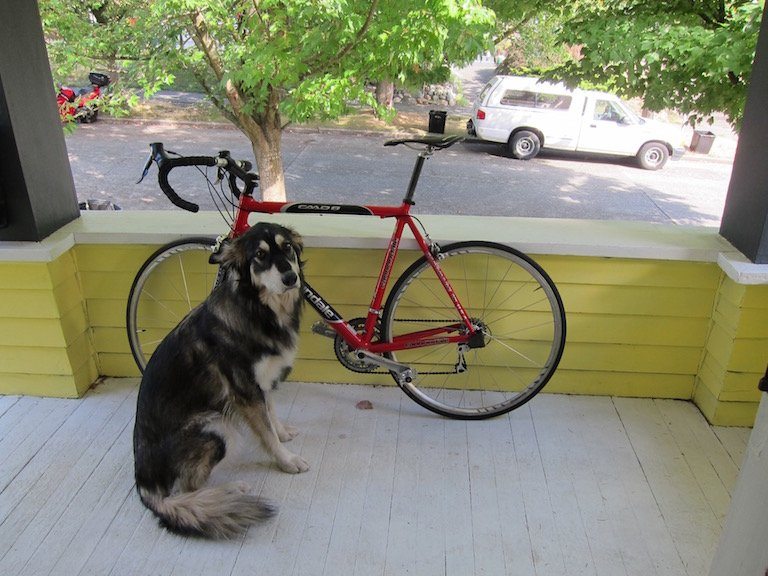

# Orange Pi Zero 3W · SmolVLM-256M 实测报告

日期：2026-10-09。模型在用户的 A733 / 6GB 开发板上真实运行，未调用云端模型。
网页：<http://192.168.88.29:8080>，同一局域网访问。

结论：适合基础英文图片问答和围绕同图连续追问。首次看一张图约 18 秒；
复用图像上下文后短追问通常小于 1 秒。内存余量充足，主要成本是首次视觉处理和持续负载温升。
中文指令遵循、细节完整性和复杂推理能力有限。

## 环境和方法

| 项目 | 配置 |
| --- | --- |
| 板卡 | Orange Pi Zero 3W，A733，6GB；系统识别 5.7GiB |
| 系统 | Ubuntu 22.04，Linux 6.6.98-sun60iw2，aarch64 |
| 存储 | 64GB SanDisk TF 卡，ext4 |
| 推理 | llama.cpp，CPU；固定源码 commit `d81235049384534c167caea52b85a694f6103d14` |
| 编译 | GCC 11.4，Release，ARM FP16 / dotprod，静态库；未使用 GPU / NPU |
| 权重 | SmolVLM-256M-Instruct Q8_0 + F16 mmproj，总计 365086144 字节（348.17MiB） |
| 线程 | 2 个，绑定 A76 核 6、7；标称频率约 2GHz |
| 上下文/缓存 | 4096 token，单 slot；prompt cache 上限 128MiB，禁止 context shift |
| 生成 | API 基准 max_tokens=128，temperature=0.2，seed=42；网页 max_tokens=256 |
| 输入 | 板上预装 YOLO 示例 dog.jpg，768×576；经实际网页转为 JPEG quality=0.85 |
| 重复 | 纯文本、重复同图、视觉追问各 3 次；热缓存服务启动、权重无缓存启动各 3 次 |
| 监控 | 每 100ms 采样 RSS、cgroup 内存、进程 CPU 时间、温度、CPU 频率、系统可用内存 |

推理引擎二进制 SHA-256：`153e7bf6327152b85e4e89983edff7dd40a19970f239abe2c37c77bc4e776266`。
源码归档、权重版本和校验值见 [部署文档](SmolVLM网页部署.md)。
二进制版本输出中的 commit 为 unknown，因为使用固定 commit 的源码归档构建，未附带 `.git`。

测试图片源文件 SHA-256：`5a9522051c3cec2bbd2f6323fccba32e8fbf3ddcc2b3e2fd46b04c720bc6f866`；
实际输入 JPEG SHA-256：`1a6e9a487fe63c940fe92f44a6c057423935cbb5255fe4063aacf2c1b70b67ac`。
仅用作本地验收样例，图片源自系统预装示例；对外发布图片前另核实其许可。

## 延迟与吞吐

以下 API 基准从板端回环接口测量，不含用户设备上传图片、Wi-Fi 传输和页面渲染。
TTFT 为请求开始到第一个非空文本增量；tokens/s 使用引擎报告的解码速率，**不含看图等待**。

| 场景 | 次数 | 首字延迟 TTFT | 完整回答耗时 | 生成速率 | 输出 tokens |
| --- | ---: | --- | --- | --- | ---: |
| 纯文本 | 3 | 中位 0.053s，范围 0.052–0.136s | 中位 1.070s，范围 1.065–1.154s | 中位 67.36 tok/s | 69 |
| 重复相同图/相同问题，命中上下文缓存 | 3 | 中位 0.084s，范围 0.082–0.089s | 中位 0.683s，范围 0.681–0.688s | 中位 60.75 tok/s | 37 |
| 同图连续追问 | 3 | 中位 0.272s，范围 0.268–0.279s | 中位 0.443s，范围 0.442–0.451s | 中位 53.80 tok/s | 10 |
| 重启服务后首次看图，权重有文件缓存 | 3 | 17.55–17.76s | 18.15–18.36s | 60.15–60.76 tok/s | 37 |
| 重启服务后首次看图，权重无文件缓存 | 3 | 17.47–17.54s | 18.07–18.14s | 60.73–60.95 tok/s | 37 |

重复同图实验每次命中 216 个缓存 token，只需重新处理 1 个 prompt token，
**不能把 0.08 秒当作新图片的识别速度**。追问命中约 217 token，新增约 55 token。
首图约 17.5 秒的阶段包括图像预处理/编码和语言模型 prompt prefill。
当前引擎默认日志未提供可独立核验的视觉编码计时，报告不虚构拆分值。

真实浏览器验证走完整链路（电脑 → Wi-Fi → 板端网页/API → 模型）：
首次图片描述 19.407s，连续追问 0.813s；本次网页输出分别为 69 和 13 tokens，
采样参数和生成长度与 API 基准不同，因此不能简单相减作为“网络开销”。
图片、多轮消息与刷新后的历史恢复已通过浏览器测试。
系统重启后再次通过同一网页验收：图片描述 18.433s、追问 0.819s；
归档截图来自这次重启后的验证。随机采样使两次回答文字有差异，重启后的颜色回答仅为 “black”。

## 启动性能

| 启动场景 | 次数 | 到模型健康接口就绪 |
| --- | ---: | --- |
| 服务重启，Linux 已缓存权重 | 3 | 1.111 / 1.117 / 1.165s，中位 1.117s |
| 服务重启，两份权重完全未缓存 | 3 | 6.490 / 6.632 / 6.556s，中位 6.556s |
| 整板软件重启，到局域网网页健康接口 ready | 1 | 36.764s，含关机、启动、Wi-Fi 重连和模型加载 |

无缓存试验先停止模型服务，只对两份模型文件执行 `POSIX_FADV_DONTNEED`，
每次用 `fincore` 确认两份权重的驻留字节数均为 **0**；没有清空系统其他文件缓存。
推理二进制及系统库仍可能已缓存，因此这是“权重从 TF 重新读取”的模型冷启动，
不是整机断电启动。

整板软件重启后，boot ID 已变化；两个服务均为 `enabled` 和 `active`，
IP 仍为 192.168.88.29。36.764 秒是从电脑发送重启命令开始计时，1 秒轮询健康接口，
不是从插电瞬间计时，也不是单独的 Linux 启动耗时。相关原始记录见
[重启验收](benchmarks/2026-10-09-smolvlm/reboot.json)。

权重无缓存时，从启动服务到首个图片回答全部完成约 **24.56–24.75 秒**。
TF 卡主要影响模型加载阶段，约增加 5.4 秒；模型就绪后的首图计算耗时基本不变。

## 系统占用和推理成本

| 指标 | 观测结果 |
| --- | --- |
| 模型加载完成、未推理时进程 RSS | 新进程约 587MiB；已有对话缓存的空闲采样约 665MiB |
| 本次实验进程 RSS 峰值 | 759.87MiB，约 0.742GiB |
| 模型服务 cgroup 内存峰值 | 959.36MiB，含归属于该服务的文件缓存 |
| 系统可用内存最低值 | 4952.69MiB，约 4.84GiB |
| 网页服务 | 上线时 systemd 显示约 10MiB；不是网页服务峰值统计 |
| Swap | 全部采样均为 0MiB 已用 |
| 空闲模型 CPU | 10 秒采样累计 CPU 时间 0.00s（计数器分辨率内） |
| 新图推理 CPU | 约 199%，以单核 100% 计，即接近占满两个 A76 核 |
| 新图一轮 CPU 时间 | 约 36.0–36.6 CPU·s；约 18s 墙钟时间 × 两核 |
| 纯文本一轮 CPU 时间 | 约 2.08–2.23 CPU·s |
| 重复同图一轮 CPU 时间 | 约 1.27–1.28 CPU·s |
| 同图短追问 CPU 时间 | 约 0.80–0.81 CPU·s |
| 模型文件磁盘占用 | 348.17MiB，不含源码、编译目录和下载分块 |

RSS 和 cgroup 内存统计口径不同，**不能相加**。前者包括进程映射的共享文件页，
后者会统计归属该服务的文件缓存；同样的权重可能此前由其他进程加载，导致归属变化。
系统可用内存比简单将多个进程 RSS 相加更适合判断是否有内存压力。

板端内核未提供 `/proc/PID/io`，服务 `io.stat` 也为空，所以本轮没有可靠的进程
磁盘读取/写入字节数，明确标记为不可用。无缓存验证和加载耗时仍有效。
未接功率计，**没有瓦数、单次推理焦耳数或电池续航实测**。CPU·s 是计算占用，不能替代能耗。

## 温度与稳定性

连续进行 6 次服务启动后的新图推理，温度峰值 **81.07°C**；空闲后温度明显回落。
A76 采样频率出现 416MHz（空闲）和 2002MHz（负载）；本轮没有观测到持续的中间降频档位。
这只能说明本次短时测试，没有证明长时间运行、炎热环境或封闭外壳下不会降频。

建议加散热片，连续视觉任务考虑小风扇。若目标是摄像头实时逐帧分析，
当前约 18 秒/新图的配置不够；更适合事件触发拍照、低频问答，或先用检测器筛选再交给 VLM。
这次评测不是小时级稳定性压力测试，也没有多用户并发性能结论。

## 模型效果：原始样例与判断

| 问题 | 原始回答 | 人工核对 |
| --- | --- | --- |
| What animal is in this image? | There is a dog sitting on the floor. | 正确识别狗 |
| What color is the bicycle? | The bicycle is red. | 正确 |
| What vehicle is in the background? | There is a car in the background of the image. | 基本正确，背景是白色皮卡 |
| Is the dog in front of or behind the bicycle? | The dog is in front of the bicycle. | 正确 |
| 请用中文简短描述这张图片。 | A red bicycle is leaning against a yellow wall next to a tree, and a car is parked on the street behind it. | 未按要求使用中文，且漏掉前景狗 |

连续追问狗的颜色时回答 “black and brown”，没有提到明显的白色胸腹/腿部，细节不完整。
网页首次描述额外提到 “windows”，图中没有充分证据支持；要求两句时还输出了四句。
这些是轻量模型的实际局限，不适合把它的描述直接作为可靠控制指令。
本报告只有一张图的定性验收，**不宣称标准数据集准确率**。

## 原始数据与复现

- [全部原始结果与资源采样](benchmarks/2026-10-09-smolvlm/results.json)
- [真实网页对话截图](benchmarks/2026-10-09-smolvlm/web-chat.png)
- [评测脚本](../scripts/benchmark_vlm.py)
- [网页真实模型验收](../tests/vlm_board_smoke.cjs)
- [部署与运行说明](SmolVLM网页部署.md)

原始 JSON 中 `tests.case=image` 是命中缓存的重复同图测试；首次处理图片的数据位于
`cold_restarts[].first_image` 和 `uncached_restarts[].first_image`。
`cold_restarts` 这个字段名代表服务进程重新启动，仍有文件缓存；判断冷暖应以本报告和
`file_cache_before_start` 为准。
