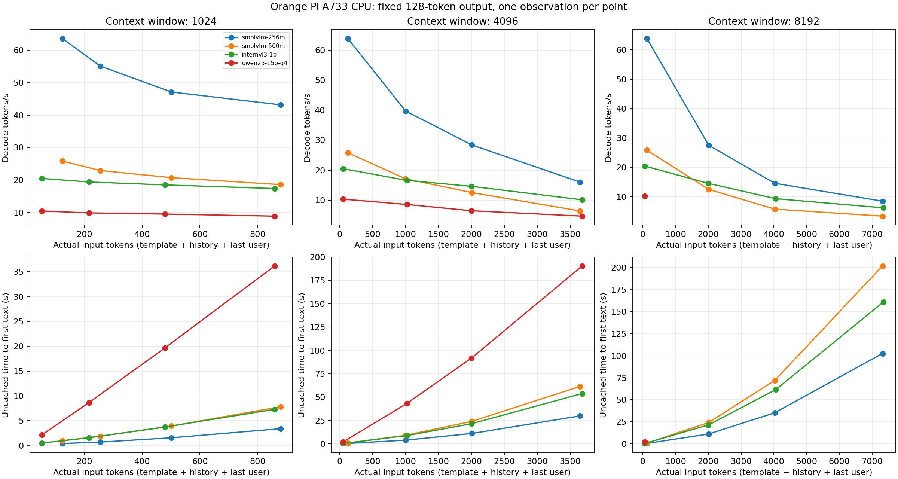
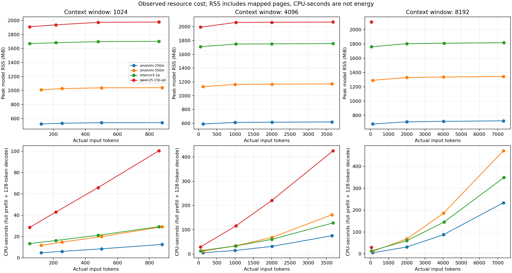

# 所有模型：历史长度与系统开销

归档状态：已停止。此文件为旧“全量重算/相同问题缓存重放”实验的中途快照，未完成且不再续跑，不能视为当前运行状态或最终结论。最终72项真实追加KV测试见[KV缓存增量性能报告](../2026-10-10-kv-fan/KV缓存增量性能报告.md)。

A733、CPU6/7、2线程、单槽。无图片输入，VLM仍加载其视觉投影器，保持与网页模型选择一致。
固定中文模拟多轮历史；按各模型自己的tokenizer与聊天模板计数。相同比例不保证相同文字数或轮数。
每档先cache_prompt=false完整预填充，再缓存重放相同请求。后者是理想前缀复用，不是用户新发一轮的端到端耗时。
各请求强制输出128token（ignore_eos=true、greedy），用于速度测量，输出内容不用于质量评分。
每个单元格仅一次测量，不能解读为统计均值；升温与上下文长度可能共同影响速度，频率和温度同步记录。
短历史不是0token；90%档要为128输出token预留空间，按完整轮次向下取整，实际占用见表。
模型CPU：单核100%；整机CPU：8核合计100%。RSS、cgroup、整机可用内存是不同口径。没有实测电功率。
原始采样每100ms一次，分块保存于同名 `.samples` 目录，独立于指标JSON。

## 4096窗口：短历史与接近满窗

| 模型 | 短输入token | 短历史token/s | 长输入token | 长历史token/s | 长历史完整预填充首字秒 | 长历史缓存首字秒 | 长历史RSS MiB |
| --- | ---: | ---: | ---: | ---: | ---: | ---: | ---: |
| smolvlm-256m | 125 | 63.86 | 3650 | 16.02 | 29.96 | 0.19 | 619.75 |
| smolvlm-500m | 125 | 25.81 | 3650 | 6.40 | 61.51 | 0.47 | 1170.92 |
| internvl3-1b | 53 | 20.50 | 3682 | 10.11 | 53.92 | 0.10 | 1755.56 |
| qwen25-15b-q4 | 53 | 10.33 | 3682 | 4.68 | 190.50 | 0.22 | 2068.09 |

“—”代表尚未测得有效结果；不能把未完成项目当成0。

## 配置空闲与启动

| 模型 | 窗口 | 加载秒（非冷启动） | 空闲RSS MiB | 空闲cgroup MiB | 空闲最低可用MiB |
| --- | ---: | ---: | ---: | ---: | ---: |
| smolvlm-256m | 1024 | 1.05 | 519.32 | 374.28 | 5189.18 |
| smolvlm-256m | 4096 | 1.20 | 586.75 | 441.86 | 5123.91 |
| smolvlm-256m | 8192 | 1.32 | 677.01 | 532.26 | 5030.37 |
| smolvlm-500m | 1024 | 1.93 | 1005.11 | 632.11 | 4926.53 |
| smolvlm-500m | 4096 | 1.97 | 1125.30 | 752.61 | 4794.79 |
| smolvlm-500m | 8192 | 2.03 | 1285.36 | 913.14 | 4636.90 |
| internvl3-1b | 1024 | 3.00 | 1666.20 | 1032.96 | 4502.78 |
| internvl3-1b | 4096 | 3.20 | 1707.44 | 1078.14 | 4480.52 |
| internvl3-1b | 8192 | 3.22 | 1755.41 | 1118.71 | 4429.20 |
| qwen25-15b-q4 | 1024 | 5.52 | 1903.34 | 1021.00 | 4521.16 |
| qwen25-15b-q4 | 4096 | 5.57 | 1987.34 | 1105.44 | 4435.07 |
| qwen25-15b-q4 | 8192 | 6.27 | 2099.19 | 1221.14 | 4325.43 |

## smolvlm-256m

| 窗口 | 目标% / 实际% | 历史轮对 | 输入token | 缓存模式 | 首字秒 | 解码token/s | 预填充token/s | 总秒 |
| ---: | --- | ---: | ---: | --- | ---: | ---: | ---: | ---: |
| 1024 | 0 / 12.2 | 0 | 125 | 完整预填充 | 0.42 | 63.60 | 328.52 | 2.39 |
| 1024 | 0 / 12.2 | 0 | 125 | 缓存重放 | 0.05 | 63.74 | 65.39 | 2.02 |
| 1024 | 25 / 24.9 | 1 | 255 | 完整预填充 | 0.70 | 55.13 | 365.07 | 3.01 |
| 1024 | 25 / 24.9 | 1 | 255 | 缓存重放 | 0.02 | 55.08 | 56.79 | 2.34 |
| 1024 | 50 / 48.9 | 3 | 501 | 完整预填充 | 1.56 | 47.13 | 320.98 | 4.27 |
| 1024 | 50 / 48.9 | 3 | 501 | 缓存重放 | 0.02 | 49.06 | 50.69 | 2.62 |
| 1024 | 90 / 85.8 | 6 | 879 | 完整预填充 | 3.40 | 43.17 | 262.45 | 6.30 |
| 1024 | 90 / 85.8 | 6 | 879 | 缓存重放 | 0.07 | 43.20 | 42.63 | 2.97 |
| 4096 | 0 / 3.1 | 0 | 125 | 完整预填充 | 0.48 | 63.86 | 280.43 | 2.45 |
| 4096 | 0 / 3.1 | 0 | 125 | 缓存重放 | 0.05 | 63.82 | 65.24 | 2.02 |
| 4096 | 25 / 24.4 | 7 | 1001 | 完整预填充 | 3.95 | 39.70 | 256.44 | 7.12 |
| 4096 | 25 / 24.4 | 7 | 1001 | 缓存重放 | 0.07 | 39.72 | 40.77 | 3.23 |
| 4096 | 50 / 49.0 | 15 | 2009 | 完整预填充 | 11.13 | 28.39 | 181.63 | 15.55 |
| 4096 | 50 / 49.0 | 15 | 2009 | 缓存重放 | 0.11 | 27.64 | 28.27 | 4.64 |
| 4096 | 90 / 89.1 | 28 | 3650 | 完整预填充 | 29.96 | 16.02 | 122.37 | 37.77 |
| 4096 | 90 / 89.1 | 28 | 3650 | 缓存重放 | 0.19 | 16.03 | 15.84 | 8.00 |
| 8192 | 0 / 1.5 | 0 | 125 | 完整预填充 | 0.52 | 63.81 | 256.22 | 2.48 |
| 8192 | 0 / 1.5 | 0 | 125 | 缓存重放 | 0.05 | 63.84 | 64.26 | 2.02 |
| 8192 | 25 / 24.5 | 15 | 2009 | 完整预填充 | 11.15 | 27.55 | 181.33 | 15.70 |
| 8192 | 25 / 24.5 | 15 | 2009 | 缓存重放 | 0.11 | 28.41 | 28.20 | 4.51 |
| 8192 | 50 / 49.2 | 31 | 4029 | 完整预填充 | 35.35 | 14.60 | 114.42 | 43.93 |
| 8192 | 50 / 49.2 | 31 | 4029 | 缓存重放 | 0.21 | 14.61 | 14.46 | 8.77 |
| 8192 | 90 / 89.3 | 57 | 7317 | 完整预填充 | 102.66 | 8.51 | 71.44 | 117.35 |
| 8192 | 90 / 89.3 | 57 | 7317 | 缓存重放 | 0.36 | 8.51 | 8.33 | 15.05 |

| 窗口 | 实际输入 | 缓存 | RSS MiB | cgroup MiB | 整机最低可用MiB | Swap峰值MiB | 模型CPU% | 整机CPU% | I/O等待% | CPU秒 | 温度峰值°C | A76 MHz范围 |
| ---: | ---: | --- | ---: | ---: | ---: | ---: | ---: | ---: | ---: | ---: | ---: | --- |
| 1024 | 125 | 否 | 522.57 | 377.75 | 5185.04 | 0.00 | 198.46 | 27.38 | 0.00 | 4.73 | 56.98 | 416–2002 |
| 1024 | 125 | 是 | 528.19 | 383.12 | 5179.15 | 0.00 | 198.44 | 26.44 | 0.00 | 4.00 | 61.01 | 2002–2002 |
| 1024 | 255 | 否 | 533.44 | 388.48 | 5173.80 | 0.00 | 199.21 | 26.73 | 0.00 | 5.99 | 63.49 | 2002–2002 |
| 1024 | 255 | 是 | 533.57 | 388.46 | 5177.61 | 0.00 | 199.31 | 26.57 | 0.00 | 4.64 | 63.05 | 2002–2002 |
| 1024 | 501 | 否 | 540.69 | 395.88 | 5163.80 | 0.00 | 196.92 | 29.62 | 0.00 | 8.39 | 65.31 | 2002–2002 |
| 1024 | 501 | 是 | 540.69 | 395.64 | 5167.52 | 0.00 | 198.72 | 26.31 | 0.00 | 5.20 | 65.25 | 2002–2002 |
| 1024 | 879 | 否 | 541.82 | 396.86 | 5164.91 | 0.00 | 199.21 | 27.11 | 0.00 | 12.54 | 69.33 | 2002–2002 |
| 1024 | 879 | 是 | 541.82 | 396.55 | 5168.88 | 0.00 | 199.23 | 27.04 | 0.00 | 5.91 | 68.14 | 2002–2002 |
| 4096 | 125 | 否 | 590.00 | 445.14 | 5120.52 | 0.00 | 199.11 | 26.30 | 0.00 | 4.86 | 64.54 | 416–2002 |
| 4096 | 125 | 是 | 595.75 | 450.86 | 5114.66 | 0.00 | 199.18 | 26.52 | 0.00 | 4.01 | 65.22 | 2002–2002 |
| 4096 | 1001 | 否 | 612.75 | 467.77 | 5097.64 | 0.00 | 199.22 | 26.66 | 0.00 | 14.16 | 69.09 | 2002–2002 |
| 4096 | 1001 | 是 | 612.75 | 468.02 | 5096.71 | 0.00 | 199.28 | 26.58 | 0.00 | 6.43 | 70.86 | 2002–2002 |
| 4096 | 2009 | 否 | 616.00 | 470.95 | 5093.07 | 0.00 | 199.55 | 26.63 | 0.00 | 31.01 | 75.64 | 2002–2002 |
| 4096 | 2009 | 是 | 616.00 | 470.86 | 5072.75 | 0.00 | 199.63 | 33.23 | 0.00 | 9.25 | 76.64 | 2002–2002 |
| 4096 | 3650 | 否 | 619.75 | 474.68 | 5073.29 | 0.00 | 198.99 | 26.93 | 0.00 | 75.14 | 82.13 | 2002–2002 |
| 4096 | 3650 | 是 | 619.88 | 474.87 | 5087.89 | 0.00 | 199.59 | 27.01 | 0.00 | 15.95 | 75.93 | 2002–2002 |
| 8192 | 125 | 否 | 680.26 | 535.50 | 5026.72 | 0.00 | 199.52 | 26.49 | 0.10 | 4.95 | 69.92 | 416–2002 |
| 8192 | 125 | 是 | 685.88 | 541.11 | 5021.34 | 0.00 | 198.74 | 26.80 | 0.00 | 4.00 | 73.28 | 2002–2002 |
| 8192 | 2009 | 否 | 710.13 | 565.44 | 4990.12 | 0.00 | 198.86 | 27.41 | 0.00 | 31.21 | 79.89 | 2002–2002 |
| 8192 | 2009 | 是 | 710.13 | 565.21 | 4993.71 | 0.00 | 199.55 | 26.90 | 0.00 | 9.00 | 77.00 | 2002–2002 |
| 8192 | 4029 | 否 | 717.13 | 572.55 | 4980.88 | 0.00 | 199.75 | 27.09 | 0.00 | 87.73 | 86.14 | 2002–2002 |
| 8192 | 4029 | 是 | 717.13 | 572.46 | 4991.64 | 0.00 | 199.63 | 26.86 | 0.00 | 17.50 | 76.64 | 2002–2002 |
| 8192 | 7317 | 否 | 724.26 | 579.63 | 4964.50 | 0.00 | 199.05 | 26.84 | 0.00 | 233.57 | 87.14 | 2002–2002 |
| 8192 | 7317 | 是 | 724.26 | 579.41 | 4981.93 | 0.00 | 199.73 | 26.90 | 0.00 | 30.05 | 76.88 | 2002–2002 |

## smolvlm-500m

| 窗口 | 目标% / 实际% | 历史轮对 | 输入token | 缓存模式 | 首字秒 | 解码token/s | 预填充token/s | 总秒 |
| ---: | --- | ---: | ---: | --- | ---: | ---: | ---: | ---: |
| 1024 | 0 / 12.2 | 0 | 125 | 完整预填充 | 0.99 | 25.83 | 137.16 | 5.84 |
| 1024 | 0 / 12.2 | 0 | 125 | 缓存重放 | 0.12 | 25.84 | 26.55 | 4.97 |
| 1024 | 25 / 24.9 | 1 | 255 | 完整预填充 | 1.89 | 22.93 | 141.47 | 7.35 |
| 1024 | 25 / 24.9 | 1 | 255 | 缓存重放 | 0.13 | 22.95 | 24.20 | 5.59 |
| 1024 | 50 / 48.9 | 3 | 501 | 完整预填充 | 3.93 | 20.73 | 130.40 | 9.98 |
| 1024 | 50 / 48.9 | 3 | 501 | 缓存重放 | 0.13 | 20.74 | 21.95 | 6.18 |
| 1024 | 90 / 85.8 | 6 | 879 | 完整预填充 | 7.83 | 18.57 | 113.91 | 14.57 |
| 1024 | 90 / 85.8 | 6 | 879 | 缓存重放 | 0.16 | 18.31 | 18.49 | 7.01 |
| 4096 | 0 / 3.1 | 0 | 125 | 完整预填充 | 0.98 | 25.81 | 138.52 | 5.83 |
| 4096 | 0 / 3.1 | 0 | 125 | 缓存重放 | 0.12 | 25.85 | 26.18 | 4.97 |
| 4096 | 25 / 24.4 | 7 | 1001 | 完整预填充 | 9.12 | 17.11 | 111.08 | 16.45 |
| 4096 | 25 / 24.4 | 7 | 1001 | 缓存重放 | 0.17 | 17.12 | 18.12 | 7.48 |
| 4096 | 50 / 49.0 | 15 | 2009 | 完整预填充 | 24.15 | 12.52 | 83.74 | 34.15 |
| 4096 | 50 / 49.0 | 15 | 2009 | 缓存重放 | 0.23 | 12.34 | 12.78 | 10.39 |
| 4096 | 90 / 89.1 | 28 | 3650 | 完整预填充 | 61.51 | 6.40 | 59.64 | 81.05 |
| 4096 | 90 / 89.1 | 28 | 3650 | 缓存重放 | 0.47 | 6.43 | 6.37 | 19.92 |
| 8192 | 0 / 1.5 | 0 | 125 | 完整预填充 | 0.92 | 25.85 | 147.96 | 5.77 |
| 8192 | 0 / 1.5 | 0 | 125 | 缓存重放 | 0.13 | 25.86 | 24.73 | 4.97 |
| 8192 | 25 / 24.5 | 15 | 2009 | 完整预填充 | 24.20 | 12.53 | 83.54 | 34.19 |
| 8192 | 25 / 24.5 | 15 | 2009 | 缓存重放 | 0.23 | 12.38 | 12.86 | 10.35 |
| 8192 | 50 / 49.2 | 31 | 4029 | 完整预填充 | 72.06 | 5.80 | 56.17 | 93.62 |
| 8192 | 50 / 49.2 | 31 | 4029 | 缓存重放 | 0.51 | 5.79 | 5.90 | 22.11 |
| 8192 | 90 / 89.3 | 57 | 7317 | 完整预填充 | 202.01 | 3.43 | 36.33 | 238.43 |
| 8192 | 90 / 89.3 | 57 | 7317 | 缓存重放 | 0.88 | 3.43 | 3.41 | 37.38 |

| 窗口 | 实际输入 | 缓存 | RSS MiB | cgroup MiB | 整机最低可用MiB | Swap峰值MiB | 模型CPU% | 整机CPU% | I/O等待% | CPU秒 | 温度峰值°C | A76 MHz范围 |
| ---: | ---: | --- | ---: | ---: | ---: | ---: | ---: | ---: | ---: | ---: | ---: | --- |
| 1024 | 125 | 否 | 1010.48 | 637.48 | 4920.68 | 0.00 | 199.56 | 26.88 | 0.00 | 11.64 | 70.33 | 780–2002 |
| 1024 | 125 | 是 | 1020.48 | 647.36 | 4910.64 | 0.00 | 199.07 | 26.73 | 0.00 | 9.88 | 73.87 | 2002–2002 |
| 1024 | 255 | 否 | 1027.73 | 654.87 | 4902.77 | 0.00 | 199.20 | 26.44 | 0.00 | 14.63 | 78.53 | 2002–2002 |
| 1024 | 255 | 是 | 1027.73 | 654.75 | 4902.78 | 0.00 | 199.65 | 26.64 | 0.00 | 11.14 | 74.99 | 2002–2002 |
| 1024 | 501 | 否 | 1038.73 | 665.95 | 4874.46 | 0.00 | 199.43 | 27.91 | 0.00 | 19.89 | 81.07 | 2002–2002 |
| 1024 | 501 | 是 | 1038.73 | 665.84 | 4882.11 | 0.00 | 199.58 | 27.06 | 0.00 | 12.32 | 75.17 | 2002–2002 |
| 1024 | 879 | 否 | 1040.23 | 667.39 | 4883.72 | 0.00 | 199.57 | 26.54 | 0.00 | 29.06 | 82.48 | 2002–2002 |
| 1024 | 879 | 是 | 1040.23 | 667.14 | 4871.84 | 0.00 | 198.74 | 28.97 | 0.00 | 13.91 | 78.65 | 2002–2002 |
| 4096 | 125 | 否 | 1130.80 | 757.95 | 4792.28 | 0.00 | 199.41 | 27.16 | 0.04 | 11.62 | 70.98 | 780–2002 |
| 4096 | 125 | 是 | 1140.67 | 767.87 | 4781.91 | 0.00 | 199.30 | 26.67 | 0.00 | 9.89 | 73.16 | 2002–2002 |
| 4096 | 1001 | 否 | 1163.92 | 791.33 | 4758.37 | 0.00 | 199.69 | 26.72 | 0.00 | 32.83 | 81.36 | 2002–2002 |
| 4096 | 1001 | 是 | 1163.92 | 791.09 | 4757.94 | 0.00 | 199.56 | 26.72 | 0.00 | 14.92 | 75.76 | 2002–2002 |
| 4096 | 2009 | 否 | 1167.17 | 794.25 | 4754.92 | 0.00 | 199.87 | 26.65 | 0.00 | 68.24 | 83.66 | 2002–2002 |
| 4096 | 2009 | 是 | 1167.17 | 794.16 | 4742.47 | 0.00 | 198.29 | 28.10 | 0.00 | 20.58 | 78.53 | 2002–2002 |
| 4096 | 3650 | 否 | 1170.92 | 797.91 | 4744.60 | 0.00 | 199.40 | 26.76 | 0.00 | 161.60 | 86.85 | 2002–2002 |
| 4096 | 3650 | 是 | 1170.92 | 798.08 | 4748.05 | 0.00 | 199.50 | 26.81 | 0.00 | 39.73 | 73.28 | 2002–2002 |
| 8192 | 125 | 否 | 1290.73 | 918.48 | 4631.98 | 0.25 | 199.39 | 26.80 | 0.00 | 11.49 | 71.15 | 2002–2002 |
| 8192 | 125 | 是 | 1300.23 | 928.54 | 4623.44 | 0.25 | 199.26 | 26.83 | 0.00 | 9.89 | 74.16 | 2002–2002 |
| 8192 | 2009 | 否 | 1329.98 | 959.21 | 4591.16 | 0.50 | 199.79 | 26.69 | 0.00 | 68.30 | 83.31 | 2002–2002 |
| 8192 | 2009 | 是 | 1329.98 | 959.25 | 4582.32 | 0.50 | 198.96 | 28.22 | 0.08 | 20.57 | 79.71 | 2002–2002 |
| 8192 | 4029 | 否 | 1336.61 | 965.90 | 4572.66 | 0.50 | 198.79 | 26.82 | 0.01 | 186.09 | 87.97 | 2002–2002 |
| 8192 | 4029 | 是 | 1336.61 | 966.05 | 4572.63 | 0.50 | 198.19 | 27.41 | 0.01 | 43.81 | 74.75 | 2002–2002 |
| 8192 | 7317 | 否 | 1343.86 | 973.28 | 4563.05 | 0.50 | 197.70 | 26.58 | 0.00 | 471.38 | 88.03 | 2002–2002 |
| 8192 | 7317 | 是 | 1343.86 | 973.29 | 4558.67 | 0.75 | 199.34 | 27.00 | 0.01 | 74.50 | 68.97 | 2002–2002 |

## internvl3-1b

| 窗口 | 目标% / 实际% | 历史轮对 | 输入token | 缓存模式 | 首字秒 | 解码token/s | 预填充token/s | 总秒 |
| ---: | --- | ---: | ---: | --- | ---: | ---: | ---: | ---: |
| 1024 | 0 / 5.2 | 0 | 53 | 完整预填充 | 0.51 | 20.48 | 105.56 | 6.72 |
| 1024 | 0 / 5.2 | 0 | 53 | 缓存重放 | 0.05 | 20.49 | 20.43 | 6.26 |
| 1024 | 25 / 21.1 | 3 | 216 | 完整预填充 | 1.57 | 19.39 | 137.47 | 8.13 |
| 1024 | 25 / 21.1 | 3 | 216 | 缓存重放 | 0.05 | 18.93 | 19.45 | 6.78 |
| 1024 | 50 / 46.8 | 8 | 479 | 完整预填充 | 3.73 | 18.49 | 128.52 | 10.61 |
| 1024 | 50 / 46.8 | 8 | 479 | 缓存重放 | 0.06 | 18.50 | 18.63 | 6.93 |
| 1024 | 90 / 83.8 | 15 | 858 | 完整预填充 | 7.30 | 17.37 | 117.51 | 14.62 |
| 1024 | 90 / 83.8 | 15 | 858 | 缓存重放 | 0.06 | 17.38 | 17.21 | 7.37 |
| 4096 | 0 / 1.3 | 0 | 53 | 完整预填充 | 0.40 | 20.50 | 134.61 | 6.60 |
| 4096 | 0 / 1.3 | 0 | 53 | 缓存重放 | 0.05 | 20.50 | 20.51 | 6.26 |
| 4096 | 25 / 25.0 | 18 | 1022 | 完整预填充 | 8.88 | 16.58 | 115.11 | 16.55 |
| 4096 | 25 / 25.0 | 18 | 1022 | 缓存重放 | 0.06 | 16.78 | 16.90 | 7.64 |
| 4096 | 50 / 48.9 | 36 | 2002 | 完整预填充 | 21.56 | 14.60 | 92.85 | 30.28 |
| 4096 | 50 / 48.9 | 36 | 2002 | 缓存重放 | 0.07 | 14.59 | 14.55 | 8.79 |
| 4096 | 90 / 89.9 | 67 | 3682 | 完整预填充 | 53.92 | 10.11 | 68.29 | 66.49 |
| 4096 | 90 / 89.9 | 67 | 3682 | 缓存重放 | 0.10 | 10.11 | 10.03 | 12.68 |
| 8192 | 0 / 0.6 | 0 | 53 | 完整预填充 | 0.40 | 20.48 | 134.82 | 6.61 |
| 8192 | 0 / 0.6 | 0 | 53 | 缓存重放 | 0.05 | 20.48 | 20.54 | 6.26 |
| 8192 | 25 / 24.4 | 36 | 2002 | 完整预填充 | 21.49 | 14.56 | 93.17 | 30.22 |
| 8192 | 25 / 24.4 | 36 | 2002 | 缓存重放 | 0.08 | 14.59 | 14.54 | 8.79 |
| 8192 | 50 / 49.6 | 74 | 4060 | 完整预填充 | 61.65 | 9.35 | 65.86 | 75.25 |
| 8192 | 50 / 49.6 | 74 | 4060 | 缓存重放 | 0.11 | 9.41 | 9.39 | 13.63 |
| 8192 | 90 / 89.7 | 134 | 7349 | 完整预填充 | 161.21 | 6.25 | 45.59 | 181.55 |
| 8192 | 90 / 89.7 | 134 | 7349 | 缓存重放 | 0.17 | 6.23 | 6.23 | 20.56 |

| 窗口 | 实际输入 | 缓存 | RSS MiB | cgroup MiB | 整机最低可用MiB | Swap峰值MiB | 模型CPU% | 整机CPU% | I/O等待% | CPU秒 | 温度峰值°C | A76 MHz范围 |
| ---: | ---: | --- | ---: | ---: | ---: | ---: | ---: | ---: | ---: | ---: | ---: | --- |
| 1024 | 53 | 否 | 1669.82 | 1036.49 | 4501.59 | 1.00 | 199.08 | 27.01 | 0.02 | 13.36 | 70.50 | 416–2002 |
| 1024 | 53 | 是 | 1669.70 | 1036.68 | 4511.19 | 1.25 | 199.13 | 26.99 | 0.00 | 12.46 | 72.75 | 2002–2002 |
| 1024 | 216 | 否 | 1682.32 | 1050.34 | 4497.64 | 1.25 | 199.02 | 26.71 | 0.00 | 16.17 | 78.06 | 2002–2002 |
| 1024 | 216 | 是 | 1682.32 | 1050.34 | 4481.75 | 1.50 | 197.94 | 29.66 | 0.20 | 13.40 | 78.17 | 2002–2002 |
| 1024 | 479 | 否 | 1697.32 | 1069.43 | 4476.46 | 1.75 | 199.20 | 27.01 | 0.01 | 21.12 | 81.30 | 2002–2002 |
| 1024 | 479 | 是 | 1697.32 | 1069.29 | 4481.43 | 1.75 | 199.37 | 26.91 | 0.00 | 13.80 | 79.53 | 2002–2002 |
| 1024 | 858 | 否 | 1702.20 | 1073.77 | 4476.82 | 1.75 | 199.36 | 26.88 | 0.00 | 29.14 | 85.55 | 2002–2002 |
| 1024 | 858 | 是 | 1702.20 | 1074.00 | 4476.86 | 1.75 | 199.38 | 26.89 | 0.02 | 14.69 | 80.65 | 2002–2002 |
| 4096 | 53 | 否 | 1710.44 | 1081.68 | 4477.45 | 1.75 | 199.27 | 26.97 | 0.00 | 13.14 | 72.10 | 2002–2002 |
| 4096 | 53 | 是 | 1710.56 | 1082.00 | 4476.48 | 1.75 | 199.12 | 27.02 | 0.00 | 12.44 | 75.22 | 2002–2002 |
| 4096 | 1022 | 否 | 1748.94 | 1121.85 | 4417.79 | 2.25 | 199.09 | 27.91 | 0.02 | 32.94 | 82.42 | 2002–2002 |
| 4096 | 1022 | 是 | 1748.31 | 1121.85 | 4432.22 | 2.25 | 199.09 | 27.01 | 0.00 | 15.20 | 81.42 | 2002–2002 |
| 4096 | 2002 | 否 | 1751.31 | 1124.77 | 4432.52 | 2.25 | 198.46 | 26.65 | 0.00 | 60.07 | 87.32 | 2002–2002 |
| 4096 | 2002 | 是 | 1751.31 | 1124.84 | 4433.32 | 2.25 | 199.37 | 26.85 | 0.00 | 17.50 | 82.66 | 2002–2002 |
| 4096 | 3682 | 否 | 1755.56 | 1129.32 | 4411.62 | 2.25 | 192.71 | 26.24 | 0.00 | 128.12 | 88.44 | 2002–2002 |
| 4096 | 3682 | 是 | 1755.56 | 1129.32 | 4426.92 | 2.25 | 199.54 | 26.99 | 0.00 | 25.29 | 83.66 | 2002–2002 |
| 8192 | 53 | 否 | 1759.16 | 1122.39 | 4423.63 | 2.25 | 199.07 | 27.23 | 0.00 | 13.14 | 73.87 | 2002–2002 |
| 8192 | 53 | 是 | 1759.29 | 1122.81 | 4423.64 | 2.25 | 199.24 | 26.94 | 0.00 | 12.46 | 76.35 | 2002–2002 |
| 8192 | 2002 | 否 | 1802.41 | 1167.56 | 4373.42 | 2.50 | 198.93 | 27.30 | 0.02 | 60.10 | 87.08 | 2002–2002 |
| 8192 | 2002 | 是 | 1802.54 | 1167.60 | 4379.96 | 2.50 | 199.39 | 26.97 | 0.00 | 17.52 | 82.54 | 2002–2002 |
| 8192 | 4060 | 否 | 1809.29 | 1174.49 | 4359.25 | 2.75 | 193.64 | 26.38 | 0.01 | 145.70 | 88.38 | 2002–2002 |
| 8192 | 4060 | 是 | 1808.54 | 1174.50 | 4373.84 | 2.75 | 199.52 | 26.98 | 0.00 | 27.17 | 82.19 | 2002–2002 |
| 8192 | 7349 | 否 | 1816.29 | 1182.41 | 4350.27 | 2.75 | 192.34 | 26.03 | 0.00 | 349.17 | 89.03 | 2002–2002 |
| 8192 | 7349 | 是 | 1816.16 | 1182.63 | 4352.40 | 2.75 | 199.67 | 27.85 | 0.02 | 41.04 | 83.84 | 2002–2002 |

## qwen25-15b-q4

| 窗口 | 目标% / 实际% | 历史轮对 | 输入token | 缓存模式 | 首字秒 | 解码token/s | 预填充token/s | 总秒 |
| ---: | --- | ---: | ---: | --- | ---: | ---: | ---: | ---: |
| 1024 | 0 / 5.2 | 0 | 53 | 完整预填充 | 2.13 | 10.46 | 24.96 | 14.28 |
| 1024 | 0 / 5.2 | 0 | 53 | 缓存重放 | 0.10 | 10.46 | 10.49 | 12.25 |
| 1024 | 25 / 21.1 | 3 | 216 | 完整预填充 | 8.65 | 9.86 | 24.97 | 21.55 |
| 1024 | 25 / 21.1 | 3 | 216 | 缓存重放 | 0.10 | 9.97 | 10.10 | 12.85 |
| 1024 | 50 / 46.8 | 8 | 479 | 完整预填充 | 19.67 | 9.50 | 24.35 | 33.05 |
| 1024 | 50 / 46.8 | 8 | 479 | 缓存重放 | 0.11 | 9.46 | 9.65 | 13.54 |
| 1024 | 90 / 83.8 | 15 | 858 | 完整预填充 | 36.18 | 8.87 | 23.72 | 50.50 |
| 1024 | 90 / 83.8 | 15 | 858 | 缓存重放 | 0.11 | 8.80 | 8.91 | 14.57 |
| 4096 | 0 / 1.3 | 0 | 53 | 完整预填充 | 2.13 | 10.33 | 24.93 | 14.43 |
| 4096 | 0 / 1.3 | 0 | 53 | 缓存重放 | 0.10 | 10.42 | 10.51 | 12.30 |
| 4096 | 25 / 25.0 | 18 | 1022 | 完整预填充 | 43.35 | 8.56 | 23.57 | 58.21 |
| 4096 | 25 / 25.0 | 18 | 1022 | 缓存重放 | 0.12 | 8.52 | 8.67 | 15.03 |
| 4096 | 50 / 48.9 | 36 | 2002 | 完整预填充 | 91.87 | 6.47 | 21.79 | 111.52 |
| 4096 | 50 / 48.9 | 36 | 2002 | 缓存重放 | 0.16 | 6.47 | 6.49 | 19.80 |
| 4096 | 90 / 89.9 | 67 | 3682 | 完整预填充 | 190.50 | 4.68 | 19.33 | 217.66 |
| 4096 | 90 / 89.9 | 67 | 3682 | 缓存重放 | 0.22 | 4.65 | 4.66 | 27.53 |
| 8192 | 0 / 0.6 | 0 | 53 | 完整预填充 | 2.12 | 10.22 | 24.98 | 14.56 |
| 8192 | 0 / 0.6 | 0 | 53 | 缓存重放 | 0.10 | 10.38 | 10.49 | 12.35 |

| 窗口 | 实际输入 | 缓存 | RSS MiB | cgroup MiB | 整机最低可用MiB | Swap峰值MiB | 模型CPU% | 整机CPU% | I/O等待% | CPU秒 | 温度峰值°C | A76 MHz范围 |
| ---: | ---: | --- | ---: | ---: | ---: | ---: | ---: | ---: | ---: | ---: | ---: | --- |
| 1024 | 53 | 否 | 1909.47 | 1027.19 | 4516.03 | 2.75 | 199.65 | 26.82 | 0.00 | 28.50 | 80.65 | 2002–2002 |
| 1024 | 53 | 是 | 1914.59 | 1032.45 | 4512.85 | 2.75 | 199.57 | 26.65 | 0.00 | 24.44 | 83.13 | 2002–2002 |
| 1024 | 216 | 否 | 1937.09 | 1055.03 | 4480.93 | 2.75 | 198.93 | 27.32 | 0.00 | 42.85 | 86.08 | 2002–2002 |
| 1024 | 216 | 是 | 1937.09 | 1055.02 | 4484.55 | 2.75 | 199.58 | 26.87 | 0.00 | 25.63 | 86.26 | 2002–2002 |
| 1024 | 479 | 否 | 1972.72 | 1090.46 | 4452.55 | 2.75 | 199.08 | 26.76 | 0.00 | 65.78 | 86.61 | 2002–2002 |
| 1024 | 479 | 是 | 1972.72 | 1090.37 | 4451.84 | 2.75 | 198.48 | 26.82 | 0.00 | 26.87 | 87.67 | 2002–2002 |
| 1024 | 858 | 否 | 1977.47 | 1095.25 | 4440.27 | 2.75 | 198.71 | 27.19 | 0.00 | 100.34 | 87.79 | 2002–2002 |
| 1024 | 858 | 是 | 1977.34 | 1095.25 | 4445.45 | 2.75 | 196.76 | 26.51 | 0.00 | 28.65 | 87.26 | 2002–2002 |
| 4096 | 53 | 否 | 1993.59 | 1111.71 | 4429.23 | 2.75 | 199.62 | 26.93 | 0.00 | 28.79 | 80.83 | 2002–2002 |
| 4096 | 53 | 是 | 1998.59 | 1116.70 | 4425.30 | 2.75 | 199.62 | 26.80 | 0.00 | 24.54 | 84.43 | 2002–2002 |
| 4096 | 1022 | 否 | 2062.34 | 1182.45 | 4347.23 | 4.25 | 198.76 | 27.01 | 0.02 | 115.68 | 87.56 | 2002–2002 |
| 4096 | 1022 | 是 | 2061.46 | 1182.22 | 4364.52 | 4.25 | 198.58 | 26.97 | 0.00 | 29.83 | 87.14 | 2002–2002 |
| 4096 | 2002 | 否 | 2064.09 | 1185.17 | 4351.68 | 4.75 | 197.68 | 26.66 | 0.00 | 220.44 | 87.56 | 2002–2002 |
| 4096 | 2002 | 是 | 2063.84 | 1185.24 | 4360.73 | 4.75 | 196.91 | 26.58 | 0.00 | 38.97 | 85.37 | 2002–2002 |
| 4096 | 3682 | 否 | 2068.09 | 1189.46 | 4348.56 | 4.75 | 195.72 | 26.34 | 0.00 | 425.98 | 88.74 | 2002–2002 |
| 4096 | 3682 | 是 | 2068.09 | 1189.46 | 4343.64 | 4.75 | 197.53 | 27.44 | 0.01 | 54.37 | 82.95 | 2002–2002 |
| 8192 | 53 | 否 | 2105.32 | 1227.38 | 4306.50 | 5.25 | 199.08 | 29.02 | 0.04 | 28.97 | 80.95 | 2002–2002 |
| 8192 | 53 | 是 | 2110.44 | 1232.64 | 4312.23 | 5.25 | 199.54 | 26.94 | 0.00 | 24.62 | 83.37 | 2002–2002 |
