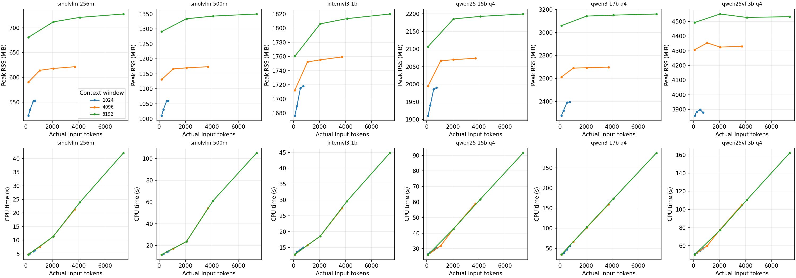

# KV cache 增量对话：最终性能报告

日期：2026-10-10。六模型 × 三档窗口 × 四档历史，共72/72项完成；72份压缩采样均已验证可解析。

## 测量口径

A733 / 6GB，已安装风扇；CPU6/7、2线程、单槽，未使用NPU。纯文本输入，VLM仍加载网页配置中的视觉投影器。
先加载模拟中文历史并生成32 token作为不计分准备，再追加真实生成的助手回答和新问题“我想再听一点，接着说吧。”；仅统计这一轮KV缓存增量推理。未将完整历史重新预填充耗时混入结果。
每次强制生成128 token，greedy、ignore_eos=true、repeat_penalty=1；这是性能测试，回答内容不用于质量评分。Qwen3关闭思考。
窗口为1024/4096/8192；目标历史档位为短历史/25%/50%/90%。实际输入含模板、准备回答及新问题，短历史不等于0 token；小窗口为输出预留空间，实际占用以表格为准。不同tokenizer的token数不能直接当作相同字数。
每格仅一次观测，无置信区间；顺序运行的温度与频率会影响结果。TTFT是客户端首个输出延迟，解码token/s采用服务端timings；总耗时含首字等待及生成。

## 关键结论

KV cache确实生效：全部72项都有缓存命中。但解码每个新token仍需访问较长的历史KV，历史增长后吞吐下降；缓存不等于长对话零成本。
SmolVLM和Qwen3的部分准备回答未被复用；表中列出实际缓存/新算token数。模板或重新分词可能影响前缀匹配，但本实验未隔离根因，不能直接归因于未实现KV cache。
InternVL3-1B与Qwen2.5-1.5B适合继续优化中文陪伴。3B更慢且内存更高；Qwen3在长历史下首字延迟尤为明显。性能不能替代对话质量验收。

## 4096窗口：短历史与最长历史

| 模型 | 短输入token | 短首字秒 | 短token/s | 长输入token | 长首字秒 | 长token/s | 长RSS MiB |
| --- | --- | --- | --- | --- | --- | --- | --- |
| smolvlm-256m | 188 | 0.21 | 56.15 | 3712 | 2.88 | 15.97 | 621.34 |
| smolvlm-500m | 189 | 0.49 | 24.17 | 3712 | 7.56 | 6.44 | 1173.73 |
| internvl3-1b | 104 | 0.17 | 20.32 | 3733 | 1.11 | 9.93 | 1759.38 |
| qwen25-15b-q4 | 104 | 0.84 | 10.33 | 3733 | 2.82 | 4.62 | 2073.78 |
| qwen3-17b-q4 | 108 | 2.52 | 8.61 | 3737 | 20.46 | 2.12 | 2697.94 |
| qwen25vl-3b-q4 | 104 | 1.75 | 5.42 | 3733 | 5.09 | 2.64 | 4329.62 |

## 8192窗口：短历史与最长历史

| 模型 | 短输入token | 短首字秒 | 短token/s | 长输入token | 长首字秒 | 长token/s | 长RSS MiB |
| --- | --- | --- | --- | --- | --- | --- | --- |
| smolvlm-256m | 188 | 0.21 | 58.70 | 7379 | 6.29 | 8.38 | 727.50 |
| smolvlm-500m | 189 | 0.49 | 24.15 | 7379 | 15.46 | 3.40 | 1349.66 |
| internvl3-1b | 104 | 0.17 | 20.20 | 7400 | 2.08 | 5.93 | 1819.99 |
| qwen25-15b-q4 | 104 | 0.84 | 10.32 | 7400 | 4.73 | 3.04 | 2199.39 |
| qwen3-17b-q4 | 108 | 2.52 | 8.58 | 7404 | 39.31 | 1.20 | 3161.10 |
| qwen25vl-3b-q4 | 104 | 1.74 | 5.42 | 7400 | 8.47 | 1.70 | 4532.02 |

## 历史长度趋势

横轴为新增用户轮次请求的实际输入token数，每条线对应一个配置窗口；图中点为单次实测。

解码图红色虚线为6 token/s的粗略中文口语参考线，不是实测语速或统一标准。日常说话可粗估约3–5汉字/秒；若分词约1–2 token/汉字，对应约3–10 token/s。这里取6作为便于比较的参考点，各模型应以实际输出的汉字/token比例换算。
高于参考线只表示持续生成吞吐可能跟得上口播，不保证对话自然或开口快；仍需单独看TTFT、分句缓冲和TTS延迟。本轮没有测试语音合成链路。

## 配置加载与空闲

加载时间是服务切换到ready的时间；未清空系统页缓存，不能称为断电冷启动。空闲内存取采样峰值。

| 模型 | 窗口 | 加载秒（非冷启动） | 空闲RSS MiB | 空闲cgroup MiB | 空闲最低可用 MiB |
| --- | --- | --- | --- | --- | --- |
| smolvlm-256m | 1024 | 1.02 | 519.38 | 374.04 | 5204.15 |
| smolvlm-256m | 4096 | 1.24 | 586.59 | 441.61 | 5137.85 |
| smolvlm-256m | 8192 | 1.36 | 677.00 | 532.26 | 5047.12 |
| smolvlm-500m | 1024 | 1.90 | 1004.86 | 631.86 | 4941.58 |
| smolvlm-500m | 4096 | 1.88 | 1125.23 | 752.61 | 4821.73 |
| smolvlm-500m | 8192 | 2.10 | 1285.41 | 913.13 | 4657.96 |
| internvl3-1b | 1024 | 3.06 | 1672.57 | 1031.94 | 4531.43 |
| internvl3-1b | 4096 | 2.89 | 1708.63 | 1068.00 | 4494.00 |
| internvl3-1b | 8192 | 3.11 | 1756.49 | 1116.09 | 4446.57 |
| qwen25-15b-q4 | 1024 | 5.54 | 1904.28 | 1021.01 | 4538.75 |
| qwen25-15b-q4 | 4096 | 5.98 | 1988.28 | 1104.96 | 4454.41 |
| qwen25-15b-q4 | 8192 | 5.57 | 2100.27 | 1217.39 | 4339.12 |
| qwen3-17b-q4 | 1024 | 6.07 | 2270.17 | 1222.09 | 4333.43 |
| qwen3-17b-q4 | 4096 | 6.40 | 2605.82 | 1559.07 | 4006.18 |
| qwen3-17b-q4 | 8192 | 6.78 | 3053.97 | 2007.50 | 3561.84 |
| qwen25vl-3b-q4 | 1024 | 61.50 | 3878.77 | 4847.12 | 2340.00 |
| qwen25vl-3b-q4 | 4096 | 42.27 | 4294.87 | 4618.88 | 2289.20 |
| qwen25vl-3b-q4 | 8192 | 42.16 | 4485.52 | 4648.44 | 2152.69 |

## smolvlm-256m

### 延迟、缓存和吞吐

| 窗口 | 目标历史% | 历史轮对 | 实际输入token | 实际占窗% | 缓存token | 新算token | 首字秒 | 增量prefill秒 | 解码token/s | 总秒 |
| --- | --- | --- | --- | --- | --- | --- | --- | --- | --- | --- |
| 1024 | 0 | 0 | 188 | 18.36 | 125 | 63 | 0.21 | 0.20 | 58.44 | 2.39 |
| 1024 | 25.00 | 1 | 319 | 31.15 | 256 | 63 | 0.26 | 0.26 | 54.51 | 2.60 |
| 1024 | 50.00 | 3 | 565 | 55.18 | 502 | 63 | 0.37 | 0.36 | 48.37 | 3.00 |
| 1024 | 90.00 | 4 | 689 | 67.29 | 626 | 63 | 0.46 | 0.42 | 46.19 | 3.18 |
| 4096 | 0 | 0 | 188 | 4.59 | 125 | 63 | 0.21 | 0.20 | 56.15 | 2.47 |
| 4096 | 25.00 | 7 | 1063 | 25.95 | 1001 | 62 | 0.63 | 0.58 | 39.11 | 3.84 |
| 4096 | 50.00 | 15 | 2071 | 50.56 | 2009 | 62 | 1.22 | 1.14 | 27.79 | 5.73 |
| 4096 | 90.00 | 28 | 3712 | 90.62 | 3650 | 62 | 2.88 | 2.74 | 15.97 | 10.71 |
| 8192 | 0 | 0 | 188 | 2.29 | 125 | 63 | 0.21 | 0.20 | 58.70 | 2.38 |
| 8192 | 25.00 | 15 | 2071 | 25.28 | 2009 | 62 | 1.22 | 1.14 | 27.87 | 5.71 |
| 8192 | 50.00 | 31 | 4091 | 49.94 | 4029 | 62 | 3.22 | 3.07 | 14.24 | 12.01 |
| 8192 | 90.00 | 57 | 7379 | 90.08 | 7317 | 62 | 6.29 | 6.04 | 8.38 | 21.23 |

### 内存与交换

| 窗口 | 输入token | RSS峰值 MiB | cgroup峰值 MiB | 整机最低可用 MiB | 整机已用峰值 MiB | 整机Swap峰值 MiB |
| --- | --- | --- | --- | --- | --- | --- |
| 1024 | 188 | 522.88 | 377.72 | 5200.55 | 652.63 | 0.00 |
| 1024 | 319 | 534.88 | 389.84 | 5188.76 | 664.43 | 0.00 |
| 1024 | 565 | 552.12 | 406.95 | 5173.34 | 679.84 | 0.00 |
| 1024 | 689 | 552.88 | 407.79 | 5171.91 | 681.28 | 0.00 |
| 4096 | 188 | 590.21 | 445.28 | 5124.24 | 728.94 | 0.00 |
| 4096 | 1063 | 614.09 | 469.27 | 5107.86 | 745.33 | 0.00 |
| 4096 | 2071 | 617.84 | 472.65 | 5106.13 | 747.05 | 0.00 |
| 4096 | 3712 | 621.34 | 476.32 | 5101.70 | 751.48 | 0.00 |
| 8192 | 188 | 680.50 | 535.70 | 5043.96 | 809.22 | 0.00 |
| 8192 | 2071 | 711.62 | 566.60 | 5011.05 | 842.13 | 0.00 |
| 8192 | 4091 | 720.75 | 575.74 | 5001.84 | 851.35 | 0.00 |
| 8192 | 7379 | 727.50 | 582.52 | 4993.46 | 859.72 | 0.00 |

### CPU、温度与原始采样

| 窗口 | 输入token | CPU秒 | 进程CPU% | 整机CPU% | IOwait% | 最高°C | A76最低MHz | A76最高MHz | 采样 |
| --- | --- | --- | --- | --- | --- | --- | --- | --- | --- |
| 1024 | 188 | 4.73 | 198.63 | 26.96 | 0.00 | 65.10 | 2002.00 | 2002.00 | [JSON.gz](samples/smolvlm-256m-1024-0-incremental.json.gz) |
| 1024 | 319 | 5.16 | 198.99 | 27.48 | 0.00 | 65.22 | 2002.00 | 2002.00 | [JSON.gz](samples/smolvlm-256m-1024-0.25-incremental.json.gz) |
| 1024 | 565 | 5.97 | 199.32 | 26.61 | 0.00 | 67.08 | 2002.00 | 2002.00 | [JSON.gz](samples/smolvlm-256m-1024-0.5-incremental.json.gz) |
| 1024 | 689 | 6.32 | 199.17 | 27.22 | 0.00 | 69.33 | 2002.00 | 2002.00 | [JSON.gz](samples/smolvlm-256m-1024-0.9-incremental.json.gz) |
| 4096 | 188 | 4.82 | 195.30 | 31.33 | 0.00 | 66.08 | 2002.00 | 2002.00 | [JSON.gz](samples/smolvlm-256m-4096-0-incremental.json.gz) |
| 4096 | 1063 | 7.64 | 199.40 | 26.86 | 0.00 | 70.03 | 2002.00 | 2002.00 | [JSON.gz](samples/smolvlm-256m-4096-0.25-incremental.json.gz) |
| 4096 | 2071 | 11.40 | 199.29 | 26.92 | 0.00 | 76.11 | 2002.00 | 2002.00 | [JSON.gz](samples/smolvlm-256m-4096-0.5-incremental.json.gz) |
| 4096 | 3712 | 21.35 | 199.45 | 27.07 | 0.00 | 79.30 | 2002.00 | 2002.00 | [JSON.gz](samples/smolvlm-256m-4096-0.9-incremental.json.gz) |
| 8192 | 188 | 4.71 | 198.61 | 26.96 | 0.00 | 74.05 | 2002.00 | 2002.00 | [JSON.gz](samples/smolvlm-256m-8192-0-incremental.json.gz) |
| 8192 | 2071 | 11.38 | 199.46 | 27.02 | 0.00 | 82.36 | 2002.00 | 2002.00 | [JSON.gz](samples/smolvlm-256m-8192-0.25-incremental.json.gz) |
| 8192 | 4091 | 23.95 | 199.51 | 26.91 | 0.00 | 83.54 | 2002.00 | 2002.00 | [JSON.gz](samples/smolvlm-256m-8192-0.5-incremental.json.gz) |
| 8192 | 7379 | 42.04 | 198.12 | 26.93 | 0.00 | 88.20 | 2002.00 | 2002.00 | [JSON.gz](samples/smolvlm-256m-8192-0.9-incremental.json.gz) |

## smolvlm-500m

### 延迟、缓存和吞吐

| 窗口 | 目标历史% | 历史轮对 | 实际输入token | 实际占窗% | 缓存token | 新算token | 首字秒 | 增量prefill秒 | 解码token/s | 总秒 |
| --- | --- | --- | --- | --- | --- | --- | --- | --- | --- | --- |
| 1024 | 0 | 0 | 189 | 18.46 | 125 | 64 | 0.49 | 0.48 | 24.17 | 5.75 |
| 1024 | 25.00 | 1 | 319 | 31.15 | 255 | 64 | 0.55 | 0.55 | 22.86 | 6.12 |
| 1024 | 50.00 | 3 | 564 | 55.08 | 501 | 63 | 0.80 | 0.79 | 20.56 | 6.98 |
| 1024 | 90.00 | 4 | 688 | 67.19 | 625 | 63 | 0.89 | 0.89 | 19.74 | 7.34 |
| 4096 | 0 | 0 | 189 | 4.61 | 125 | 64 | 0.49 | 0.48 | 24.17 | 5.75 |
| 4096 | 25.00 | 7 | 1065 | 26.00 | 1001 | 64 | 0.93 | 0.92 | 16.85 | 8.48 |
| 4096 | 50.00 | 15 | 2073 | 50.61 | 2009 | 64 | 1.45 | 1.44 | 12.31 | 11.78 |
| 4096 | 90.00 | 28 | 3712 | 90.62 | 3650 | 62 | 7.56 | 7.55 | 6.44 | 27.28 |
| 8192 | 0 | 0 | 189 | 2.31 | 125 | 64 | 0.49 | 0.48 | 24.15 | 5.75 |
| 8192 | 25.00 | 15 | 2073 | 25.31 | 2009 | 64 | 1.46 | 1.45 | 12.32 | 11.78 |
| 8192 | 50.00 | 31 | 4092 | 49.95 | 4029 | 63 | 8.52 | 8.51 | 5.70 | 30.79 |
| 8192 | 90.00 | 57 | 7379 | 90.08 | 7317 | 62 | 15.46 | 15.45 | 3.40 | 52.81 |

### 内存与交换

| 窗口 | 输入token | RSS峰值 MiB | cgroup峰值 MiB | 整机最低可用 MiB | 整机已用峰值 MiB | 整机Swap峰值 MiB |
| --- | --- | --- | --- | --- | --- | --- |
| 1024 | 189 | 1010.61 | 637.64 | 4937.07 | 916.12 | 0.00 |
| 1024 | 319 | 1030.23 | 657.61 | 4916.66 | 936.53 | 0.00 |
| 1024 | 564 | 1058.86 | 685.99 | 4887.89 | 965.29 | 0.00 |
| 1024 | 688 | 1059.73 | 687.12 | 4887.18 | 966.00 | 0.00 |
| 4096 | 189 | 1130.98 | 758.13 | 4816.14 | 1037.04 | 0.00 |
| 4096 | 1065 | 1166.48 | 794.00 | 4779.88 | 1073.31 | 0.00 |
| 4096 | 2073 | 1169.98 | 797.24 | 4775.42 | 1077.77 | 0.00 |
| 4096 | 3712 | 1173.73 | 800.75 | 4769.22 | 1083.96 | 0.00 |
| 8192 | 189 | 1291.03 | 918.67 | 4652.10 | 1201.09 | 0.00 |
| 8192 | 2073 | 1333.78 | 961.19 | 4608.31 | 1244.87 | 0.00 |
| 8192 | 4092 | 1342.78 | 970.39 | 4598.39 | 1254.80 | 0.00 |
| 8192 | 7379 | 1349.66 | 977.08 | 4587.99 | 1265.20 | 0.00 |

### CPU、温度与原始采样

| 窗口 | 输入token | CPU秒 | 进程CPU% | 整机CPU% | IOwait% | 最高°C | A76最低MHz | A76最高MHz | 采样 |
| --- | --- | --- | --- | --- | --- | --- | --- | --- | --- |
| 1024 | 189 | 11.45 | 199.37 | 27.00 | 0.00 | 74.10 | 2002.00 | 2002.00 | [JSON.gz](samples/smolvlm-500m-1024-0-incremental.json.gz) |
| 1024 | 319 | 12.19 | 199.47 | 26.94 | 0.00 | 78.29 | 2002.00 | 2002.00 | [JSON.gz](samples/smolvlm-500m-1024-0.25-incremental.json.gz) |
| 1024 | 564 | 13.92 | 199.56 | 27.07 | 0.00 | 80.59 | 2002.00 | 2002.00 | [JSON.gz](samples/smolvlm-500m-1024-0.5-incremental.json.gz) |
| 1024 | 688 | 14.62 | 199.41 | 26.95 | 0.00 | 82.54 | 2002.00 | 2002.00 | [JSON.gz](samples/smolvlm-500m-1024-0.9-incremental.json.gz) |
| 4096 | 189 | 11.45 | 199.37 | 27.31 | 0.00 | 74.87 | 2002.00 | 2002.00 | [JSON.gz](samples/smolvlm-500m-4096-0-incremental.json.gz) |
| 4096 | 1065 | 16.90 | 199.55 | 27.26 | 0.00 | 80.71 | 2002.00 | 2002.00 | [JSON.gz](samples/smolvlm-500m-4096-0.25-incremental.json.gz) |
| 4096 | 2073 | 23.50 | 199.68 | 27.00 | 0.00 | 84.96 | 2002.00 | 2002.00 | [JSON.gz](samples/smolvlm-500m-4096-0.5-incremental.json.gz) |
| 4096 | 3712 | 54.38 | 199.41 | 26.80 | 0.01 | 83.72 | 2002.00 | 2002.00 | [JSON.gz](samples/smolvlm-500m-4096-0.9-incremental.json.gz) |
| 8192 | 189 | 11.46 | 199.40 | 27.15 | 0.00 | 75.46 | 2002.00 | 2002.00 | [JSON.gz](samples/smolvlm-500m-8192-0-incremental.json.gz) |
| 8192 | 2073 | 23.49 | 199.57 | 27.03 | 0.00 | 84.19 | 2002.00 | 2002.00 | [JSON.gz](samples/smolvlm-500m-8192-0.25-incremental.json.gz) |
| 8192 | 4092 | 61.19 | 198.76 | 26.68 | 0.00 | 83.96 | 2002.00 | 2002.00 | [JSON.gz](samples/smolvlm-500m-8192-0.5-incremental.json.gz) |
| 8192 | 7379 | 105.08 | 199.01 | 26.76 | 0.00 | 84.37 | 2002.00 | 2002.00 | [JSON.gz](samples/smolvlm-500m-8192-0.9-incremental.json.gz) |

## internvl3-1b

### 延迟、缓存和吞吐

| 窗口 | 目标历史% | 历史轮对 | 实际输入token | 实际占窗% | 缓存token | 新算token | 首字秒 | 增量prefill秒 | 解码token/s | 总秒 |
| --- | --- | --- | --- | --- | --- | --- | --- | --- | --- | --- |
| 1024 | 0 | 0 | 104 | 10.16 | 84 | 20 | 0.17 | 0.17 | 20.32 | 6.43 |
| 1024 | 25.00 | 3 | 267 | 26.07 | 247 | 20 | 0.20 | 0.20 | 19.14 | 6.85 |
| 1024 | 50.00 | 8 | 530 | 51.76 | 510 | 20 | 0.25 | 0.24 | 18.26 | 7.21 |
| 1024 | 90.00 | 12 | 751 | 73.34 | 731 | 20 | 0.28 | 0.28 | 17.51 | 7.55 |
| 4096 | 0 | 0 | 104 | 2.54 | 84 | 20 | 0.17 | 0.17 | 20.32 | 6.43 |
| 4096 | 25.00 | 18 | 1073 | 26.20 | 1053 | 20 | 0.34 | 0.33 | 16.78 | 7.92 |
| 4096 | 50.00 | 36 | 2053 | 50.12 | 2033 | 20 | 0.52 | 0.51 | 14.43 | 9.34 |
| 4096 | 90.00 | 67 | 3733 | 91.14 | 3713 | 20 | 1.11 | 1.11 | 9.93 | 13.91 |
| 8192 | 0 | 0 | 104 | 1.27 | 84 | 20 | 0.17 | 0.17 | 20.20 | 6.47 |
| 8192 | 25.00 | 36 | 2053 | 25.06 | 2033 | 20 | 0.52 | 0.51 | 14.41 | 9.34 |
| 8192 | 50.00 | 74 | 4111 | 50.18 | 4091 | 20 | 1.20 | 1.19 | 9.22 | 14.99 |
| 8192 | 90.00 | 134 | 7400 | 90.33 | 7380 | 20 | 2.08 | 2.07 | 5.93 | 23.51 |

### 内存与交换

| 窗口 | 输入token | RSS峰值 MiB | cgroup峰值 MiB | 整机最低可用 MiB | 整机已用峰值 MiB | 整机Swap峰值 MiB |
| --- | --- | --- | --- | --- | --- | --- |
| 1024 | 104 | 1676.45 | 1035.89 | 4529.05 | 1324.13 | 0.00 |
| 1024 | 267 | 1689.95 | 1049.27 | 4514.61 | 1338.57 | 0.00 |
| 1024 | 530 | 1715.32 | 1074.64 | 4489.02 | 1364.16 | 0.00 |
| 1024 | 751 | 1718.07 | 1077.57 | 4486.90 | 1366.28 | 0.00 |
| 4096 | 104 | 1712.38 | 1072.00 | 4491.28 | 1361.90 | 0.00 |
| 4096 | 1073 | 1752.25 | 1111.86 | 4452.25 | 1400.93 | 0.00 |
| 4096 | 2053 | 1755.25 | 1114.51 | 4449.05 | 1404.13 | 0.00 |
| 4096 | 3733 | 1759.38 | 1118.74 | 4445.17 | 1408.02 | 0.00 |
| 8192 | 104 | 1760.37 | 1119.87 | 4443.94 | 1409.24 | 0.00 |
| 8192 | 2053 | 1806.12 | 1165.69 | 4396.66 | 1456.53 | 0.00 |
| 8192 | 4111 | 1813.49 | 1173.04 | 4388.14 | 1465.04 | 0.00 |
| 8192 | 7400 | 1819.99 | 1179.61 | 4381.90 | 1471.29 | 0.00 |

### CPU、温度与原始采样

| 窗口 | 输入token | CPU秒 | 进程CPU% | 整机CPU% | IOwait% | 最高°C | A76最低MHz | A76最高MHz | 采样 |
| --- | --- | --- | --- | --- | --- | --- | --- | --- | --- |
| 1024 | 104 | 12.80 | 199.17 | 27.11 | 0.00 | 76.52 | 2002.00 | 2002.00 | [JSON.gz](samples/internvl3-1b-1024-0-incremental.json.gz) |
| 1024 | 267 | 13.63 | 199.29 | 26.96 | 0.00 | 78.94 | 2002.00 | 2002.00 | [JSON.gz](samples/internvl3-1b-1024-0.25-incremental.json.gz) |
| 1024 | 530 | 14.36 | 199.32 | 27.13 | 0.00 | 81.89 | 2002.00 | 2002.00 | [JSON.gz](samples/internvl3-1b-1024-0.5-incremental.json.gz) |
| 1024 | 751 | 15.03 | 199.35 | 27.24 | 0.00 | 83.54 | 2002.00 | 2002.00 | [JSON.gz](samples/internvl3-1b-1024-0.9-incremental.json.gz) |
| 4096 | 104 | 12.80 | 199.17 | 27.14 | 0.00 | 76.70 | 2002.00 | 2002.00 | [JSON.gz](samples/internvl3-1b-4096-0-incremental.json.gz) |
| 4096 | 1073 | 15.76 | 199.23 | 27.44 | 0.00 | 82.78 | 2002.00 | 2002.00 | [JSON.gz](samples/internvl3-1b-4096-0.25-incremental.json.gz) |
| 4096 | 2053 | 18.59 | 199.28 | 27.17 | 0.00 | 86.73 | 2002.00 | 2002.00 | [JSON.gz](samples/internvl3-1b-4096-0.5-incremental.json.gz) |
| 4096 | 3733 | 27.42 | 197.21 | 26.68 | 0.00 | 88.74 | 2002.00 | 2002.00 | [JSON.gz](samples/internvl3-1b-4096-0.9-incremental.json.gz) |
| 8192 | 104 | 12.88 | 199.25 | 27.38 | 0.00 | 77.35 | 2002.00 | 2002.00 | [JSON.gz](samples/internvl3-1b-8192-0-incremental.json.gz) |
| 8192 | 2053 | 18.61 | 199.31 | 27.29 | 0.00 | 85.43 | 2002.00 | 2002.00 | [JSON.gz](samples/internvl3-1b-8192-0.25-incremental.json.gz) |
| 8192 | 4111 | 29.64 | 197.86 | 26.89 | 0.00 | 88.26 | 2002.00 | 2002.00 | [JSON.gz](samples/internvl3-1b-8192-0.5-incremental.json.gz) |
| 8192 | 7400 | 44.80 | 190.65 | 26.04 | 0.00 | 88.85 | 2002.00 | 2002.00 | [JSON.gz](samples/internvl3-1b-8192-0.9-incremental.json.gz) |

## qwen25-15b-q4

### 延迟、缓存和吞吐

| 窗口 | 目标历史% | 历史轮对 | 实际输入token | 实际占窗% | 缓存token | 新算token | 首字秒 | 增量prefill秒 | 解码token/s | 总秒 |
| --- | --- | --- | --- | --- | --- | --- | --- | --- | --- | --- |
| 1024 | 0 | 0 | 104 | 10.16 | 84 | 20 | 0.84 | 0.83 | 10.23 | 13.25 |
| 1024 | 25.00 | 3 | 267 | 26.07 | 247 | 20 | 0.88 | 0.87 | 9.69 | 13.99 |
| 1024 | 50.00 | 8 | 530 | 51.76 | 510 | 20 | 1.05 | 1.04 | 8.36 | 16.25 |
| 1024 | 90.00 | 12 | 751 | 73.34 | 731 | 20 | 1.24 | 1.24 | 7.50 | 18.19 |
| 4096 | 0 | 0 | 104 | 2.54 | 84 | 20 | 0.84 | 0.83 | 10.33 | 13.14 |
| 4096 | 25.00 | 18 | 1073 | 26.20 | 1053 | 20 | 1.24 | 1.24 | 7.64 | 17.87 |
| 4096 | 50.00 | 36 | 2053 | 50.12 | 2033 | 20 | 1.88 | 1.87 | 6.40 | 21.75 |
| 4096 | 90.00 | 67 | 3733 | 91.14 | 3713 | 20 | 2.82 | 2.81 | 4.62 | 30.33 |
| 8192 | 0 | 0 | 104 | 1.27 | 84 | 20 | 0.84 | 0.83 | 10.32 | 13.16 |
| 8192 | 25.00 | 36 | 2053 | 25.06 | 2033 | 20 | 1.86 | 1.85 | 6.19 | 22.39 |
| 8192 | 50.00 | 74 | 4111 | 50.18 | 4091 | 20 | 2.93 | 2.92 | 4.49 | 31.21 |
| 8192 | 90.00 | 134 | 7400 | 90.33 | 7380 | 20 | 4.73 | 4.71 | 3.04 | 46.52 |

### 内存与交换

| 窗口 | 输入token | RSS峰值 MiB | cgroup峰值 MiB | 整机最低可用 MiB | 整机已用峰值 MiB | 整机Swap峰值 MiB |
| --- | --- | --- | --- | --- | --- | --- |
| 1024 | 104 | 1910.78 | 1027.42 | 4532.92 | 1320.26 | 0.00 |
| 1024 | 267 | 1939.53 | 1055.99 | 4503.45 | 1349.73 | 0.00 |
| 1024 | 530 | 1985.91 | 1102.66 | 4457.28 | 1395.91 | 0.00 |
| 1024 | 751 | 1990.53 | 1107.29 | 4452.43 | 1400.76 | 0.00 |
| 4096 | 104 | 1995.03 | 1111.90 | 4448.64 | 1404.55 | 0.00 |
| 4096 | 1073 | 2066.41 | 1183.36 | 4375.73 | 1477.45 | 0.00 |
| 4096 | 2053 | 2069.66 | 1186.58 | 4371.37 | 1481.81 | 0.00 |
| 4096 | 3733 | 2073.78 | 1190.47 | 4366.55 | 1486.63 | 0.00 |
| 8192 | 104 | 2106.89 | 1223.84 | 4332.27 | 1520.92 | 0.00 |
| 8192 | 2053 | 2185.39 | 1302.51 | 4252.63 | 1600.55 | 0.00 |
| 8192 | 4111 | 2192.64 | 1309.60 | 4246.07 | 1607.11 | 0.00 |
| 8192 | 7400 | 2199.39 | 1316.59 | 4231.95 | 1621.23 | 0.00 |

### CPU、温度与原始采样

| 窗口 | 输入token | CPU秒 | 进程CPU% | 整机CPU% | IOwait% | 最高°C | A76最低MHz | A76最高MHz | 采样 |
| --- | --- | --- | --- | --- | --- | --- | --- | --- | --- |
| 1024 | 104 | 26.43 | 199.52 | 27.17 | 0.00 | 83.37 | 2002.00 | 2002.00 | [JSON.gz](samples/qwen25-15b-q4-1024-0-incremental.json.gz) |
| 1024 | 267 | 27.73 | 198.31 | 26.91 | 0.01 | 87.56 | 2002.00 | 2002.00 | [JSON.gz](samples/qwen25-15b-q4-1024-0.25-incremental.json.gz) |
| 1024 | 530 | 29.01 | 178.60 | 24.71 | 0.00 | 87.38 | 2002.00 | 2002.00 | [JSON.gz](samples/qwen25-15b-q4-1024-0.5-incremental.json.gz) |
| 1024 | 751 | 30.34 | 166.87 | 23.58 | 0.00 | 88.50 | 2002.00 | 2002.00 | [JSON.gz](samples/qwen25-15b-q4-1024-0.9-incremental.json.gz) |
| 4096 | 104 | 26.22 | 199.64 | 27.05 | 0.00 | 83.19 | 2002.00 | 2002.00 | [JSON.gz](samples/qwen25-15b-q4-4096-0-incremental.json.gz) |
| 4096 | 1073 | 32.02 | 179.29 | 24.73 | 0.00 | 87.67 | 2002.00 | 2002.00 | [JSON.gz](samples/qwen25-15b-q4-4096-0.25-incremental.json.gz) |
| 4096 | 2053 | 42.70 | 196.36 | 26.60 | 0.00 | 88.15 | 2002.00 | 2002.00 | [JSON.gz](samples/qwen25-15b-q4-4096-0.5-incremental.json.gz) |
| 4096 | 3733 | 58.97 | 194.50 | 26.17 | 0.00 | 88.50 | 2002.00 | 2002.00 | [JSON.gz](samples/qwen25-15b-q4-4096-0.9-incremental.json.gz) |
| 8192 | 104 | 26.24 | 199.55 | 26.73 | 0.00 | 83.78 | 2002.00 | 2002.00 | [JSON.gz](samples/qwen25-15b-q4-8192-0-incremental.json.gz) |
| 8192 | 2053 | 42.72 | 190.85 | 25.99 | 0.00 | 89.80 | 2002.00 | 2002.00 | [JSON.gz](samples/qwen25-15b-q4-8192-0.25-incremental.json.gz) |
| 8192 | 4111 | 61.76 | 197.95 | 26.61 | 0.00 | 82.78 | 2002.00 | 2002.00 | [JSON.gz](samples/qwen25-15b-q4-8192-0.5-incremental.json.gz) |
| 8192 | 7400 | 91.49 | 196.70 | 26.38 | 0.00 | 84.90 | 2002.00 | 2002.00 | [JSON.gz](samples/qwen25-15b-q4-8192-0.9-incremental.json.gz) |

## qwen3-17b-q4

### 延迟、缓存和吞吐

| 窗口 | 目标历史% | 历史轮对 | 实际输入token | 实际占窗% | 缓存token | 新算token | 首字秒 | 增量prefill秒 | 解码token/s | 总秒 |
| --- | --- | --- | --- | --- | --- | --- | --- | --- | --- | --- |
| 1024 | 0 | 0 | 108 | 10.55 | 53 | 55 | 2.52 | 2.51 | 8.60 | 17.29 |
| 1024 | 25.00 | 3 | 271 | 26.46 | 216 | 55 | 2.95 | 2.94 | 7.62 | 19.63 |
| 1024 | 50.00 | 8 | 534 | 52.15 | 479 | 55 | 4.26 | 4.25 | 6.12 | 25.03 |
| 1024 | 90.00 | 12 | 755 | 73.73 | 700 | 55 | 5.34 | 5.34 | 5.27 | 29.43 |
| 4096 | 0 | 0 | 108 | 2.64 | 53 | 55 | 2.52 | 2.52 | 8.61 | 17.27 |
| 4096 | 25.00 | 17 | 1023 | 24.98 | 968 | 55 | 6.74 | 6.73 | 4.51 | 34.90 |
| 4096 | 50.00 | 36 | 2057 | 50.22 | 2002 | 55 | 11.79 | 11.78 | 3.15 | 52.15 |
| 4096 | 90.00 | 67 | 3737 | 91.24 | 3682 | 55 | 20.46 | 20.45 | 2.12 | 80.25 |
| 8192 | 0 | 0 | 108 | 1.32 | 53 | 55 | 2.52 | 2.52 | 8.58 | 17.33 |
| 8192 | 25.00 | 36 | 2057 | 25.11 | 2002 | 55 | 11.93 | 11.92 | 3.12 | 52.61 |
| 8192 | 50.00 | 74 | 4115 | 50.23 | 4060 | 55 | 22.55 | 22.55 | 1.94 | 88.12 |
| 8192 | 90.00 | 134 | 7404 | 90.38 | 7349 | 55 | 39.31 | 39.30 | 1.20 | 144.93 |

### 内存与交换

| 窗口 | 输入token | RSS峰值 MiB | cgroup峰值 MiB | 整机最低可用 MiB | 整机已用峰值 MiB | 整机Swap峰值 MiB |
| --- | --- | --- | --- | --- | --- | --- |
| 1024 | 108 | 2275.67 | 1227.85 | 4328.93 | 1524.26 | 0.75 |
| 1024 | 271 | 2318.80 | 1271.27 | 4285.86 | 1567.32 | 0.75 |
| 1024 | 534 | 2389.30 | 1341.53 | 4223.57 | 1629.61 | 0.75 |
| 1024 | 755 | 2394.92 | 1347.28 | 4217.58 | 1635.61 | 0.75 |
| 4096 | 108 | 2611.82 | 1564.94 | 3997.43 | 1855.75 | 1.25 |
| 4096 | 1023 | 2689.44 | 1642.32 | 3926.88 | 1926.30 | 1.25 |
| 4096 | 2057 | 2693.07 | 1646.23 | 3919.81 | 1933.37 | 1.25 |
| 4096 | 3737 | 2697.94 | 1651.06 | 3914.94 | 1938.24 | 1.25 |
| 8192 | 108 | 3059.60 | 2013.45 | 3550.94 | 2302.25 | 1.25 |
| 8192 | 2057 | 3143.22 | 2097.17 | 3468.89 | 2384.29 | 1.25 |
| 8192 | 4115 | 3151.35 | 2105.41 | 3460.04 | 2393.14 | 1.25 |
| 8192 | 7404 | 3161.10 | 2115.22 | 3440.34 | 2412.84 | 1.25 |

### CPU、温度与原始采样

| 窗口 | 输入token | CPU秒 | 进程CPU% | 整机CPU% | IOwait% | 最高°C | A76最低MHz | A76最高MHz | 采样 |
| --- | --- | --- | --- | --- | --- | --- | --- | --- | --- |
| 1024 | 108 | 34.49 | 199.56 | 26.77 | 0.01 | 80.00 | 2002.00 | 2002.00 | [JSON.gz](samples/qwen3-17b-q4-1024-0-incremental.json.gz) |
| 1024 | 271 | 38.17 | 194.54 | 26.30 | 0.01 | 81.18 | 2002.00 | 2002.00 | [JSON.gz](samples/qwen3-17b-q4-1024-0.25-incremental.json.gz) |
| 1024 | 534 | 47.16 | 188.48 | 25.54 | 0.01 | 80.48 | 2002.00 | 2002.00 | [JSON.gz](samples/qwen3-17b-q4-1024-0.5-incremental.json.gz) |
| 1024 | 755 | 55.80 | 189.65 | 25.60 | 0.00 | 80.53 | 2002.00 | 2002.00 | [JSON.gz](samples/qwen3-17b-q4-1024-0.9-incremental.json.gz) |
| 4096 | 108 | 34.47 | 199.61 | 26.83 | 0.00 | 80.53 | 2002.00 | 2002.00 | [JSON.gz](samples/qwen3-17b-q4-4096-0-incremental.json.gz) |
| 4096 | 1023 | 66.81 | 191.45 | 25.86 | 0.00 | 77.53 | 2002.00 | 2002.00 | [JSON.gz](samples/qwen3-17b-q4-4096-0.25-incremental.json.gz) |
| 4096 | 2057 | 101.59 | 194.85 | 26.03 | 0.00 | 77.17 | 2002.00 | 2002.00 | [JSON.gz](samples/qwen3-17b-q4-4096-0.5-incremental.json.gz) |
| 4096 | 3737 | 159.48 | 198.75 | 26.47 | 0.00 | 77.88 | 2002.00 | 2002.00 | [JSON.gz](samples/qwen3-17b-q4-4096-0.9-incremental.json.gz) |
| 8192 | 108 | 34.59 | 199.67 | 27.09 | 0.01 | 80.24 | 2002.00 | 2002.00 | [JSON.gz](samples/qwen3-17b-q4-8192-0-incremental.json.gz) |
| 8192 | 2057 | 102.44 | 194.75 | 26.13 | 0.00 | 77.41 | 2002.00 | 2002.00 | [JSON.gz](samples/qwen3-17b-q4-8192-0.25-incremental.json.gz) |
| 8192 | 4115 | 173.68 | 197.12 | 26.30 | 0.00 | 77.94 | 2002.00 | 2002.00 | [JSON.gz](samples/qwen3-17b-q4-8192-0.5-incremental.json.gz) |
| 8192 | 7404 | 287.11 | 198.11 | 26.47 | 0.00 | 76.52 | 2002.00 | 2002.00 | [JSON.gz](samples/qwen3-17b-q4-8192-0.9-incremental.json.gz) |

## qwen25vl-3b-q4

### 延迟、缓存和吞吐

| 窗口 | 目标历史% | 历史轮对 | 实际输入token | 实际占窗% | 缓存token | 新算token | 首字秒 | 增量prefill秒 | 解码token/s | 总秒 |
| --- | --- | --- | --- | --- | --- | --- | --- | --- | --- | --- |
| 1024 | 0 | 0 | 104 | 10.16 | 84 | 20 | 1.74 | 1.74 | 5.37 | 25.41 |
| 1024 | 25.00 | 3 | 267 | 26.07 | 247 | 20 | 1.82 | 1.82 | 5.18 | 26.34 |
| 1024 | 50.00 | 8 | 530 | 51.76 | 510 | 20 | 1.98 | 1.97 | 4.97 | 27.52 |
| 1024 | 90.00 | 12 | 751 | 73.34 | 731 | 20 | 2.14 | 2.14 | 4.73 | 28.99 |
| 4096 | 0 | 0 | 104 | 2.54 | 84 | 20 | 1.75 | 1.74 | 5.42 | 25.18 |
| 4096 | 25.00 | 18 | 1073 | 26.20 | 1053 | 20 | 2.33 | 2.32 | 4.57 | 30.11 |
| 4096 | 50.00 | 36 | 2053 | 50.12 | 2033 | 20 | 3.53 | 3.53 | 3.54 | 39.41 |
| 4096 | 90.00 | 67 | 3733 | 91.14 | 3713 | 20 | 5.09 | 5.08 | 2.64 | 53.23 |
| 8192 | 0 | 0 | 104 | 1.27 | 84 | 20 | 1.74 | 1.74 | 5.42 | 25.18 |
| 8192 | 25.00 | 36 | 2053 | 25.06 | 2033 | 20 | 3.50 | 3.49 | 3.56 | 39.16 |
| 8192 | 50.00 | 74 | 4111 | 50.18 | 4091 | 20 | 5.34 | 5.33 | 2.50 | 56.17 |
| 8192 | 90.00 | 134 | 7400 | 90.33 | 7380 | 20 | 8.47 | 8.46 | 1.70 | 83.08 |

### 内存与交换

| 窗口 | 输入token | RSS峰值 MiB | cgroup峰值 MiB | 整机最低可用 MiB | 整机已用峰值 MiB | 整机Swap峰值 MiB |
| --- | --- | --- | --- | --- | --- | --- |
| 1024 | 104 | 3857.77 | 4822.29 | 2319.86 | 3533.33 | 53.75 |
| 1024 | 267 | 3883.39 | 4849.30 | 2294.12 | 3559.06 | 50.25 |
| 1024 | 530 | 3898.14 | 4859.18 | 2247.72 | 3605.46 | 50.00 |
| 1024 | 751 | 3878.14 | 4833.41 | 2245.86 | 3607.32 | 50.25 |
| 4096 | 104 | 4306.75 | 4630.88 | 2264.13 | 3589.05 | 82.50 |
| 4096 | 1073 | 4353.25 | 4678.50 | 2179.58 | 3673.60 | 78.25 |
| 4096 | 2053 | 4325.00 | 4650.78 | 2174.07 | 3679.11 | 76.75 |
| 4096 | 3733 | 4329.62 | 4655.33 | 2165.14 | 3688.04 | 74.75 |
| 8192 | 104 | 4492.27 | 4657.11 | 2127.62 | 3725.56 | 98.50 |
| 8192 | 2053 | 4550.14 | 4716.02 | 2028.65 | 3824.53 | 92.50 |
| 8192 | 4111 | 4526.89 | 4695.48 | 2023.96 | 3829.23 | 92.25 |
| 8192 | 7400 | 4532.02 | 4701.12 | 1984.24 | 3868.94 | 91.25 |

### CPU、温度与原始采样

| 窗口 | 输入token | CPU秒 | 进程CPU% | 整机CPU% | IOwait% | 最高°C | A76最低MHz | A76最高MHz | 采样 |
| --- | --- | --- | --- | --- | --- | --- | --- | --- | --- |
| 1024 | 104 | 50.70 | 199.58 | 26.94 | 0.01 | 75.11 | 2002.00 | 2002.00 | [JSON.gz](samples/qwen25vl-3b-q4-1024-0-incremental.json.gz) |
| 1024 | 267 | 52.57 | 199.65 | 26.71 | 0.00 | 81.54 | 2002.00 | 2002.00 | [JSON.gz](samples/qwen25vl-3b-q4-1024-0.25-incremental.json.gz) |
| 1024 | 530 | 54.90 | 199.58 | 26.96 | 0.01 | 85.25 | 2002.00 | 2002.00 | [JSON.gz](samples/qwen25vl-3b-q4-1024-0.5-incremental.json.gz) |
| 1024 | 751 | 57.08 | 196.96 | 26.78 | 0.01 | 88.91 | 2002.00 | 2002.00 | [JSON.gz](samples/qwen25vl-3b-q4-1024-0.9-incremental.json.gz) |
| 4096 | 104 | 50.27 | 199.70 | 26.78 | 0.01 | 79.59 | 2002.00 | 2002.00 | [JSON.gz](samples/qwen25vl-3b-q4-4096-0-incremental.json.gz) |
| 4096 | 1073 | 60.08 | 199.55 | 26.99 | 0.01 | 86.67 | 2002.00 | 2002.00 | [JSON.gz](samples/qwen25vl-3b-q4-4096-0.25-incremental.json.gz) |
| 4096 | 2053 | 77.66 | 197.08 | 26.76 | 0.00 | 87.08 | 2002.00 | 2002.00 | [JSON.gz](samples/qwen25vl-3b-q4-4096-0.5-incremental.json.gz) |
| 4096 | 3733 | 105.15 | 197.56 | 26.53 | 0.00 | 86.08 | 2002.00 | 2002.00 | [JSON.gz](samples/qwen25vl-3b-q4-4096-0.9-incremental.json.gz) |
| 8192 | 104 | 50.28 | 199.71 | 26.67 | 0.00 | 80.89 | 2002.00 | 2002.00 | [JSON.gz](samples/qwen25vl-3b-q4-8192-0-incremental.json.gz) |
| 8192 | 2053 | 77.15 | 197.07 | 26.72 | 0.01 | 87.26 | 2002.00 | 2002.00 | [JSON.gz](samples/qwen25vl-3b-q4-8192-0.25-incremental.json.gz) |
| 8192 | 4111 | 110.38 | 196.52 | 26.37 | 0.02 | 85.61 | 2002.00 | 2002.00 | [JSON.gz](samples/qwen25vl-3b-q4-8192-0.5-incremental.json.gz) |
| 8192 | 7400 | 162.14 | 195.17 | 26.63 | 0.02 | 86.38 | 2002.00 | 2002.00 | [JSON.gz](samples/qwen25vl-3b-q4-8192-0.9-incremental.json.gz) |

## 解释与局限

进程CPU以单核100%计，约200%表示占满两个核；整机CPU以8核合计100%计，两者并不矛盾。CPU秒是计算时间，不是电能。
RSS、cgroup内存和整机可用内存口径不同，不能简单相加或用RSS推算剩余内存。Swap是整机已用峰值，可能含前次任务遗留，不代表本模型新增交换量。
装风扇后仍有接近90°C的记录；没有受控的装风扇前后对照，不能宣称温度改善幅度或排除热影响。
本轮未测电功率/能耗、统一断电冷启动、多并发、图像理解、超窗裁剪后的缓存损失或多seed重复；这些不在72项已完成的范围内。

## 复现与证据

- [完整原始结果（含各模型manifest）](results.json)
- [固定模型来源与版本](../../../configs/vlm-models.json)
- [测试脚本](../../../scripts/evaluate_history.py)
- [本报告生成脚本](../../../scripts/report_kv_history.py)

在仓库根目录运行：`python3 scripts/report_kv_history.py docs/benchmarks/2026-10-10-kv-fan/results.json`。
