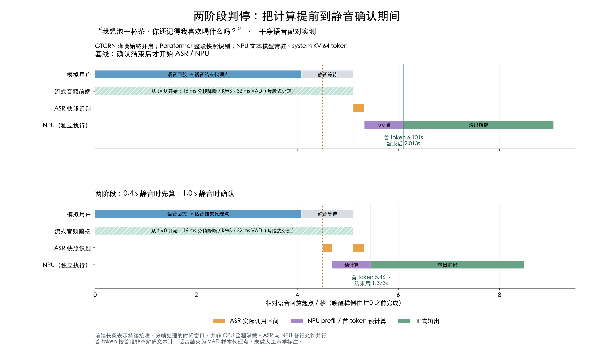

# 两阶段 VAD 判停与 NPU 预计算实板实验

日期：2026-10-19。结论：保留 1.0 秒最终静音确认，提前到 0.4 秒静音时做 ASR 与 NPU 预计算，可以把本组语音的首响应中位延迟从约 1.91 秒降到 1.28～1.31 秒；尚未实现稳定 1 秒以内。本次为 Paraformer 两阶段端点实验，原流式 Zipformer 与非流式版本保留，没有替换生产服务。

## 实测结果

指标起点是共享的硬 VAD 语段末样本代理点，终点是首次可解码的非空文本。它接近“说完→首字”，但不是人工标注的真实声学终点，也不含网络传输、UI 刷新或 TTS。每环境 12 句 × 基线/预计算各一次；P95 按 nearest-rank 计算，12 例时就是最大值。

| 环境 / 方案 | 首响应 P50 | 首响应 P95 / 最大 | 最后输出 P50 | 判停确认→首响应 P50 |
|---|---:|---:|---:|---:|
| 干净 / 基线 | 1.906 s | 2.461 s | 3.679 s | 0.886 s |
| 干净 / 两阶段 | **1.311 s** | **1.518 s** | 3.279 s | 0.291 s |
| 合成白噪声 20 dB / 基线 | 1.912 s | 2.449 s | 3.737 s | 0.893 s |
| 合成白噪声 20 dB / 两阶段 | **1.277 s** | **1.823 s** | 3.271 s | 0.257 s |

逐句配对节省时间的中位数分别为 0.598 / 0.623 秒，不能用两列 P50 相减代替。每个环境有 12/12 次最终候选命中；两个环境共 24/24 对最终 ASR、完整 prompt token 和最终回复 token 序列完全相同。CER 均为 0/196 字；这是很小的合成语音集，不能外推真实家庭识别准确率。最后输出是引擎结束或达到 48 token 上限，不保证回答语义完整。



图中两条链路都保留从 t≈0 开始的流式前处理长条，内部按帧间歇计算。Paraformer 本身仍是快照式整段识别，不把它称为流式 ASR。NPU 独立一行，是因为预计算会与音频接收、最终 ASR 并行。

## 实现和保护逻辑

1. GTCRN 降噪始终开启；KWS 常驻；两份 Silero VAD 分别使用 0.4 / 1.0 秒最短静音，音频按 16 ms 回放、VAD 每 32 ms 处理。其余检测阈值沿用现有实现。
2. 短静音触发临时 ASR，识别从本轮起点累计的全部降噪音频。读取记忆、打包 prompt 后，单个 NPU 工作线程预计算至首 token，结果暂存，不公开。
3. 检测到续说就递增 revision，旧候选失效；下一次识别包含前后完整语音。取消是逻辑取消：已开始的单 token NPU 请求跑完后丢弃结果，没有抢占图执行或重新加载模型。
4. 硬端点确认后，再做一次最终 ASR；必须 revision 和最终 prompt 都匹配才使用候选。否则走最终文本的正常推理。逐次输出仍检查当前 revision。
5. 候选阶段仅检索记忆，不写入永久记忆、不执行外部工具。预计算与最终生成串行拥有同一套 NPU KV，避免并行请求破坏缓存。

干净测试发生 9 次、加噪发生 3 次续说，合计 12 个旧候选被丢弃。例：“我住在哪个城市”后继续说“你还记得我说过的信息吗”，临时半句候选没有输出，最终回复仍为“你住在杭州”。记录的提前输出违规为 0，5 项纯 Gate 测试通过；这不是对所有并发时序或多人抢话的形式化保证。极短续说仍受 VAD 自身检测门槛限制。

## 为什么还有 1.8 秒长尾

20 dB 的第 6 句中，软端点后的 ASR 约 0.154 秒，候选 NPU 请求约 1.254 秒；最终 ASR 已结束，但仍在等待同一 NPU 候选请求，所以总延迟达到 1.823 秒。相同内容在干净测试有一次句中候选，已提前计算了可复用的前缀；噪声改变了软端点行为。不能把中位数更低理解为噪声能提速。

保留 1 秒最终确认，就有约 1 秒的等待下限；本实现还保留约 0.2 秒的最终 ASR 校验。继续冲 1 秒，应单独验证更短的最终确认或真正流式 ASR 终结，而不是直接删掉最终校验、提前播出错误回答。

## 资源与成本

CPU 为整机 8 核合计 100%，分方案统计语音开始至该轮回复结束的时间加权占用。每对固定先基线后两阶段，没有随机顺序和恒温控制；差值为本次观测，不能当作精确功耗增量。

| 指标 | 干净 | 20 dB 合成白噪声 |
|---|---:|---:|
| 基线 / 两阶段活动期 CPU | 7.27% / 8.21% | 5.97% / 6.58% |
| 全过程温度范围 | 39.25～46.07°C | 41.29～45.45°C |
| 最低 MemAvailable | 3411 MiB | 3409 MiB |
| Python 进程峰值 RSS | 282.25 MiB | 287.21 MiB |
| NPU 宿主峰值 RSS | 33.26 MiB | 33.38 MiB |
| NPU driver 分配 | 718.38 MiB | 718.38 MiB |
| swap 读 / 写页数增量 | 0 / 0 | 0 / 0 |
| 1 分钟 loadavg 范围 | 1.57～3.89 | 3.27～3.67 |
| 测试时长 / 完成轮数 | 281.94 s / 24 | 282.31 s / 24 |

NPU 宿主、driver 与 RSS 不应直接相加当物理总占用。后台原 CPU llama-server 保留约 1130.7 MiB RSS，但本实验生成没有调用它。前端累计约 4.7% 帧计算超过 16 ms，最大调度滞后分别 29.9 / 33.0 ms，不能宣称每帧都满足截止期。CPU 频率快照覆盖 416/780/1794/2002 MHz，未做频率锁定；温度正常不能单独证明完全没有降频。无电功率实测。

干净条件每轮 ASR 调用总时间中位数从 222 ms 增至 505 ms；加噪从 223 ms 增至 420 ms。最终那次 ASR 约 228 ms，其余是临时快照调用。前端每个 16 ms 帧摊销：降噪约 3.4 ms、KWS 约 1.05 ms、两份 VAD 合计约 0.65 ms（含调度与封装，不是独立模型算子 benchmark）。这是增加少量总计算、重叠关键路径来减少等待。

## 配对公平性与适用范围

- Orange Pi A733，语音模块 CPU、24 层 1B 文本解码 NPU；每轮恢复同一个 64 token system KV，避免上一轮完整 prompt 缓存污染对照。每轮不冷加载模型。
- prompt 为 system + 召回记忆 + 当前用户文本；无历史。实际动态输入仅 16～32 token，虽然预算为 256；本轮不能代表 128/256 动态输入和图片。
- 基线也使用同样双 VAD 前端，唯一策略差异是是否触发临时 ASR/NPU。这是机制消融，不是对所有旧单 VAD 版本的直接性能承诺。
- 同一模拟语音、相同逐样本噪声、同一模型、记忆、输出上限。每轮先播放“小白小白”正例且必须命中，然后播放命令；延迟从命令末尾计算，不包含前面的唤醒音频。
- 噪声为确定性全片白噪声，信噪比依据原始完整 WAV（含静音）RMS 计算，并覆盖尾部静音；不是活动语音 RMS 标准，也不是真实风扇、电视、其他说话人、回声或纯噪声误唤醒评测。
- 本轮未加载 Zipformer；因此内存不能与同时常驻两套 ASR 的旧实验直接相比。视觉 encoder/NPU 完整 VLM 未接入。本次不含 TTS，也没有麦克风采集。
- 此版约 9.4 分钟主要配对测试，不能继承旧版的 30 分钟稳定性结论。候选缓存机制不修复基模错误，例如 3 个苹果 + 2 盒牛奶仍回答 4 件，两方案输出一致也不代表内容正确。

## 复现、版本与证据

Windows 权威仓库：`F:/Files/OPi-Lab/repos/OragnePi-3W_ForVLM`，分支 `codex/wsl-intern1b-reproduction`。新增独立入口 `research/resident-agent/two_stage.py`，未修改旧 `agent_replay.py` 流式/非流式入口。实测脚本 SHA256：`084e57ff17bfa7c088c37e866812b7459a8c3152b36df6f95454fe1928b3e4fc`。

板端工作目录 `/opt/opi-vlm/resident-agent-20261019`，沿用现有 tokenizer、resident、speech、memory_lab、prompt_budget、audio_worker、worker 与本机模型依赖。保留 Windows hostlock；通过 board_access 连接后，以板端 `flock -w 10 /run/opi-npu-kv-benchmark.lock` 串行运行：

```sh
python3 two_stage.py --out NEW_UNIQUE_CLEAN_NAME
python3 two_stage.py --out NEW_UNIQUE_NOISE_NAME --noise-snr 20
```

目录必须新建，禁止覆盖旧结果。取回 `meta.json`、`turns.jsonl`、`resources.jsonl`、日志，按现有前缀命名，再运行 `summarize_two_stage.py RESULTS_DIR PREFIX`。重跑依赖已有板端资产，此 Git 提交不是系统/权重的完整部署镜像。

紧凑逐轮证据、汇总、退出码与失败记录位于 `results/two-stage-20261019/`；原始资源日志在 `F:/Files/OPi-Lab/results/two-stage-20261019/`，SHA 和大小记录于 `raw-manifest.json`。首次 smoke 因 SQLite 跨线程访问失败，已改为主线程检索/打包，失败日志保留；随后 smoke2、clean、noise20 均成功，退出时 driver_bytes=0。保留原始失败以便复核。

建议：保留此实现为实验候选，先接受约 0.6 秒的配对收益；将 0.6～0.8 秒最终确认作为下一轮独立变量，用句中长停顿、真实家庭噪声与续说负例验证后再决定默认值。
