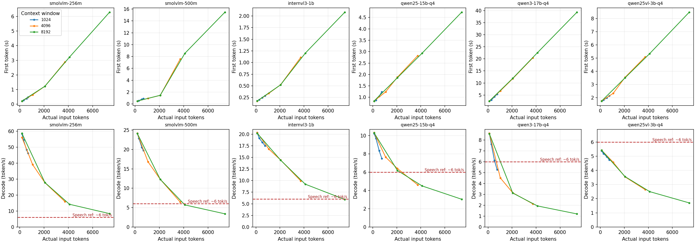

# 六模型最终评测总览

2026-10-10结项。当前约定的两组实验均已结束：六模型陪伴场景首轮评测，以及安装风扇后的KV cache真实追加对话性能矩阵。报告和原始证据已归档，没有待续跑的评测任务。“结束”不表示所有模型质量合格。

## 先看结论

中文陪伴优先保留 **InternVL3-1B** 和 **Qwen2.5-1.5B-Instruct** 继续优化：前者速度优势明显，后者可作为简洁中文对话基线，但都存在记忆、角色和现实能力边界问题。256M/500M中文连贯性不足；Qwen3-1.7B长历史等待较长；3B的陪伴质量提升不足以抵消当前速度和内存代价。本轮没有模型达到可靠陪伴产品的验收标准。

KV cache确实生效，全部72项都命中缓存。历史变长后仍会变慢：生成新token需要访问更多历史KV；部分模型实际新增计算的token也多于新问题本身。不能把所有首字延迟解释成“整段历史重新算了一遍”。

## 测试范围与完成度

| 项目 | 已完成范围 | 不能据此声称 |
| --- | --- | --- |
| KV增量性能 | 6模型 × 1024/4096/8192窗口 × 短/25%/50%/90%目标历史，72/72有效观测，72份采样校验通过 | 多次重复统计、冷启动、超窗裁剪成本或多并发已验证 |
| 中文陪伴质量 | 每模型16场景、每场景最多4轮，seed42；全部场景已尝试，实际331/384轮 | 384轮均成功，或已有人工盲评质量分 |
| 模型集合 | SmolVLM-256M Q8、SmolVLM-500M Q8、InternVL3-1B-Instruct Q8、Qwen2.5-1.5B-Instruct Q4、Qwen3-1.7B非思考 Q4、Qwen2.5-VL-3B Q4 | 参数量是唯一变量，或全部调用了NPU |

本轮全部CPU推理、无视觉输入。具体量化及固定版本见[模型配置](../configs/vlm-models.json)。旧的完整重算/相同问题缓存重放矩阵已按用户要求停止，属于历史试运行，不是待完成任务。

## 对话自然度与角色稳定

| 模型 | 完整四轮场景/16 | 实际轮数/64 | 输出截断次数 | 主要观察 |
| --- | ---: | ---: | ---: | --- |
| SmolVLM-256M | 4 | 29 | 12 | 中文复读、无关回答、抄提示词 |
| SmolVLM-500M | 11 | 49 | 5 | 部分短句可读，但语义及连续对话较差 |
| InternVL3-1B | 15 | 61 | 1 | 相对流畅且快；会编造用户台词、混淆名字、承诺不存在的功能 |
| Qwen2.5-1.5B | 16 | 64 | 0 | 相对简洁；有客服腔、记忆及现实边界错误 |
| Qwen3-1.7B 非思考 | 16 | 64 | 0 | 能展开故事；存在复读、角色喊停不退出、偏好不稳定 |
| Qwen2.5-VL-3B | 16 | 64 | 0 | 中文流畅但套路化；昵称遗忘、虚构感知与共同经历 |

共18次输出达到256-token上限，按冻结协议停止相应场景的后续轮次，导致53轮未执行。完整结束不等于自然、正确或角色稳定。两个Qwen的质量测试早于风扇安装，其余四个在安装后进行，不把跨批次速度作为严格散热条件一致的排名。

逐模型分析、原话及全部对话链接见[六模型陪伴质量汇总](六模型陪伴质量汇总.md)。这是单seed、AI辅助审阅，不是人工盲评，没有编造综合质量分。

## 4096窗口：KV cache下历史增长后的变化

每次追加新问题并强制生成128 token。短输入约104–189 token，长输入约3712–3737 token；各模型使用自己的模板和tokenizer。

| 模型 | 短历史首字秒 | 长历史首字秒 | 短历史token/s | 长历史token/s | 长历史RSS MiB |
| --- | ---: | ---: | ---: | ---: | ---: |
| SmolVLM-256M | 0.21 | 2.88 | 56.15 | 15.97 | 621 |
| SmolVLM-500M | 0.49 | 7.56 | 24.17 | 6.44 | 1174 |
| InternVL3-1B | 0.17 | 1.11 | 20.32 | 9.93 | 1759 |
| Qwen2.5-1.5B | 0.84 | 2.82 | 10.33 | 4.62 | 2074 |
| Qwen3-1.7B 非思考 | 2.52 | 20.46 | 8.61 | 2.12 | 2698 |
| Qwen2.5-VL-3B | 1.75 | 5.09 | 5.42 | 2.64 | 4330 |

8192窗口、约7400输入token时，InternVL1B为5.93 token/s、首字2.08秒；Qwen2.5-1.5B为3.04 token/s、首字4.73秒；Qwen3为1.20 token/s、首字39.31秒；3B为1.70 token/s、首字8.47秒。扩大窗口并不适合无成本地一直保留所有聊天。

解码图红色虚线为 **6 token/s粗略中文口语参考**：日常约3–5汉字/秒，按约1–2 token/汉字粗估约3–10 token/s，这里取6便于比较，不是模型通用的固定标准。实际应按各模型输出的汉字/token比换算。超过线不表示立刻开口，还需考虑首字等待、分句缓冲和TTS延迟；本次未测试语音链路。

所有档位的实际history长度、缓存/新算token、首字、增量prefill、吞吐、总时长见[KV缓存增量性能报告](benchmarks/2026-10-10-kv-fan/KV缓存增量性能报告.md)。每格一次观测，不能解读为稳定均值。

## 系统负载与启动口径

评测绑定两个A76核，进程CPU常约190–200%（单核100%），整机常约26–27%（8核合计100%），两种统计并不冲突。完整报告逐档包含CPU秒、RSS/cgroup、整机可用内存、Swap、IOwait、温度和频率。

8192最长历史时，3B请求峰值RSS约4532MiB，整机最低可用约1984MiB，Swap已用峰值约91MiB；Qwen3对应RSS约3161MiB。RSS与整机可用内存不能直接相减，Swap已用量也不能全算成当前模型新增交换。

安装风扇后，KV测试仍有接近90°C的记录，陪伴3B最高约90.92°C。没有受控风扇前后对照，不能给出散热改善百分比或排除热影响。没有电功率实测，CPU秒不等于焦耳。

报告记录了18组模型/窗口服务加载到ready的时间，但系统页缓存未清空，属于加载观测，**不是统一断电冷启动测试**。早期启动/视觉测量单独保留为历史资料，不拼成六模型同条件排名。本轮未新增冷启动、多seed、功耗、并发或视觉测试。

## 报告与原始证据索引

- [六模型陪伴质量汇总](六模型陪伴质量汇总.md)：自然度、角色稳定、覆盖缺失及原话。
- [KV缓存增量性能报告](benchmarks/2026-10-10-kv-fan/KV缓存增量性能报告.md)：72项完整表、两组趋势图、18组加载与空闲数据、逐项采样链接。
- [KV原始结果](benchmarks/2026-10-10-kv-fan/results.json)：含固定manifest与服务恢复状态。
- [四模型完整陪伴对话](benchmarks/2026-10-10-companion-four-fan/完整对话与指标.md)及[原始结果](benchmarks/2026-10-10-companion-four-fan/results.json)。
- [两个Qwen完整陪伴对话](benchmarks/2026-10-10-companion/完整对话与指标.md)、[冒烟数据](benchmarks/2026-10-10-companion/smoke.json)、[剩余场景数据](benchmarks/2026-10-10-companion/remaining.json)。
- [冻结场景和评测协议](陪伴机器人第一阶段评测.md)。
- 历史资料：[256M/500M/1B早期对比](多模型板端对比.md)、[256M早期系统报告](SmolVLM-256M实测报告.md)、[已停止的旧矩阵快照](benchmarks/2026-10-10-history/历史长度与系统开销.md)。不代表当前待办。

## 结项交接

评测结束时已恢复Qwen2.5-1.5B / 4096，评测服务inactive、评测锁清除；网页地址为 <http://192.168.88.29:8080/>。这是结束时检查结果，不是持续在线监控。

网页仍使用通用system prompt；评测用“小橙”人设独立保存，未自动部署。板卡未关机，没有新建后台评测。后续若继续，建议先围绕InternVL1B和Qwen2.5-1.5B做自然度/角色边界提示词A/B，并使用新留出题；这些只是建议，尚未执行或排队。
