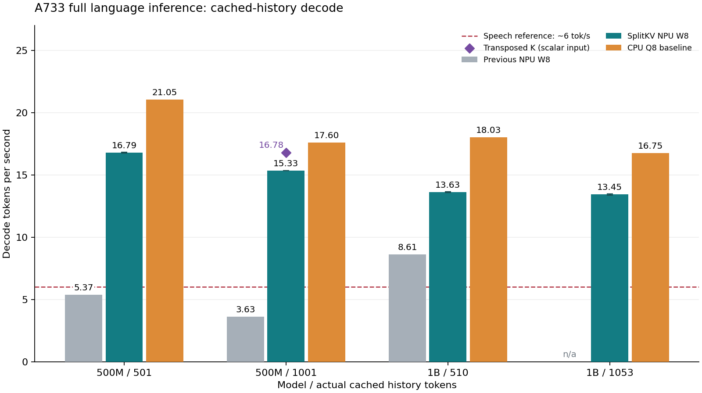

# KV 搬运与长历史 decode 优化

2026-10-12。完整语言模型、对应CPU Q8_0、真实缓存历史约512/1024。新候选拆分历史/当前K和V，并把softmax概率输出设为INT16，显著改善decode；当前仍未达到超过CPU的目标。所有decoder层和完整输出头在NPU。

权重仍为W8主体，沿用已披露的敏感FP16例外；KV主要INT16。概率输出由FP16改为DFP INT16、fl=15（步长2⁻¹⁵）。保留softmax公式和因果mask，但不能保证SDK选择相同内核或中间算术。不能把该变化说成无损或全INT8。



图中NPU为五轮中位，误差条是最小–最大，不是置信区间。6 token/s沿用此前粗略中文口语参考线，非统一实测标准；分词和输出语言会改变对应语速。主柱使用四档splitKV方案口径，新batch首字和转置K另列。

## 硬件计数定位

已接通 VIPLite NPD。板端输出 VNPD v2、128字节记录；SDK自带解析器按192字节读取而失败，新增解析器严格检查格式、记录长度和溢出位。

下表是500M、两层、容量1280、有效历史1024的硬件忙碌计数，**不是整模型延迟占比**；可能未覆盖其他执行单元及调度等待。编译器UID在融合层之间重复，映射保留候选算子，不猜测具体层归属。

| 两层图 | 合计忙碌周期 | concat周期 | concat占比 | 全连接周期 |
| --- | ---: | ---: | ---: | ---: |
| 原图 | 6,061,508 | 2,847,239 | 46.97% | 2,302,786 |
| 拆分K | 4,760,896 | 1,561,026 | 32.79% | 2,303,321 |
| 拆分KV+INT16概率 | 3,440,720 | 40,189 | 1.17% | 2,303,681 |

拆分K利用 `Q·cat(Kpast,Knew)ᵀ = cat(Q·Kpastᵀ,Q·Knewᵀ)`，只拼接小得多的注意力分数。完整softmax、mask、RoPE位置和外部KV格式保留。新token点积用乘法和归约表达以绕开退化矩阵的编译问题，新增舍入经过独立FP32和完整模型检查。

新方案进一步利用 `P·cat(Vpast,Vnew) = Ppast·Vpast + Pnew·Vnew`。无模型权重的最小复现定位到softmax→slice→AV的batch GEMM -8；把概率生产者输出设为INT16后消失。完整新V分支的广播乘仍报reshape -1，改成外积matmul后编译成功。原先失败候选保留，不能把它们说成性能结果。TP concat开关生成相同二进制，无收益；FP16常驻KV通过但更慢，不采用。

## 全深度数值与初次诊断

相同冻结CPU轨迹、固定128步预测，包含全部decoder层和完整NPU输出头。阈值保持logits L2≤5%、每步cos≥0.99、argmax≥95%、全部有限。参考重建实际导出常量；该门槛不覆盖相对原始模型的权重量化损失，也不是独立留出质量验收。固定轨迹的预测拼接不是自然自由回答。诊断速度不混入五轮正式成绩。

| 模型/已缓存token/候选 | L2 | 最低cos | argmax | 门槛 | 诊断token/s | 增量首字秒 |
| --- | ---: | ---: | ---: | --- | ---: | ---: |
| smol500/501/splitk | 4.332% | 0.9968807 | 128/128 | 通过 | 5.537 | 2.630 |
| smol500/1001/splitk | 3.581% | 0.9957449 | 128/128 | 通过 | 3.833 | 4.232 |
| intern1b/510/splitk | 3.668% | 0.9911101 | 125/128 | 通过 | 7.819 | 0.612 |
| intern1b/1053/splitk | 3.204% | 0.9986212 | 124/128 | 通过 | 6.709 | 2.246 |
| smol500/501/splitkv-i16mm | 4.252% | 0.9966974 | 127/128 | 通过 | 15.246 | 2.284 |
| smol500/1001/splitkv-i16mm | 3.457% | 0.9970530 | 127/128 | 通过 | 14.032 | 3.475 |
| intern1b/510/splitkv-i16mm | 3.639% | 0.9909133 | 125/128 | 通过 | 11.182 | 0.611 |
| intern1b/1053/splitkv-i16mm | 3.187% | 0.9988032 | 125/128 | 通过 | 11.118 | 1.132 |

补查原GGUF Q8常量的FP32参考（包含重编码权重和执行引入的总差异），与上述导出常量门槛分开报告：

| 模型/历史 | logits L2 | 最低cos | 对原常量FP32 argmax | 对实际CPU Q8固定轨迹预测 | KL nat/token | 开发轨迹困惑度比 |
| --- | ---: | ---: | ---: | ---: | ---: | ---: |
| smol500/1001 | 5.946% | 0.9925150 | 124/128 | 122/128 | 0.002048 | 0.99358 |
| intern1b/1053 | 4.618% | 0.9977758 | 120/128 | 120/128 | 0.005712 | 1.01113 |

原常量参考显示额外权重编码差异。协议对该项采用独立留出KL和困惑度门槛，不与导出常量的执行门槛混用；上表是开发轨迹，不能声称整体质量验收已完成，也不为速度放宽门槛。

1B/1053采用逐token准备和追加输入，避开尚未解决的批量prefill旧hidden问题；这不是修复声明。其内存、首字和首次准备时间不能直接与加载双套图的批量方案比较。已有缓存不会在单次增量响应中重新计算。

## 五轮重复与CPU对照

沿用A76核6/7宿主、起温≤68°C补充协议。每个候选首先要求诊断完整logits逐字节复现，再预热和五轮无logits大输出的测量。驱动释放、预测轨迹、温度和逐秒系统状态均检查。下列CPU为此前无部署干扰的对应Q8结果，并非本轮重新穷举调优。

| 场景 | 新NPU中位token/s | 五轮范围 | 旧NPU | 提升 | CPU Q8 | NPU/CPU |
| --- | ---: | ---: | ---: | ---: | ---: | ---: |
| smol500/501 | 16.794 | 16.763–16.806 | 5.369 | +212.8% | 21.052 | 79.8% |
| smol500/1001 | 15.328 | 15.325–15.358 | 3.634 | +321.8% | 17.600 | 87.1% |
| intern1b/510 | 13.630 | 13.586–13.656 | 8.610 | +58.3% | 18.026 | 75.6% |
| intern1b/1053 | 13.451 | 13.358–13.468 | — | — | 16.754 | 80.3% |

旧正式NPU与CPU见[长历史KV验证](长历史KV验证.md)。1B/1053此前没有合格五轮，不以单次诊断替代。目标仍是逐模型/历史档超过最快合格CPU至少15%。

| 场景 | 新增token | 增量TTFT秒 | CPU TTFT秒 | 总响应秒 | 一次性准备历史秒 | 图加载秒 |
| --- | ---: | ---: | ---: | ---: | ---: | ---: |
| smol500/501 | 63 | 2.273 | 0.796 | 9.836 | 17.570 | 0.731 |
| smol500/1001 | 64 | 3.470 | 1.030 | 11.757 | 53.797 | 1.032 |
| intern1b/510 | 20 | 0.589 | 0.247 | 9.906 | 14.692 | 0.698 |
| intern1b/1053 | 20 | 1.108 | 0.337 | 10.549 | 57.323 | 0.333 |

增量TTFT不包含首次建立历史缓存。图加载受系统页缓存影响，不是统一断电冷启动。500M与1B新增输入长度不同，不能直接横比首字。

| 场景 | decoder毫秒/token | 输出头毫秒/token | 驱动MiB | RSS MiB | 增量响应CPU秒 |
| --- | ---: | ---: | ---: | ---: | ---: |
| smol500/501 | 52.79 | 5.47 | 725.25 | 19.41 | 0.222 |
| smol500/1001 | 58.58 | 5.51 | 805.50 | 23.70 | 0.207 |
| intern1b/510 | 52.50 | 18.62 | 809.56 | 26.21 | 0.349 |
| intern1b/1053 | 53.73 | 18.47 | 456.22 | 19.49 | 0.341 |

驱动内存和进程RSS分开报告，不能用小RSS代替推理总占用。所有正式轮次驱动释放后为0。

| 场景 | 起温范围°C | 采样最高温°C | 最低系统可用RAM MiB | 系统swap范围MiB | 采样系统CPU最高% |
| --- | ---: | ---: | ---: | ---: | ---: | ---: |
| smol500/501 | 51.6–52.7 | 55.6 | 3810.5 | 1175.8–1183.2 | 7.2 |
| smol500/1001 | 50.7–51.4 | 54.4 | 3701.3 | 1180.2–1181.5 | 10.1 |
| intern1b/510 | 52.7–53.7 | 54.9 | 3687.5 | 1181.0–1182.8 | 8.1 |
| intern1b/1053 | 55.8–57.4 | 57.5 | 4117.3 | 1182.8–1182.8 | 4.6 |

系统1秒采样无法捕捉全部瞬时峰值；swap包含本轮开始前的占用，不能归因于本轮新增。网页CPU后端采样时保持ready且空闲。

仅拆K的500M五轮作为消融保留：

- 历史501：5.766 token/s。
- 历史1001：3.940 token/s。

1B两个仅拆K五轮任务在获取锁前撤出队列，优先测更快候选；不是推理失败。

## 1B旧输出问题的缩小实验

原捕获输入与另一个真实输入交替；主图加12份同图常驻，40轮合计520次执行。驱动分配528.69MiB，主图变化0轮，副本不同元素0，退出分配0。这次未复现旧hidden，只说明该同图驻留条件不充分；不同图交互、更大驻留或特定执行轨迹仍未排除。

## 探针与失败记录

| 探针 | API毫秒/两层 | 精度/重复门槛 | 范围 |
| --- | ---: | --- | --- |
| smol500/splitk | 15.541 | True | 单个两层图，不是全模型 |
| smol500/kvfp16 | 25.087 | True | 单个两层图，不是全模型 |
| smol500/splitkv-i16mm | 3.503 | True | 单个两层图，不是全模型 |
| smol500/probi16 | 6.621 | True | 单个两层图，不是全模型 |
| smol500/splitkv-transk | 3.086 | True | 单个两层图，不是全模型 |
| smol500/prefill-splitkv-i16mm | 19.702 | True | 单个两层图，不是全模型 |
| intern1b/splitk | 8.945 | True | 单个两层图，不是全模型 |
| intern1b/kvfp16 | 11.583 | True | 单个两层图，不是全模型 |
| intern1b/splitkv-i16mm | 4.126 | True | 单个两层图，不是全模型 |
| intern1b/prefill-splitkv-i16mm | 150.662 | True | 单个两层图，不是全模型 |

probi16保留原KV concat，只改概率精度；说明收益来自格式与搬运两部分。prefill探针每次20token，1B选敏感2/3层，不能直接与单token/其他层比较。转置K已增加带严格形状检查的单token运行路径，批量路径仍明确拒绝；完整结果见下节。

| 无权重最小复现 | 编译退出码 |
| --- | ---: |
| direct-direct | 0 |
| slice-direct | 0 |
| softmax-complete-split | 1 |
| softmax-complete-split-i16 | 1 |
| softmax-complete-split-i16-mm | 0 |
| softmax-direct | 0 |
| softmax-slice | 1 |
| softmax-slice-i16 | 0 |

## 后续完整候选与自然生成

下面单独列出新batch与转置K候选，不把单次诊断当正式五轮。batch即使单次通过，也须再次检查完整logits能否复现。自然生成用自己的token回灌并尊重EOS，与fixed轨迹分开。

| 场景 | 执行门槛 | L2 | 最低cos | argmax | 诊断TTFT秒 | 诊断token/s |
| --- | --- | ---: | ---: | ---: | ---: | ---: |
| smol500/history1001-batchsplit-fixed | 通过 | 3.625% | 0.9936489 | 127/128 | 1.448 | 13.942 |
| intern1b/history1053-batchsplit-fixed | 通过 | 3.186% | 0.9985560 | 125/128 | 0.430 | 11.080 |
| smol500/history1001-transk-fixed | 通过 | 3.485% | 0.9959908 | 128/128 | 3.470 | 15.250 |
| smol500/history1001-natural | 通过 | 4.386% | 0.9973825 | 40/42 | 3.481 | 13.999 |
| intern1b/history1053-natural | 通过 | 3.196% | 0.9987352 | 78/82 | 1.133 | 10.962 |

smol500，实际生成42 token（上限128；EOS须看末尾特殊token）：

```text
 说话时，我会在房间里聊聊。我会在房间里聊聊。<end_of_utterance>
```

intern1b，实际生成82 token（上限128；EOS须看末尾特殊token）：

```text
当然，我继续。我们一家人围坐在篝火旁，听着音乐，分享着今天的趣事。妈妈唱着欢快的歌，孩子们兴奋地跳着舞，笑声不断。我们还分享了一些有趣的新闻，比如最近发生的地震和洪水，但很快又转回了轻松愉快的氛围。我们一边聊天，一边享受着这个美好的傍晚，感觉非常幸福和满足。<|im_end|>
```

这些是开发场景的单次实际回答，不是独立留出、人工评分或跨请求多轮验收。模型本身的中文能力和NPU引入的额外退化需要CPU自然回答配对才能区分。

后续候选五轮结果（含失败；不覆盖上方已验证对照）：

| 场景/候选 | 状态 | token/s中位 | TTFT秒 | 总响应秒 | 首次准备秒 | 驱动MiB |
| --- | --- | ---: | ---: | ---: | ---: | ---: |
| smol500/1001/batchsplit | 五轮完成 | 15.409 | 1.411 | 9.652 | 19.561 | 765.40 |
| intern1b/1053/batchsplit | 五轮完成 | 13.392 | 0.409 | 9.891 | 20.786 | 839.67 |
| smol500/1001/transk | 五轮完成 | 16.776 | 3.460 | 11.030 | 53.983 | 368.30 |

| 场景/候选 | 五轮token/s范围 | 响应CPU秒 | RSS MiB | 采样最高温°C | 最低可用RAM MiB |
| --- | ---: | ---: | ---: | ---: | ---: |
| smol500/1001/batchsplit | 15.403–15.418 | 0.158 | 22.48 | 59.9 | 3737.1 |
| intern1b/1053/batchsplit | 13.369–13.456 | 0.334 | 30.25 | 57.0 | 3691.0 |
| smol500/1001/transk | 16.715–16.783 | 0.459 | 19.25 | 61.6 | 4187.0 |

转置K目前只支持逐token输入；即使decode更快，也不能自动视为首字或端到端最佳方案。新batch重复通过的结论只覆盖本开发场景，旧batch故障根因及其他输入仍需验证。

代码与小型证据进Git；模型、NBG、SDK、完整logits及捕获二进制仅本地保留。详情见[evidence-kv-movement-20261012](evidence-kv-movement-20261012)。

下一步改善batch首字和1B敏感层/输出头，并处理相对原Q8参考的精度差距。独立留出质量、真实跨HTTP多轮、充分CPU调优及30分钟连续运行仍需完成。网页保持原CPU后端；本轮为命令行NPU研发，不是已部署NPU聊天服务。
