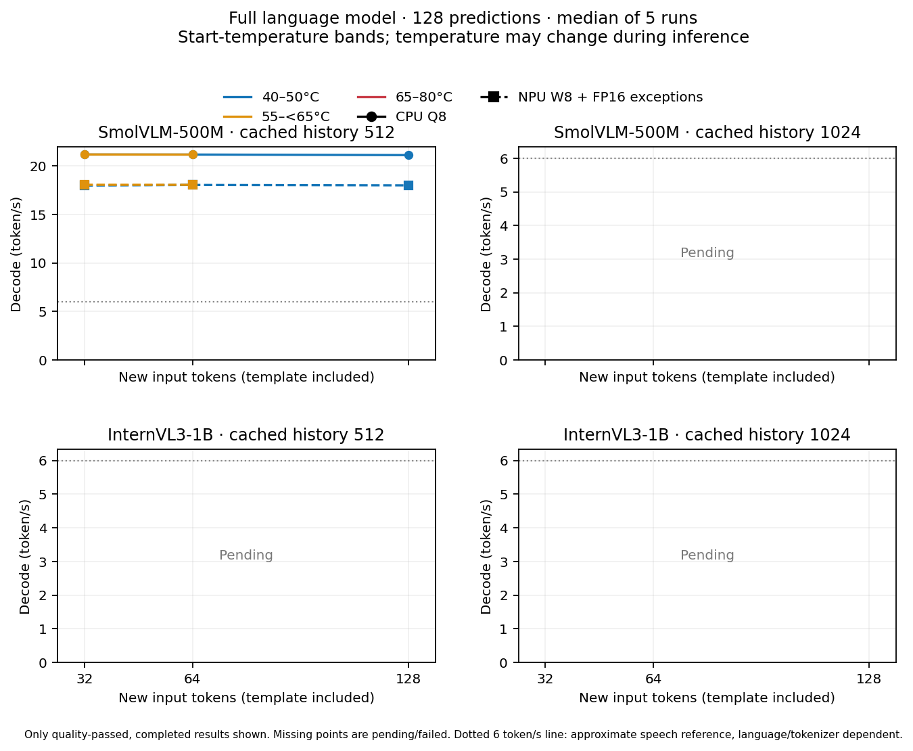
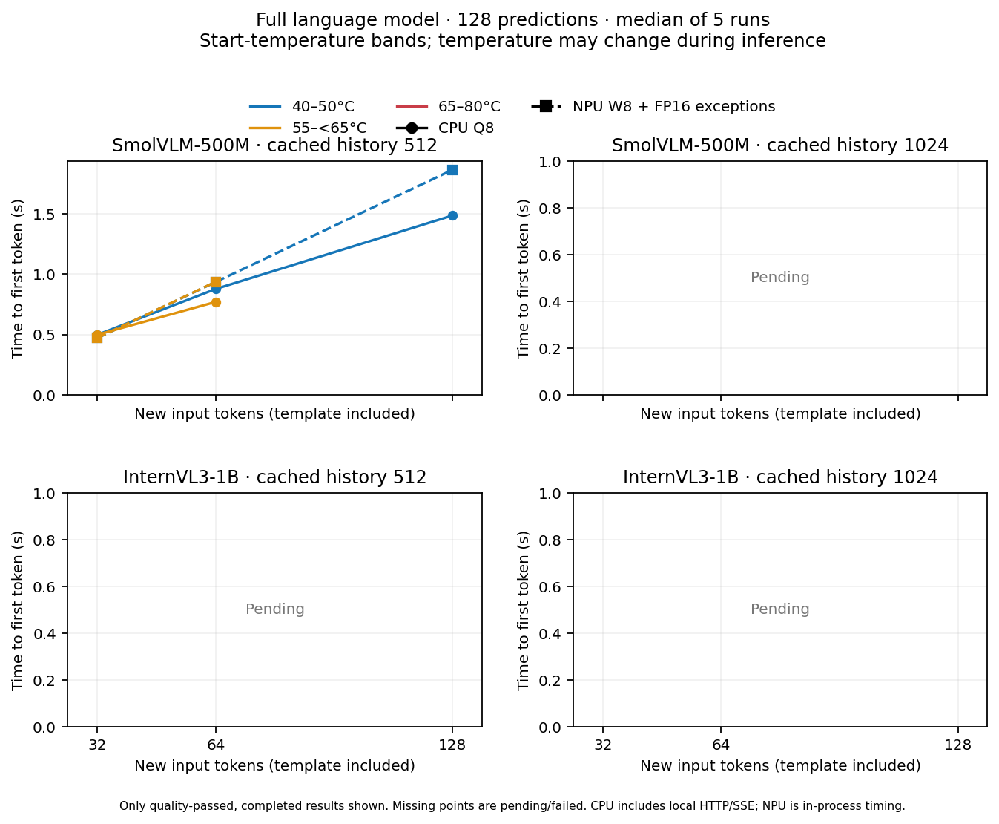

# 三温档、精确token、完整深度CPU/NPU对标

2026-10-13。正式范围为SmolVLM-500M全部32层、InternVL3-1B全部24层，最终Norm、完整词表输出头及采样；仅语言部分，不测视觉编码。

**断电重启后已恢复，续测限低/中温档。** 1 MiB临时文件写入、fsync、丢弃该文件页缓存后读回一致，36个部署图/embedding/CPU模型哈希匹配；核查时无D态进程、无启动10秒后的存储错误，网页ready。启动调谐阶段仍出现DMA hold timeout后成功挂载，不能认定故障只由过热引起，也不能凭小测试保证TF长期稳定。高温档暂缓，之前仅1次测量未计入正式结果。[恢复证据](evidence-thermal-20261013/storage-recovery.json)。

当前优先低/中温：CPU 5/24、通过完整数值门槛及五轮测速的NPU 5/24。含暂缓高温的原总矩阵仍为CPU 5/36、NPU 5/36；失败或精度未通过的输入场景 0。空格为未完成，不能作为零速度。

| 起始温档 | 实测温度范围 |
| --- | --- |
| 低温 | 40–50°C |
| 中温 | 55–低于65°C |
| 高温 | 65–80°C |

原高温设70–80°C，停预热后结温陡降导致两次无法进入/保持起温范围，尚无成功高温数据时改为65–80°C；旧失败记录保留，不重新贴标签。之前中温成功数据仍逐条检查实际温度<65°C。

温度在历史KV已准备好、增量响应开始时归档。预热使用独立CPU负载，正式计时前终止并等待所有预热线程退出；等待散热/预热单列，KV始终驻留。停止CPU负载后结温下降很快，当前预热停止阈值最多80°C，实际起测仍须落入标注温档，预热采样峰值另外保存。初版85°C阈值难以达到，失败日志保留。不修改系统温控和频率限制。推理期间允许自然升降温，因此是起温档位试验，不是恒温/稳态试验。温区不可达时记录失败，不强行填表。

每模型：缓存512/1024 token × 新增32/64/128 token × 三温档，共36格。新增包含模板标记，CPU/NPU每格输入二进制相同；固定CPU greedy轨迹回灌，128步全词表预测，忽略EOS仅用于固定工作量。每温档独立诊断完整logits与已通过的参考逐字节相同，预热1次、正式5次。

CPU为历史筛选较快的llama.cpp Q8_0、2线程/两A76；尚未穷举长历史所有配置。NPU主体W8、敏感down FP16、KV与多数激活INT16；32-token批量prefill，500M转置K，1B普通K。CPU客户端TTFT含本机HTTP/SSE、可能受UTF-8输出缓冲影响；NPU是运行器首预测、不含HTTP。decode双方均统计首token之后127步。

## 五轮中位数

| 模型 | 历史 | 新增 | 温档 | CPU token/s | NPU token/s | NPU/CPU | CPU TTFT s | NPU TTFT s | CPU总响应 s | NPU总响应 s |
| --- | ---: | ---: | --- | ---: | ---: | ---: | ---: | ---: | ---: | ---: |
| smol500 | 512 | 32 | 低 | 21.181 | 17.981 | 0.849 | 0.499 | 0.472 | 6.403 | 7.535 |
| smol500 | 512 | 32 | 中 | 21.188 | 18.061 | 0.852 | 0.499 | 0.473 | 6.400 | 7.505 |
| smol500 | 512 | 32 | 高 | — | — | — | — | — | — | — |
| smol500 | 512 | 64 | 低 | 21.177 | 18.049 | 0.852 | 0.878 | 0.937 | 6.781 | 7.973 |
| smol500 | 512 | 64 | 中 | 21.177 | 18.057 | 0.853 | 0.771 | 0.938 | 6.676 | 7.971 |
| smol500 | 512 | 64 | 高 | — | — | — | — | — | — | — |
| smol500 | 512 | 128 | 低 | 21.121 | 18.003 | 0.852 | 1.487 | 1.865 | 7.403 | 8.920 |
| smol500 | 512 | 128 | 中 | — | — | — | — | — | — | — |
| smol500 | 512 | 128 | 高 | — | — | — | — | — | — | — |
| smol500 | 1024 | 32 | 低 | — | — | — | — | — | — | — |
| smol500 | 1024 | 32 | 中 | — | — | — | — | — | — | — |
| smol500 | 1024 | 32 | 高 | — | — | — | — | — | — | — |
| smol500 | 1024 | 64 | 低 | — | — | — | — | — | — | — |
| smol500 | 1024 | 64 | 中 | — | — | — | — | — | — | — |
| smol500 | 1024 | 64 | 高 | — | — | — | — | — | — | — |
| smol500 | 1024 | 128 | 低 | — | — | — | — | — | — | — |
| smol500 | 1024 | 128 | 中 | — | — | — | — | — | — | — |
| smol500 | 1024 | 128 | 高 | — | — | — | — | — | — | — |
| intern1b | 512 | 32 | 低 | — | — | — | — | — | — | — |
| intern1b | 512 | 32 | 中 | — | — | — | — | — | — | — |
| intern1b | 512 | 32 | 高 | — | — | — | — | — | — | — |
| intern1b | 512 | 64 | 低 | — | — | — | — | — | — | — |
| intern1b | 512 | 64 | 中 | — | — | — | — | — | — | — |
| intern1b | 512 | 64 | 高 | — | — | — | — | — | — | — |
| intern1b | 512 | 128 | 低 | — | — | — | — | — | — | — |
| intern1b | 512 | 128 | 中 | — | — | — | — | — | — | — |
| intern1b | 512 | 128 | 高 | — | — | — | — | — | — | — |
| intern1b | 1024 | 32 | 低 | — | — | — | — | — | — | — |
| intern1b | 1024 | 32 | 中 | — | — | — | — | — | — | — |
| intern1b | 1024 | 32 | 高 | — | — | — | — | — | — | — |
| intern1b | 1024 | 64 | 低 | — | — | — | — | — | — | — |
| intern1b | 1024 | 64 | 中 | — | — | — | — | — | — | — |
| intern1b | 1024 | 64 | 高 | — | — | — | — | — | — | — |
| intern1b | 1024 | 128 | 低 | — | — | — | — | — | — | — |
| intern1b | 1024 | 128 | 中 | — | — | — | — | — | — | — |
| intern1b | 1024 | 128 | 高 | — | — | — | — | — | — | — |

## 实测温度、频率与开销

1秒采样可能漏峰；早期时间序列读网页2秒缓存，响应边界可能混入先前预热温度，不能将其最高值认作推理时刻真实峰值。新版直接读取sysfs温度，每条来源归档；所有入档起温/终温一直为直接读取，不受网页缓存影响。频率降低可能是负载/调频策略变化，不能仅据频率低就判定热降频。CPU RSS为独立server进程，NPU RSS为宿主进程，驱动分配另列，不能仅比RSS。响应温度含起/终点；首格低温CPU缺分段时间标记，仅能给起/终点范围，完整流程采样仍归档。

| 场景 | 温档/后端 | 起温°C | 响应采样°C | A76采样MHz | 响应CPU s | RSS MiB | 驱动MiB | 温控准备 s |
| --- | --- | ---: | ---: | ---: | ---: | ---: | ---: | ---: |
| smol500-h512-n32 | 低/cpu | 48.7–49.3 | 48.7–64.5 | — | 12.780 | 817.2 | — | 1.5 |
| smol500-h512-n32 | 低/npu | 41.9–43.2 | 37.3–45.0 | 416–2002 | 0.221 | 22.8 | 702.448 | 0.8 |
| smol500-h512-n32 | 中/cpu | 56.9–57.6 | 54.6–70.1 | 2002–2002 | 12.770 | 817.7 | — | 0.5 |
| smol500-h512-n32 | 中/npu | 60.7–61.5 | 45.8–70.2 | 416–2002 | 0.201 | 22.8 | 702.448 | 12.9 |
| smol500-h512-n64 | 低/cpu | 47.8–48.6 | 47.8–64.8 | 2002–2002 | 13.530 | 817.3 | — | 2.5 |
| smol500-h512-n64 | 低/npu | 45.6–46.6 | 38.6–53.1 | 416–2002 | 0.209 | 22.9 | 702.448 | 1.2 |
| smol500-h512-n64 | 中/cpu | 59.7–62.9 | 59.7–72.7 | 2002–2002 | 13.320 | 818.2 | — | 0.4 |
| smol500-h512-n64 | 中/npu | 60.3–61.8 | 45.8–68.8 | 416–2002 | 0.214 | 23.8 | 702.448 | 10.6 |
| smol500-h512-n128 | 低/cpu | 48.5–48.8 | 48.5–65.9 | 780–2002 | 14.780 | 818.1 | — | 3.0 |
| smol500-h512-n128 | 低/npu | 45.8–46.9 | 39.7–55.4 | 416–2002 | 0.246 | 24.0 | 702.448 | 1.2 |

## 完整数值门槛

参考重建实际导出权重；logits L2≤5%、每步cos≥0.99、argmax≥95%、全有限。三温档再做完整logits复现。此门槛不替代原始权重量化质量和独立陪伴留出验收。

| 场景 | L2 | 最低cos | argmax/128 | 门槛 |
| --- | ---: | ---: | ---: | --- |
| smol500-h512-n32 | 3.320% | 0.997830 | 127 | 通过 |
| smol500-h512-n64 | 3.663% | 0.997702 | 127 | 通过 |
| smol500-h512-n128 | 4.670% | 0.995081 | 127 | 通过 |

## 曲线

未分温档的过渡结果见[精确长度报告](精确长度全深度对标.md)，不混入本表。旧500M64新增对1B20新增的TTFT差异主要来自工作量不同；本轮用相同新增token档位替代比较。

图、模型、完整logits留本地；代码和小型证据进入Git。[归档汇总](evidence-thermal-20261013/summary.json)。重建命令：`npu/.venv/bin/python npu/kv-cache/report_thermal_matrix.py --root npu/results/thermal-aligned-20261013`。
