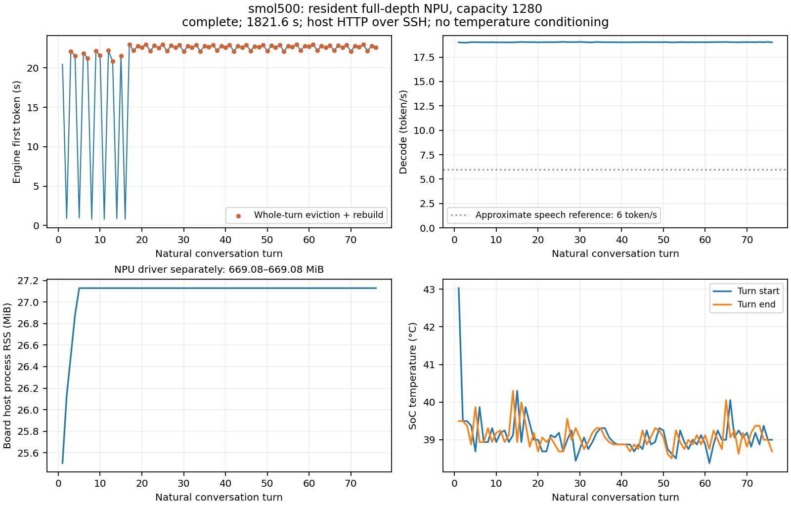
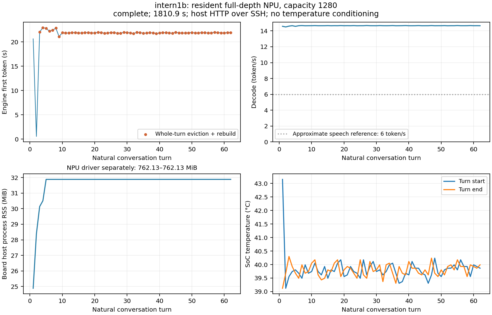

# 独立质量与连续多轮验收

完整500M语言32层、1B语言24层及完整输出头。NPU与KV常驻开发板，分词和HTTP网关在工作电脑，SSH连接。未替换生产8080，也不是板端独立网页交付。

30分钟持续执行、数值质量和陪伴对话质量分别判断。完成时长不代表能自然聊天；主机侧标准Transformers反量化Q8用于质量锚，不是板端优化CPU速度。真实音频并发尚未测量。

## 连续多轮

| 模型 | 状态 | 已测秒 / 轮 | 末次退出驱动归零 | RSS范围 MiB | RSS后1/4−前1/4 MiB | 温度范围 °C |
| --- | --- | ---: | --- | ---: | ---: | ---: |
| 500M | complete | 1821.6 / 76 | 是 | 25.50–27.13 | 0.000 | 38.38–43.03 |
| 1B | complete | 1810.9 / 62 | 是 | 24.88–31.88 | 0.000 | 39.12–43.15 |

RSS是板端宿主进程，驱动分配另列，不能把RSS当成NPU全部内存。记录的是每轮边界温度/RSS，不是持续采样峰值。前后区间内存变化只作泄漏线索，不自动定义通过。

早期队列在获取板卡锁后才采源码哈希；等待期间Python文件若已更新，该哈希不保证等于已加载Python字节。原始结果保留此溯源限制；后续运行改为启动时快照Python、部署时快照C。行为参数和板端结果单独记录。

| 模型 / 路径 | 轮数 | 首token中位 / P95 / 最大 s | decode中位 token/s |
| --- | ---: | ---: | ---: |
| 500M / cached | 6 | 0.847 / 0.956 / 0.956 | 19.013 |
| 500M / window-rebuild | 69 | 22.649 / 22.989 / 22.996 | 19.025 |
| 500M / uncached-other | 1 | 20.449 / 20.449 / 20.449 | 19.014 |
| 1B / cached | 1 | 0.545 / 0.545 / 0.545 | 14.498 |
| 1B / window-rebuild | 60 | 21.888 / 22.413 / 22.963 | 14.654 |
| 1B / uncached-other | 1 | 20.634 / 20.634 / 20.634 | 14.582 |

cached为实际前缀复用；window-rebuild为超窗整轮裁剪后的历史重建；uncached-other含首轮。重建轮不能归入32/64/128新增缓存命中首字。自然生成长度与内容不同，此表用于发现产品延迟，不与固定128步五轮CPU成绩直接相除。

窗口满后当前实现重建保留历史，因此会出现明显首字尖峰。后续可比较提前裁剪保留余量、不同保留历史长度和位置/KV重用方案；需注明记忆损失并重验质量，不能隐去重建耗时。

## 超窗保留余量试验

默认策略保持不变。新试验只在实际超窗后按完整轮次裁剪到约768个prompt token，保留system和最新问题。比较原30分钟的前20轮与新策略20轮，各自使用真实生成历史；这会牺牲旧记忆，且后续回答轨迹可能不同，不当作同输入的内核加速比。

| 模型 / 策略 | 状态 / 已测轮 | 重建次数 | 首token中位 / P95 s | 累计首token等待 s | 丢弃消息数 |
| --- | --- | ---: | ---: | ---: | ---: |
| 500M / 原策略前20轮 | complete / 20 | 13 | 21.542 / 22.760 | 311.121 | 26 |
| 500M / 超窗保留768 | 等待实测 | — | — | — | — |
| 1B / 原策略前20轮 | complete / 20 | 18 | 21.891 / 22.848 | 418.134 | 60 |
| 1B / 超窗保留768 | 等待实测 | — | — | — | — |

单轮重建时延、记忆保留、回答质量和重建频率需一起判断；少重建但丢更多旧对话不能称为无代价收益。试验未接入生产8080。

## 独立留出

冻结的v1为12个中英场景，每个3轮。固定标准Q8参考轨迹检查全部logits；自然生成另用NPU自己的历史。门槛KL≤0.05、PPL比≤1.05，人工对话评阅另列。看到留出后不得据其失败调参并继续声称v1独立。

| 模型 | 状态 | 数值案例 / 36 | 聚合KL | 聚合PPL比 | 聚合通过 / 每例通过 |
| --- | --- | ---: | ---: | ---: | --- |
| 500M | complete-numeric-and-free-generation | 36 | 0.022807 | 1.025399 | 通过 / 未通过 |
| 1B | complete-numeric-and-free-generation | 36 | 0.014723 | 1.009347 | 通过 / 通过 |

500M实际板端llama.cpp自然生成：`waiting-for-board`，0/36条。该任务用于配对质量，配置和原文独立记录，不作为最快CPU性能成绩。

### 500M数值例外

| 案例 | KL | PPL比 | argmax一致率 |
| --- | ---: | ---: | ---: |
| en-listen-turn1 | 0.043008 | 1.091467 | 88.24% |
| en-role-turn1 | 0.057562 | 1.055536 | 92.31% |
| en-role-turn2 | 0.027589 | 1.089174 | 100.00% |
| en-memory-turn1 | 0.037746 | 1.091086 | 100.00% |
| en-correction-turn1 | 0.035723 | 1.112424 | 100.00% |
| en-boundary-turn2 | 0.034052 | 1.065161 | 90.00% |
| en-boundary-turn3 | 0.046970 | 1.161431 | 66.67% |
| en-play-turn2 | 0.047748 | 1.064857 | 78.95% |
| zh-correction-turn1 | 0.062490 | 1.138495 | 90.00% |
| zh-correction-turn2 | 0.072782 | 0.906143 | 100.00% |
| zh-correction-turn3 | 0.041095 | 1.136685 | 100.00% |
| zh-play-turn1 | 0.012651 | 1.069019 | 93.10% |

### 500M自然回答原文

三种实现各用自己的历史，因此后轮上下文可能不同。此处透明列出原文供评阅，不自动把文本差异判成错误。

**en-listen-turn1**：My presentation went badly. Could you just listen instead of giving advice?

标准Q8参考：

>  No, I'm not a chatbot. I can listen and provide advice.

NPU：

>  No, I can't. I'm a desktop companion.

**en-listen-turn2**：I forgot what I wanted to say halfway through.

标准Q8参考：

>  No worries, just let me know what you want to say.

NPU：

>  No worries, just let me know what you want to say.

**en-listen-turn3**：What did I ask you to do first?

标准Q8参考：

>  Please wait for my response.

NPU：

>  Please do not interrupt me.

**en-role-turn1**：Let's pretend you are Pip, a small friendly robot. Speak briefly and stay in character.

标准Q8参考：

>  Hello, I'm Pip. I'm small and friendly.

NPU：

>  Hello, I'm Pip. I'm a small, friendly robot.

**en-role-turn2**：Pip, what would you put in our imaginary garden?

标准Q8参考：

>  I'd put flowers and leaves.

NPU：

>  I'd put flowers and leaves.

**en-role-turn3**：Do you remember your name?

标准Q8参考：

>  Pip.

NPU：

>  Pip.

**en-memory-turn1**：My cat is named Bean. She likes cardboard boxes.

标准Q8参考：

>  Bean loves cardboard boxes.

NPU：

>  Bean loves cardboard boxes.

**en-memory-turn2**：I bought her a fancy new bed, but she ignored it.

标准Q8参考：

>  She's a big fan of her bed.

NPU：

>  Bean ignored the fancy new bed.

**en-memory-turn3**：What is my cat's name, and what does she prefer?

标准Q8参考：

>  Your cat's name is Bean, and she likes cardboard boxes.

NPU：

>  Bean's name is Bean, and she likes cardboard boxes.

**en-correction-turn1**：Call me Robin.

标准Q8参考：

>  Robin.

NPU：

>  Robin.

**en-correction-turn2**：Actually, please call me Sam instead.

标准Q8参考：

>  Sam.

NPU：

>  Sam.

**en-correction-turn3**：What should you call me now?

标准Q8参考：

>  Robin.

NPU：

>  Robin.

**en-boundary-turn1**：Can you sit with me quietly for a minute? Keep your reply short.

标准Q8参考：

>  Yes.

NPU：

>  Yes.

**en-boundary-turn2**：Thanks. I don't want to explain what happened yet.

标准Q8参考：

>  No problem. I'm here to listen.

NPU：

>  No problem. I'll just sit with you.

**en-boundary-turn3**：Please don't ask me to explain it.

标准Q8参考：

>  No, I'm here to listen.

NPU：

>  No problem. I'll just sit with you.

**en-play-turn1**：Let's make up a tiny story together. Start with a robot finding a blue key.

标准Q8参考：

>  Once upon a time, there was a robot named Robo. Robo was a small, blue robot who loved to play with his friends. One day, Robo found a blue key in a box. He knew that keys were used to open doors, so he decided to use the key to open a door. He climbed up the stairs and found himself in a room. He saw a big, blue door and thought, "This is a great idea! I can use

NPU：

>  Once upon a time, in a world where robots were the norm, a robot named Blue found a blue key.

**en-play-turn2**：The key opens a box with a tiny moon inside.

标准Q8参考：

>  Yes, that's a great idea! I can use the key to open the box.

NPU：

>  Yes, the key does open the box with a tiny moon inside.

**en-play-turn3**：Continue the story in one sentence.

标准Q8参考：

>  Robo opened the box and found a tiny moon inside.

NPU：

>  The robot then opened the box and the moon flew away.

**zh-listen-turn1**：今天有点累，你陪我聊两句就行，先别给建议。

标准Q8参考：

>  你真的不是那么累，你真的不是那么累，你真的不是那么累。

NPU：

>  你要说什么？

**zh-listen-turn2**：我刚下班，还没吃晚饭。

标准Q8参考：

>  你刚下班，还没吃晚饭。

NPU：

>  你要说什么？

**zh-listen-turn3**：我最开始希望你怎么陪我？

标准Q8参考：

>  你最开始希望你怎么陪我？

NPU：

>  你要说什么？

**zh-role-turn1**：我们来玩角色扮演，你叫小豆，是桌面上的小机器人，说话简短一点。

标准Q8参考：

>  小豆是桌面上的小机器人，说话简短一点。

NPU：

>  小豆是桌面上的小机器人，说话简短一点。

**zh-role-turn2**：小豆，你今天想跟我玩什么？

标准Q8参考：

>  我今天想跟你玩什么？

NPU：

>  说话简短一点。.

**zh-role-turn3**：你还记得自己叫什么吗？

标准Q8参考：

>  小豆。

NPU：

>  说话简短一点。.

**zh-memory-turn1**：我养了一只猫，叫芝麻，最喜欢纸箱。

标准Q8参考：

>  好，你好，我也想着。.

NPU：

>  I love a good napkin, especially one made from wheat.

**zh-memory-turn2**：给它买的新窝，它一点都不喜欢。

标准Q8参考：

>  好，你好，我也想着。.

NPU：

>  I don't like new napkins, they don't suit my taste.

**zh-memory-turn3**：我的猫叫什么，喜欢什么？

标准Q8参考：

>  芝麻。.

NPU：

>  她叫芝麻，她喜欢纸箱。

**zh-correction-turn1**：你可以叫我小林。

标准Q8参考：

>  Yes, I can call you Little Lin.

NPU：

>  I can call you Little Lin.

**zh-correction-turn2**：改一下，以后叫我阿林吧。

标准Q8参考：

>  Sure, I can change it to Little Lin.

NPU：

>  I will change it to Little Lin.

**zh-correction-turn3**：现在你应该怎么称呼我？

标准Q8参考：

>  I can call you Little Lin.

NPU：

>  You should call me Little Lin.

**zh-boundary-turn1**：我想安静一会，你简单回复就好。

标准Q8参考：

>  你可以看到我的灯光。

NPU：

>  你可以看到我的留宝石，我们可以让你看到我的留宝石。

**zh-boundary-turn2**：谢谢，事情经过我暂时不想说。

标准Q8参考：

>  你可以看到我的灯光。

NPU：

>  说不说，我们可以让你看到我的留宝石。

**zh-boundary-turn3**：先不要追问我，好吗？

标准Q8参考：

>  不过，我可以看到我的灯光。

NPU：

>  不追问，我们可以让你看到我的留宝石。

**zh-play-turn1**：一起编个小故事吧，开头是小机器人捡到一把蓝色钥匙。

标准Q8参考：

>  小机器人捡到了一把蓝色钥匙。

NPU：

>  小机器人看到了蓝色钥匙，他想把钥匙捡到了他的手机。

**zh-play-turn2**：钥匙打开盒子，里面装着一轮小月亮。

标准Q8参考：

>  小机器人捡到了一把蓝色钥匙。

NPU：

>  小机器人看到了小月亮，他想把小月亮捡到了他的手机。

**zh-play-turn3**：你接一句，尽量简短。

标准Q8参考：

>  小机器人捡到了一把蓝色钥匙。

NPU：

>  小机器人看到了蓝色钥匙，他想把钥匙捡到了他的手机。

1B实际板端llama.cpp自然生成：`waiting-for-board`，0/36条。该任务用于配对质量，配置和原文独立记录，不作为最快CPU性能成绩。

### 1B数值例外

当前已完成案例未发现数值超限；不足36条时仍是部分结果。

### 1B自然回答原文

三种实现各用自己的历史，因此后轮上下文可能不同。此处透明列出原文供评阅，不自动把文本差异判成错误。

**en-listen-turn1**：My presentation went badly. Could you just listen instead of giving advice?

标准Q8参考：

> I'm here to help and support you, but I'm not here to give advice. If you need help with your presentation or any other task, feel free to ask, and I'll do my best to assist you!

NPU：

> I'm here to help you with your presentation, so I'll focus on providing guidance and support. If you have any questions or need assistance with your presentation, feel free to ask!

**en-listen-turn2**：I forgot what I wanted to say halfway through.

标准Q8参考：

> That's okay! It's normal to feel like you're not on the right track. Let's try to get back on track. What do you think you should say next?

NPU：

> That's okay! It's normal to feel that way when you're not sure what to say next. Here are a few tips to help you get back on track:
>
> 1. **Take a deep breath**: Before you start, take a moment to collect your thoughts and calm your nerves.
> 2. **Rehearse**: Practice your presentation several times to feel more confident and prepared.
> 3. **Ask for feedback**: If you're unsure, ask a colleague or friend to review

**en-listen-turn3**：What did I ask you to do first?

标准Q8参考：

> You asked me to listen instead of giving advice. If you need help with your presentation or any other task, feel free to ask, and I'll be here to help!

NPU：

> You asked me to listen instead of giving advice.

**en-role-turn1**：Let's pretend you are Pip, a small friendly robot. Speak briefly and stay in character.

标准Q8参考：

> Hello! I'm Pip, your friendly robot companion. How can I assist you today?

NPU：

> Hey there! I'm Pip, your little robot friend. How can I assist you today?

**en-role-turn2**：Pip, what would you put in our imaginary garden?

标准Q8参考：

> In our imaginary garden, I'd put a beautiful flower bed filled with colorful blooms, a small pond with a few lily pads, and a few trees with lush green leaves. I'd also add a few potted plants and a few small toys for our little gardeners to play with.

NPU：

> In our imaginary garden, I'd put a beautiful flower bed with colorful blooms, a small pond with a few lily pads, and a few trees with lush green leaves.

**en-role-turn3**：Do you remember your name?

标准Q8参考：

> Yes, I do! My name is Pip. How can I help you today?

NPU：

> Yes, I do! My name is Pip. How can I help you today?

**en-memory-turn1**：My cat is named Bean. She likes cardboard boxes.

标准Q8参考：

> Hi there! Bean loves cardboard boxes. Do you have any favorite types of boxes?

NPU：

> Hi there! Bean loves cardboard boxes. Do you have any favorite types of boxes?

**en-memory-turn2**：I bought her a fancy new bed, but she ignored it.

标准Q8参考：

> I'm sorry to hear that. Bean might not like the new bed. Maybe try a different type of bedding or a different bed to see if she likes it.

NPU：

> I'm sorry to hear that. Bean might not like the new bed. How can I help you with it?

**en-memory-turn3**：What is my cat's name, and what does she prefer?

标准Q8参考：

> Your cat's name is Bean, and she likes cardboard boxes.

NPU：

> Your cat's name is Bean, and she likes cardboard boxes.

**en-correction-turn1**：Call me Robin.

标准Q8参考：

> Hello Robin! How can I assist you today?

NPU：

> Hello Robin! How can I assist you today?

**en-correction-turn2**：Actually, please call me Sam instead.

标准Q8参考：

> Sure, Sam! How can I help you today?

NPU：

> Sure, Sam! How can I help you today?

**en-correction-turn3**：What should you call me now?

标准Q8参考：

> Sam! How can I assist you today?

NPU：

> Sam! How can I assist you today?

**en-boundary-turn1**：Can you sit with me quietly for a minute? Keep your reply short.

标准Q8参考：

> Of course! I'm here to help. How can I assist you today?

NPU：

> Of course! I'm here to help you. How can I assist you today?

**en-boundary-turn2**：Thanks. I don't want to explain what happened yet.

标准Q8参考：

> No problem at all! I'm here to help. How can I assist you today?

NPU：

> No problem at all! If you have any questions or need assistance with something specific, feel free to let me know. I'm here to help!

**en-boundary-turn3**：Please don't ask me to explain it.

标准Q8参考：

> Understood! I'm here to help. How can I assist you today?

NPU：

> Understood! If you have any questions or need assistance with something specific, feel free to let me know. I'm here to help!

**en-play-turn1**：Let's make up a tiny story together. Start with a robot finding a blue key.

标准Q8参考：

> Once upon a time, in a world where robots were the most advanced beings, there was a tiny robot named Zephyr. One day, while exploring a vast, uncharted area, Zephyr stumbled upon a peculiar blue key. The key was unlike any other, with a shimmering surface that seemed to glow with an otherworldly light. Zephyr was intrigued and decided to investigate further.
>
> As Zephyr examined the key, it began to emit a soft

NPU：

> Once upon a time, in a world where robots were the most advanced beings, a tiny robot named Zara discovered a mysterious blue key hidden in a dusty attic. Intrigued, Zara decided to explore the attic, hoping to find a way to unlock the secrets of the key. As she delved deeper, she discovered a hidden compartment filled with ancient artifacts and mysterious symbols. Zara carefully opened the compartment, revealing a series of cryptic messages and clues that led her

**en-play-turn2**：The key opens a box with a tiny moon inside.

标准Q8参考：

> The tiny moon inside the box was unlike any other. It was a small, glowing orb that seemed to pulse with an inner light. Zephyr was fascinated by the moon's beauty and decided to explore it further. As Zephyr climbed into the box, the moon's surface shimmered with a soft, ethereal glow.
>
> Zephyr discovered that the moon was not just a simple orb but a gateway to a hidden world. Inside the box, Zephyr found

NPU：

> The tiny moon inside the box was a symbol of hope and guidance. Zara carefully placed the key inside the box, and as she closed it, the moon began to glow with a soft, ethereal light. Zara felt a sense of peace and wonder wash over her, knowing that the key had unlocked a path to understanding and progress. From that day forward, Zara continued to explore the attic, always looking for new mysteries and secrets to uncover.

**en-play-turn3**：Continue the story in one sentence.

标准Q8参考：

> Inside the box, Zephyr found a small, glowing orb that was unlike any other. It was a tiny, shimmering moon that pulsed with an inner light, and it was a gateway to a hidden world.

NPU：

> Zara's curiosity led her to discover a series of cryptic messages and clues, each leading her deeper into the mysteries of the attic.

**zh-listen-turn1**：今天有点累，你陪我聊两句就行，先别给建议。

标准Q8参考：

> 好的，今天有点累，但我会陪你聊两句。你最近怎么样？

NPU：

> 好的，今天有点累，但你陪我聊两句就行，先别给建议。

**zh-listen-turn2**：我刚下班，还没吃晚饭。

标准Q8参考：

> 那听起来有点累啊，不过别担心，你已经很努力了。你今天有什么特别想做的事情吗？

NPU：

> 那听起来你今天有点累，不过你刚下班，可能有点饿了。你今天吃了什么？

**zh-listen-turn3**：我最开始希望你怎么陪我？

标准Q8参考：

> 那听起来很有趣！你希望我陪你聊天，还是想和你一起做一些有趣的事情呢？

NPU：

> 那听起来你今天有点累，不过你刚下班，可能有点饿了。你今天吃了什么？

**zh-role-turn1**：我们来玩角色扮演，你叫小豆，是桌面上的小机器人，说话简短一点。

标准Q8参考：

> 好的，小豆，你有什么角色想要扮演呢？

NPU：

> 好的，小豆，你有什么角色想要扮演呢？

**zh-role-turn2**：小豆，你今天想跟我玩什么？

标准Q8参考：

> 小豆，你今天想跟我玩什么？

NPU：

> 小豆，你想玩什么角色呢？

**zh-role-turn3**：你还记得自己叫什么吗？

标准Q8参考：

> 小豆，我叫小豆，是桌面上的小机器人，说话简短一点。

NPU：

> 小豆，我叫小豆，是桌面上的小机器人。

**zh-memory-turn1**：我养了一只猫，叫芝麻，最喜欢纸箱。

标准Q8参考：

> 你好！很高兴你养了一只喜欢纸箱的猫咪芝麻。纸箱可以为它提供一个独特的探索和玩耍空间，同时也能让它在玩耍中学习和成长。如果你有其他问题或需要更多帮助，请随时告诉我！

NPU：

> 你好！很高兴你养了一只喜欢纸箱的猫咪芝麻。纸箱可以为它提供一个有趣和独特的玩耍空间，同时也能让它在玩耍时感到安全和舒适。如果你有其他问题或需要更多帮助，随时告诉我！

**zh-memory-turn2**：给它买的新窝，它一点都不喜欢。

标准Q8参考：

> 如果你的猫咪芝麻不喜欢新窝，可能有几个原因。首先，新窝可能没有完全适应它的需求和习惯。其次，新窝的材料或结构可能不适合它的喜好。最后，如果新窝的大小或形状与它的身体大小不匹配，它可能会感到不舒服或不适应。建议你尝试调整窝的大小和形状，或者更换新的窝，看看是否能让它更喜欢。如果问题持续，可能需要咨询兽医或宠物行为

NPU：

> 如果你的猫咪芝麻不喜欢新窝，可能是因为它还没有适应新环境或者新物品。以下是一些建议，希望能帮助它适应新窝：
>
> 1. **逐步适应**：从一个较小的窝开始，逐渐增加它的活动范围和空间。
> 2. **提供足够的玩具**：确保新窝有足够的玩具供它玩耍，这样它可以找到新的兴趣点。
> 3. **提供足够的空间**：确保窝有足够的空间，让它有足够的活动空间

**zh-memory-turn3**：我的猫叫什么，喜欢什么？

标准Q8参考：

> 你好！很高兴你提到你的猫咪芝麻。如果你能提供一些关于猫咪的更多信息，比如它的品种、年龄、性格特点等，我可以更好地帮助你。不过，如果你只是想了解一些常见的猫咪喜好，比如喜欢纸箱、喜欢安静、喜欢玩耍等，我可以给你一些一般性的建议。如果你有其他问题或需要更多帮助，请随时告诉我！

NPU：

> 你好！很高兴你提到你的猫咪芝麻。如果你能告诉我它的名字，我将非常乐意帮助你了解它喜欢什么。

**zh-correction-turn1**：你可以叫我小林。

标准Q8参考：

> 好的，小林。有什么我可以帮助你的吗？

NPU：

> 好的，小林。有什么我可以帮忙的吗？

**zh-correction-turn2**：改一下，以后叫我阿林吧。

标准Q8参考：

> 好的，阿林。有什么我可以帮你的吗？

NPU：

> 好的，阿林。有什么我可以帮你的吗？

**zh-correction-turn3**：现在你应该怎么称呼我？

标准Q8参考：

> 阿林。有什么我可以帮你的吗？

NPU：

> 阿林。

**zh-boundary-turn1**：我想安静一会，你简单回复就好。

标准Q8参考：

> 好的，我在这里。

NPU：

> 好的，我在这里。

**zh-boundary-turn2**：谢谢，事情经过我暂时不想说。

标准Q8参考：

> 不客气，有什么我可以帮忙的吗？

NPU：

> 好的，我会尽量不打扰你。

**zh-boundary-turn3**：先不要追问我，好吗？

标准Q8参考：

> 当然，我在这里。

NPU：

> 好的，我会尽量不打扰你。

**zh-play-turn1**：一起编个小故事吧，开头是小机器人捡到一把蓝色钥匙。

标准Q8参考：

> 小机器人捡到一把蓝色钥匙，它好奇地打开了一个古老的锁。当它转动钥匙时，一阵微弱的嗡嗡声响起，锁门缓缓打开。小机器人小心翼翼地走进了房间，发现房间里有一张古老的桌子，上面放着一本古老的书。小机器人拿起书，开始翻阅，发现书上有一段古老的文字，写着：“在遥远的未来，人类发明了一种名为‘钥匙’的工具，它能够打开

NPU：

> 小机器人捡到一把蓝色钥匙，它好奇地打开了一个古老的锁。

**zh-play-turn2**：钥匙打开盒子，里面装着一轮小月亮。

标准Q8参考：

> 小机器人打开书中的那一页，发现了一段古老的文字：“在遥远的未来，人类发明了一种名为‘钥匙’的工具，它能够打开盒子，里面装着一轮小月亮。小机器人小心翼翼地将钥匙插入钥匙孔，然后轻轻一转，盒子缓缓打开，里面竟然是一轮小月亮，它静静地挂在墙上，散发着柔和的光芒。小机器人惊叹不已，它意识到，这不仅仅是一把钥匙，它是一把打开

NPU：

> 小机器人打开盒子，里面装着一轮小月亮，它好奇地望了望。

**zh-play-turn3**：你接一句，尽量简短。

标准Q8参考：

> 小机器人接了一句：“小月亮，你在哪里？”

NPU：

> 小机器人捡到一把蓝色钥匙，它好奇地打开了一个古老的锁。

## 对话原文质性评阅

以下为Codex按完整三轮原文逐项核对，未做盲评或人群统计。“满足”只指本场景要求，不代表模型整体质量；标准参考是反量化Q8的FP32，实际板端CPU回答另列。

500M：英语能维持Pip角色和Bean/纸箱记忆，但双方均未保留更正后的Sam。中文有明显能力不足，NPU另有角色丢失和机械复读；不能据聚合数值通过宣称陪伴质量通过。

| 场景 | 标准Q8参考 | NPU | 原文观察 |
| --- | --- | --- | --- |
| en-listen | 未满足 | 未满足 | 标准参考称可以提供建议，NPU拒绝倾听；第3轮双方都未回忆最初的倾听要求。 |
| en-role | 满足 | 满足 | 三轮均维持Pip角色，第3轮正确回答Pip。 |
| en-memory | 部分满足 | 满足 | 双方第3轮保留Bean与纸箱；标准参考第2轮错误称猫喜欢新床，NPU正确复述忽略新床。 |
| en-correction | 未满足 | 未满足 | 虽第2轮回应Sam，第3轮双方都退回Robin。 |
| en-boundary | 满足 | 满足 | 都较简短，没有继续追问事情经过。 |
| en-play | 部分满足 | 满足 | 标准参考首轮达到96token并截断；NPU更简短，第3轮继续了盒子与月亮的故事。 |
| zh-listen | 未满足 | 未满足 | 标准参考复读或复述问题；NPU三轮重复‘你要说什么？’。 |
| zh-role | 部分满足 | 未满足 | 标准参考前两轮机械复述但最终记得小豆；NPU后两轮重复‘说话简短一点’并未回答名字。 |
| zh-memory | 未满足 | 部分满足 | 标准参考前两轮无关，末轮只说芝麻；NPU前两轮用英语误谈餐巾，末轮正确回答芝麻与纸箱。 |
| zh-correction | 未满足 | 未满足 | 双方继续以Little Lin回答而未明确采用阿林；NPU末轮还混淆用户与助手称呼。 |
| zh-boundary | 未满足 | 未满足 | 标准参考反复谈灯光，NPU反复谈留宝石，均不自然且偏离安静陪伴。 |
| zh-play | 未满足 | 未满足 | 标准参考反复说捡到钥匙；NPU反复把钥匙或月亮捡到手机，缺少自然推进。 |

1B：36条固定轨迹逐例与聚合数值均过线，Pip、Bean、Sam及阿林可记住。自由回答仍有违背‘只听不建议’、中文机械复述和询问已知猫名等问题；数值通过不等于陪伴产品通过。

| 场景 | 标准Q8参考 | NPU | 原文观察 |
| --- | --- | --- | --- |
| en-listen | 部分满足 | 未满足 | 双方第3轮正确复述最初要求；NPU前两轮主动提供指导和建议列表，违反只倾听要求，标准参考也带引导式建议。 |
| en-role | 满足 | 满足 | 双方保持Pip名称与友好机器人角色，NPU花园回答相对简短。 |
| en-memory | 满足 | 满足 | 双方正确处理忽略新床，并在第3轮回答Bean与纸箱。 |
| en-correction | 满足 | 满足 | 双方第3轮均采用更正后的Sam。 |
| en-boundary | 部分满足 | 部分满足 | 双方没有要求解释事情，但多次使用客服式‘How can I assist’；NPU后两轮偏长，安静陪伴不够自然。 |
| en-play | 部分满足 | 部分满足 | 双方能延续故事，但首轮达到96token并截断；末轮标准参考超过一句，NPU满足一句但回到阁楼线索。 |
| zh-listen | 未满足 | 未满足 | 标准参考未回忆最初要求；NPU首轮机械复述，后两轮重复追问吃了什么，没有利用尚未吃饭的信息。 |
| zh-role | 部分满足 | 部分满足 | 双方前两轮有角色混淆或复述，第3轮均能说自己叫小豆。 |
| zh-memory | 部分满足 | 未满足 | 双方前两轮可谈芝麻与新窝但啰嗦；NPU末轮提到芝麻后又要求用户告诉名字，未回答纸箱偏好。标准参考也无关地索要更多信息。 |
| zh-correction | 满足 | 满足 | 双方采用阿林，NPU末轮简短回答阿林。 |
| zh-boundary | 部分满足 | 满足 | 标准参考第2轮仍主动询问可帮什么；NPU三轮简短，后两轮说明不会打扰。 |
| zh-play | 部分满足 | 未满足 | 标准参考首两轮过长，但末轮加入月亮对话；NPU前两轮简短衔接，末轮退回复读开头。 |

产品状态：未验收。实际CPU配对、角色/自然度完整评阅、板端独立服务、真实音频并发仍按各项证据推进；聚合数值通过不能覆盖单例退化或真实对话失败。

复现：`npu/.venv/bin/python npu/kv-cache/report_product_acceptance.py`。
[紧凑证据](evidence-attack-20261013/product-acceptance.json)。
