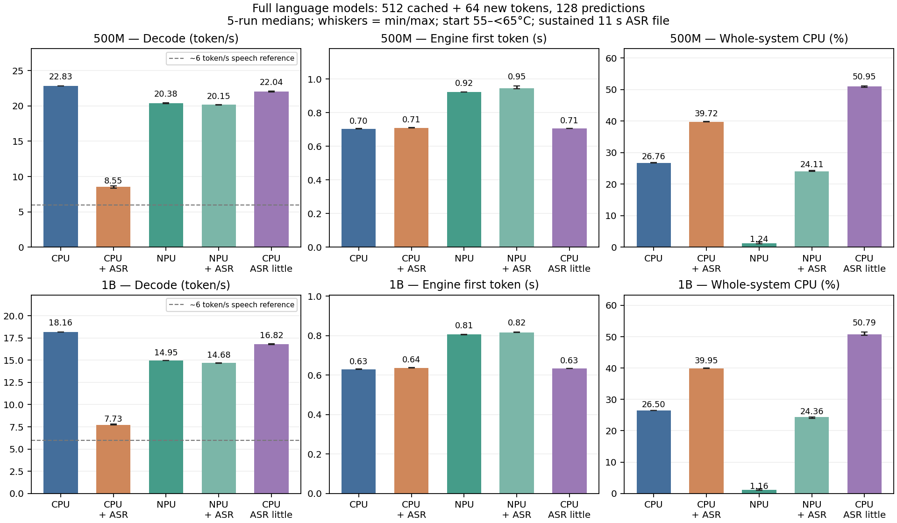

# 真实ASR与LLM并发验收

语音负载为whisper.cpp v1.8.0、多语言tiny Q5_1，两个CPU线程允许在0–7核调度。固定11秒、16kHz、单声道JFK录音，模型和录音常驻，连续重复识别。它是真实识别运算，但属于饱和离线负载，不是实时麦克风调度、中文准确率、AEC或TTS验收。

每个语言模型取512已有历史＋64新增、128次完整预测；500M32层、1B24层、完整词表头。CPU与NPU反馈轨迹相同，NPU先复现全部logits。ASR开关交替，预热一轮、正式五轮；响应起温55–<65°C，推理期间可变化。ASR模型在开关两种条件下都驻留，因此表中体现计算竞争而不混入ASR模型加载。

CPU使用与该NPU候选轨迹对齐的已测Q8配置，具体命令归档；与持续CPU搜索得到的最终最快成绩分开。生产网页CPU模型在两种后端测量期间均保持常驻。

板端音频准备状态：`passed-setup-only`。本机编译/识别smoke通过不代替板端验证；setup通过也不等于并发通过。

| 模型 | 并发任务状态 | 已完成正式测量 / 20 |
| --- | --- | ---: |
| 500M | complete-paired-concurrency | 20 |
| 1B | complete-paired-concurrency | 20 |

| 模型 / 后端 | ASR关→开 decode token/s | 解码变化 | ASR关→开首token s | ASR关→开响应 s |
| --- | ---: | ---: | ---: | ---: |
| smol500 / cpu | 22.825→8.555 | -62.52% | 0.703→0.710 | 6.269→15.559 |
| smol500 / npu | 20.380→20.148 | -1.14% | 0.922→0.945 | 7.156→7.257 |
| intern1b / cpu | 18.163→7.727 | -57.46% | 0.630→0.636 | 7.625→17.076 |
| intern1b / npu | 14.950→14.683 | -1.78% | 0.806→0.817 | 9.302→9.467 |

| 模型 / 后端 / ASR | 整机CPU % | LLM / ASR RSS MiB | NPU驱动 MiB | 最低可用RAM MiB | 换入＋换出 KiB | ASR重叠比例 |
| --- | ---: | ---: | ---: | ---: | ---: | ---: |
| smol500 / cpu / 关 | 26.76 | 817.83 / 102.62 | 0.00 | 4025.4 | 0 | 0.0% |
| smol500 / cpu / 开 | 39.72 | 817.96 / 102.62 | 0.00 | 4026.7 | 0 | 100.0% |
| smol500 / npu / 关 | 1.24 | 20.12 / 102.62 | 607.73 | 3834.7 | 0 | 0.0% |
| smol500 / npu / 开 | 24.11 | 20.12 / 102.62 | 607.73 | 3832.9 | 0 | 100.0% |
| intern1b / cpu / 关 | 26.50 | 1098.14 / 102.80 | 0.00 | 4013.1 | 0 | 0.0% |
| intern1b / cpu / 开 | 39.95 | 1098.51 / 102.80 | 0.00 | 4011.2 | 0 | 100.0% |
| intern1b / npu / 关 | 1.16 | 19.12 / 102.80 | 732.01 | 3723.3 | 0 | 0.0% |
| intern1b / npu / 开 | 24.36 | 19.12 / 102.80 | 732.01 | 3723.1 | 0 | 100.0% |

整机CPU以8核合计100%计算。LLM与ASR的RSS分别列出，驱动不是独立显存；RSS与驱动不能直接相加当作去重物理内存。换页和系统负载只统计完全位于响应内的直接采样区间。不能由CPU占用推算整板功率。

| 模型 / 后端 / ASR | LLM平均占用核数 | ASR平均占用核数 | 响应采样A76 MHz范围 |
| --- | ---: | ---: | ---: |
| smol500 / cpu / 关 | 1.995 | 0.000 | 2002–2002 |
| smol500 / cpu / 开 | 1.332 | 1.783 | 2002–2002 |
| smol500 / npu / 关 | 0.031 | 0.000 | 416–2002 |
| smol500 / npu / 开 | 0.021 | 1.817 | 2002–2002 |
| intern1b / cpu / 关 | 1.992 | 0.000 | 2002–2002 |
| intern1b / cpu / 开 | 1.345 | 1.779 | 2002–2002 |
| intern1b / npu / 关 | 0.029 | 0.000 | 416–2002 |
| intern1b / npu / 开 | 0.021 | 1.821 | 2002–2002 |

平均占用核数=两次直接进程CPU累计时间之差/采样墙钟间隔；2代表约两核计算时间，不表示固定在哪两核。只描述已采样时段；并发还可能有缓存、带宽和线程调度竞争，不能把所有降速归于单一原因。

| 模型 / 语言后端 | 与响应重叠的ASR调用 | ASR整次识别中位 s | ASR整次RTF中位 |
| --- | ---: | ---: | ---: |
| smol500 / cpu | 15 | 6.752 | 0.614 |
| smol500 / npu | 10 | 4.064 | 0.369 |
| intern1b / cpu | 15 | 6.886 | 0.626 |
| intern1b / npu | 15 | 4.041 | 0.367 |

RTF为识别耗时/11秒音频时长，<1表示该文件的处理快于实时。每次ASR完整调用可能延续到LLM响应结束之后，因此RTF是混合时段的实测值，不能当成全程竞争下的严格实时保证。每轮记录重叠率（要求≥95%）、转写原文和单调时钟边界；两后端ASR任务参数相同。

## CPU与语音分核复核

默认ASR两线程可在全部核调度，可能与CPU语言模型争用A76；因此不能把上表的争用损失视为最优CPU并发的必然表现。补充试验固定语言模型原Q8配置，将ASR两线程限制在0–5小核。同样预热＋五轮、同温档、ASR开关交替，保留ASR识别延迟，不能只追求语言速度而忽略音频变慢。该表是调度试验，尚非穷举CPU/ASR联合配置。

| 模型 | 状态 | CPU单独→ASR小核并发 token/s | 首token s | ASR识别 s / RTF |
| --- | --- | ---: | ---: | ---: |
| smol500 | complete-paired-concurrency | 23.049→22.040 | 0.707 | 13.446 / 1.222 |
| intern1b | complete-paired-concurrency | 18.222→16.824 | 0.635 | 15.707 / 1.428 |

图中柱为五轮中位数，误差线为最小至最大；6 token/s虚线仅作口语节奏示意，实际换算随语言和分词器而变，不是质量或吞吐验收门槛。第五根柱（若已完成）为另一次CPU/ASR分核试验，需要结合ASR的RTF判断，不能只按语言token/s宣告更好。

完整原始采样位于本地`npu/results/audio-concurrency-*-20261013`；复现报告：`npu/.venv/bin/python npu/kv-cache/report_audio_concurrency.py`。
