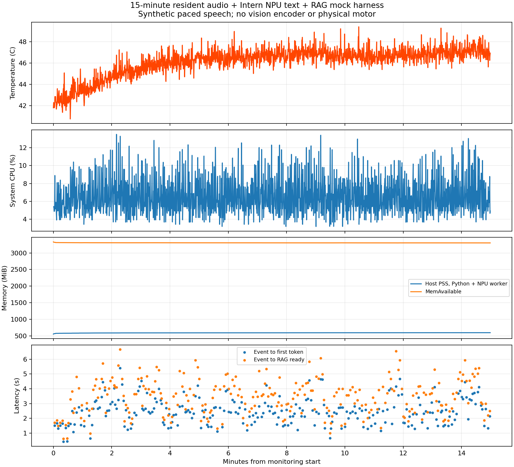

# 常驻语音 → 异步大脑 → RAG模拟执行：端侧测试报告

日期：2026-10-25。权威代码位于 Windows F:/Files/OPi-Lab/repos/OragnePi-3W_ForVLM/research/async-agent-20261025。

**结论：15分钟计算与调度测试跑完，未崩溃、未出现持续音频滞后或swap；但动作决策质量不合格，不能接真实执行器。** 修正提示后的75秒回归改善输出格式，仍发现弯腰被RAG映射成抬头。两版分开报告，修正版没有完成15分钟验证。

## 实际架构

GTCRN降噪 + Silero VAD（0.5s静音）+ Streaming Zipformer Small，16ms流式块常驻；独立墙钟循环播放12条中文合成语音，不等大脑推理完成。最近60秒ASR最终文本队列 + 当前partial；ASR完成后不归档音频并重置VAD。VAD代理时间用于窗口过期，非人工声学终点。没有声音事件/情绪识别。

独立随机事件间隔2–5秒，平均3.496秒。只有大脑接受事件时才执行64-token抽取压缩，随后Intern1B NPU文本推理，BGE-small中文RAG在128个新版家庭原子动作中检索Top3，只模拟执行Top1。固定8秒mock动作被新计划替换，generation ID防止旧tick续跑。单NPU worker + 一个待处理事件槽；本次没有发生覆盖丢事件。

**不是完整视觉VLM测试**：无图片输入和视觉encoder；无真实麦克风、TTS/回声、物理电机。模拟停止耗时不等于电机安全停止时间。

## 15分钟 v1 实测

有效音频56250帧，恰好900.000秒；含收尾900.966秒。257次事件、257次完整推理，256次mock动作启动，最后1个计划在关闭时丢弃。255次新计划抢占 + 1次关闭取消，取消后的旧动作tick为0。说话与大脑任务重叠至少538.29秒，避免了旧测试生成期间只喂静音的问题。

| 指标 | P50 | P95 |
|---|---:|---:|
| 最近一分钟压缩 | 1.45 ms | 1.68 ms |
| 大脑排队 | 0.31 ms | 2.10 s |
| 模型首token（从generate开始） | 2.05 s | 2.70 s |
| 事件→首token | 2.43 s | 4.16 s |
| 模型完整生成 | 2.84 s | 4.09 s |
| RAG embedding + 检索 | 79.1 ms | 109.9 ms |
| 事件→实际mock动作开始 | 3.56 s | 5.41 s |
| RAG就绪→新动作开始 | 0.80 ms | 2.98 ms |
| 新计划就绪→旧动作停止处理 | 0.33 ms | 0.40 ms |
| NPU decode | 13.67 token/s | 14.47 token/s（高值分位） |

事件→动作最大6.66秒，事件→首token最大5.40秒。总输入P50 178 token，输出P50 15 token；至少复用64token系统前缀，复用P50 80token，允许动态相同前缀自然复用。246次EOS、11次32token长度截断，原版没有拦截这些输出。

与早期0.8秒短输入TTFT不能直接比较：本次动态输入更长，同时存在事件排队，且语音/RAG常驻。压缩本身仅毫秒级，主要耗时在大脑新输入prefill与生成。

## 资源、温度与长期趋势

- 整机8核容量归一化CPU：平均6.47%，P95 10.27%，峰值13.48%。不是单核百分比。
- 温度：中位46.50°C，P95 47.74°C，最高49.414°C。
- 本次Python + 实际NPU worker宿主PSS峰值595.95MiB，RSS峰值605.93MiB；不包含其他后台服务，NPU driver独立分配753274680字节（约718.4MiB），不与RSS直接相加当作物理总量。
- MemAvailable最低3301.95MiB；swap in/out均为0。
- 结束后NPU driver当前0，550次分配/550次释放，进程退出码0，无harness异常。内核尾日志有vipcore seq_file遍历警告，不能称内核零警告；未做完整前后内核日志差分。
- 后台已有llama-server驻留约1.94GiB RSS，健康快照显示闲置；未把其RSS计入本次模型进程和。整体可用内存是整机测量。
- TF剩余2.9GiB、使用率96%；本轮没有下载新权重。

| 时间段 | decode P50 | 温度P50 | 宿主PSS P50 | 帧完成滞后P95 |
|---|---:|---:|---:|---:|
| 0–5min | 13.668 | 45.04°C | 589.15MiB | 42.64ms |
| 5–10min | 13.668 | 46.69°C | 591.93MiB | 42.44ms |
| 10–15min | 13.668 | 46.81°C | 594.81MiB | 42.66ms |

温度和decode趋稳，但PSS从初始到结束增加42.26MiB，包含初始化后的高水位增长；后10分钟仍缓慢增加约4.9MiB。**不能凭15分钟证明无内存泄漏**，下一步应做2小时及对象/allocator分析。

## 音频与压缩

每16ms音频帧计算P50 4.10ms/P95 4.93ms，2.56%的帧超过16ms，主要有流式ASR与端点drain的突发。完成滞后P95 42.57ms，最大68.08ms；剔除本帧计算后的启动迟到最大52.25ms。没有持续增长的滞后，但不能称每帧都满足16ms。ASR端点drain P50 57.03ms。

应用pending上限256样本，仅表示应用拼块数组，不包括Sherpa内部缓存，未验证内部缓存逐字节释放；没有一分钟原始音频队列。

131条完整播放产生142段ASR：120条单段，source10的11次重复均因句内停顿分为2段。第132条在结束时未播完。没有发现完整播放音频完全缺final，但source2十一遍均有转写错误；不报告未经人工标注的CER，也不宣称识别质量合格。

压缩输入P50 93token，输出P50 61，最大64，257次均未超预算；内部规则标记的关键子句遗漏0，非空窗口最新子句遗漏0。这不是人工事实保留率，当前语料也不是专门的取消/否定压力集。未来需以独立标签测试任务保真与撤销优先级。

## 决策质量失败与修复回归

v1系统提示混合了聊天助手和“不假装执行”要求，导致动作提示冲突。人工查看257条输出：30个明确运动指令（11.67%），132个拒绝动作（51.36%），94个超出已定义能力的整理/物品操作（36.58%），1个无关文本。实际256次mock启动中226次没有有效运动计划。这是管线缺少合法性门控的问题，不应把拒绝文本正常交给RAG。

30个有效运动均为点头，RAG30/30返回点头一次；这仅是运动指令到候选一致性，不是整体情景正确率。

修正版v2使用专用动作规划system，增加拒绝、超能力关键词和截断拦截。75秒短回归：20次推理，19次mock启动，1次关闭丢弃；无异常、结束driver0。事件→首token P50 1.595s，事件→实际mock开始P50 1.922s/P95 3.026s；decode P50 13.81token/s。

但20次输出为16次保持静止、2次弯腰、2次摆臂；弯腰两次均被Top1错误映射为抬头，**RAG兼容性仍不合格**。保持静止虽格式合规，不能据此声称主动陪伴质量提升；输出更短及语料窗口不同，也不能把短回归速度提升当作受控加速结论。

## 下一步，按优先级

1. RAG加入身体部位与动作方向兼容性门控；弯腰不得用抬头代替，拒绝/闲聊/截断输出不得进入执行器。TopK按可执行C/有条件U/明确冲突N评估。
2. 用包含否定、撤销、重复、改口、无动作必要情景的家庭对话集校准规划质量；不能只优化格式与速度。
3. 继续优化prefill输入与触发去重；保留当前结果作为真实基线，不把短prompt旧成绩替代本场景。
4. v2及后续兼容性修复后重新跑15min，再做2h内存稳定性；真实麦克风/噪声/视觉/电机另测。

## 复现与证据

- 900秒v1源码：harness_v1.py；SHA e8b0c4453ac1dd5cda216cfd0e504b817b3ce85e41b728fc67a378633988278c。
- 75秒v2源码：harness.py；SHA d6f7249f083fcbc17ecc1ff36d4e48ae436434d72312a32fdbd5c00b0e895009。
- Windows results/stress15-v1 与 results/regression-v2 含原始JSONL、meta、summary、NPU日志；本地Mac报告目录保留v1原始JSONL与summary。
- controller.py通过Windows/WSL持双锁部署；summarize.py生成统计；AUDIT.md包含独立审计。
