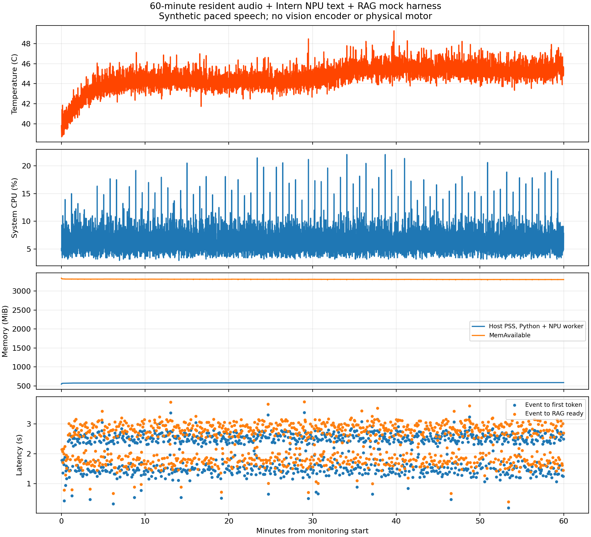

# 常驻语音＋异步大脑＋RAG：1小时端侧报告

日期：2026-10-25。版本stress60-v2。

**板端工作负载完成，远程控制器收尾失败后已恢复全部数据。动作正确性仍未验收。**

模型/系统设置：GTCRN、Silero VAD(0.5s)、流式Zipformer、BGE-small中文常驻；Intern1B NPU文本decoder，无视觉encoder。16ms合成中文语音循环；独立2–5s事件，一次一个NPU请求、有界待处理槽；固定8秒mock动作被新计划抢占。无真实麦克风、TTS或电机。

## 完成与控制器异常

板端225000帧＝3600.000秒有效音频，含收尾3602.491秒；1022事件/1022推理，1021次mock启动，最后1个计划关闭丢弃。1020次新计划抢占，另1次关闭取消；取消后旧tick为0，未记录事件覆盖、模型异常或超温停止。所有输出EOS。

原控制器等SSH命令3840秒后超时，未进入自动文件回收。随后读取板端meta=complete、closed事件driver_bytes=0，进程检查未发现本次harness/NPU子进程，驱动当前0且550分配/550释放。重新持锁复制55MiB原始日志并汇总。不能把controller失败改写成exit0；板端wrapper退出码未成功回收，SSH未结束根因尚未确定。

已为后续配对改为独立日志/退出文件与短SSH轮询，避免依赖单条一小时连接；这是控制器修复，未改写本次证据。

## 性能

| 指标 | P50 | P95 |
|---|---:|---:|
|压缩|1.396 ms|1.626 ms|
|事件排队|0.193 ms|567.509 ms|
|模型首token|2.331 s|2.733 s|
|事件到首token|2.348 s|2.754 s|
|模型完整输出|2.493 s|3.030 s|
|RAG|60.040 ms|70.484 ms|
|事件到实际mock开始|2.584 s|3.107 s|
|新计划到旧动作停止处理|0.352 ms|0.478 ms|
|RAG就绪到新动作开始|0.524 ms|2.849 ms|

Decode P50 13.501 token/s。动作开始最大3.739s，事件到首token最大3.376s。此指标不是用户真实说完到首字。

固定system86token（含模板）；总输入P50 209，非system输入P50 123（含模板与动态指令），新prefill P50 106，复用P50 96；摘要P50 61/上限64，输出P50 5、范围3–5（含EOS）。**这是旧64摘要+partial+动态指令方案，不是新要求的仅32-token abstraction。**

## 资源和稳定性

整机8核CPU平均6.237%、P95 9.828%、峰值22.034%；温度P50 44.702°C、P95 46.252°C、最高49.290°C。宿主Python+NPU worker PSS峰值585.660MiB、RSS595.555MiB；NPU驱动另列753274680字节，不直接相加为物理总占用。MemAvailable最低3293.707MiB，swap in/out均0。后台其他常驻服务不计入本次进程和。

| 区间 | 事件→首token P50 s | Decode P50 tok/s | 温度 P50°C | PSS P50 MiB |
|---|---:|---:|---:|---:|
|0–5min|1.773|13.665|42.47|573.73|
|5–10min|2.336|13.549|44.02|574.59|
|10–15min|2.364|13.491|44.21|575.77|
|15–20min|2.379|13.480|44.14|577.60|
|20–25min|2.353|13.517|44.14|577.88|
|25–30min|2.329|13.473|44.21|579.58|
|30–35min|2.391|13.520|44.83|579.86|
|35–40min|2.405|13.510|45.45|580.91|
|40–45min|2.345|13.486|45.45|581.91|
|45–50min|2.378|13.451|45.38|582.75|
|50–55min|2.332|13.472|45.20|583.80|
|55–60min|2.338|13.427|45.32|584.80|

PSS初末增加41.891MiB，包含早期高水位增长；5–10min中位574.59MiB，55–60min584.80MiB，后期约0.20MiB/min缓慢上升。没有本次OOM或swap，但**尚未证明内存最终收敛/无泄漏**，应做allocator/对象分析和更长测试。独立原始记录审计：帧ID连续1..225000，推理ID与1022个触发ID完全对应，无旧版本残留tick或时戳倒退。前/后半小时事件→首token中位2.333→2.380秒、P95 2.740→2.760秒，decode13.521→13.483t/s；整机CPU平均6.233→6.240%。延迟各区间没有持续爬升，温度整体稳定；不能仅凭这些推断没有任何频率波动。

## 音频与压缩边界

说话与大脑任务重叠1747.21秒。帧计算P50 4.05ms/P95 4.93ms，5771/225000=2.565%超过16ms帧预算；帧完成滞后P95 42.34ms、最大80.01ms，各5分钟P95约42ms，未持续增长。应用pending只是一部分音频缓冲，未测Sherpa内部缓存；ASR后无应用音频归档。

525条完整播放产生568段final，涉及VAD句内停顿切分；重复语料不等于525个独立样例。没有人工CER/声音事件理解或真实麦克风验证。

1022次压缩均不超过64token；内部关键/最新子句遗漏标志为0，仅为规则自检，不能冒充人工语义保真率。

## 决策质量与后续

本版本虽输出短动作，仍存在弯腰→抬头的已知RAG兼容性错误，保持静止占比高，不以资源稳定宣称情景理解/执行决策正确。独立审计1022条输出：保持静止644（63.01%）、弯腰196（19.18%）、摆臂166、点头回应16；未触发基本拒绝门控。196次弯腰全部被Top1映射为抬头（候选文字还明确“不同时弯腰”），属于明确冲突。保持静止的Top2/3出现前后移动，不能把Top3同时执行。模拟抢占不是物理电机停止时间。结束后健康快照可见MMC DMA timeout告警，发生在工作负载结束后；未做完整日志基线差分，不能归因于本次测试，也不能宣称内核/TF完全健康。

下一步配对：相同86token系统约束，动态正文仅最近1分钟abstraction且<=32token，partial也计入32；去除动态重复指令。单独记录正文、模板、实际新增prefill。先新跑300秒v2再300秒32版本，记录顺序/热状态；压缩更短可能丢信息，需比较遗漏标志和动作输出，不能只比速度。

## 证据

源码SHA d6f7249f083fcbc17ecc1ff36d4e48ae436434d72312a32fdbd5c00b0e895009。权威结果：research/async-agent-20261025/results/stress60-v2。controller失败记录与stress60-recovery-status.json分别保留，meta/events/resources/npu.log/summary/post-health均已取回。
