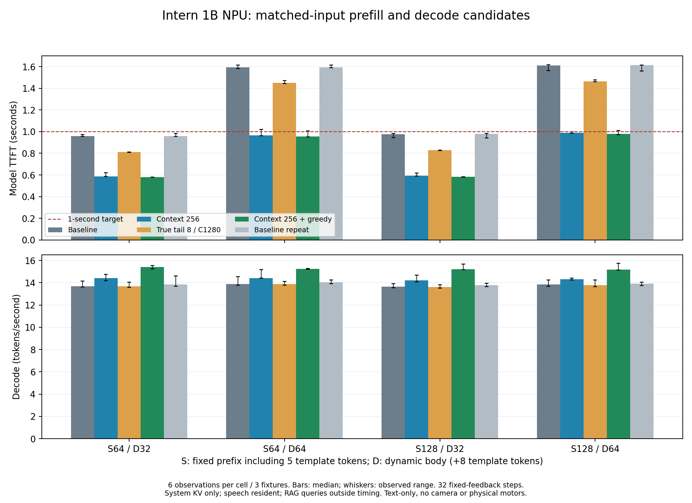

# Intern 1B NPU：同输入 prefill / decode 优化（第一轮完整矩阵）

2026-10-25。candidate-matrix-r3 完成：returncode=0，144次性能、72次自然输出、24次cost输入自然生成、24份4步完整logits，6次关闭均driver=0。r2因统计字段缺失停止，失败证据独立保留，未混入本表。

**结论：短文本容量256 + 单遍argmax候选将TTFT中位数降至0.58秒（动态正文32）及0.95–0.98秒（64），decode约15.2–15.4 tokens/s；64正文仍有少数约1.01秒，尚不能承诺全部<1秒。组合真8尾批继续单独验证，未替换默认运行时。**

## 对齐契约

| 固定前缀 | system正文 | system模板 | 动态正文 | 动态模板 | 总输入 | reused | new prefill | 性能输出 |
|---:|---:|---:|---:|---:|---:|---:|---:|---:|
|64|59|5|32|8|104|64|40|32|
|64|59|5|64|8|136|64|72|32|
|128|123|5|32|8|168|128|40|32|
|128|123|5|64|8|200|128|72|32|

同格完整token IDs、量化来源、CPU亲和和背景负载对齐。每次只复用system KV，prefix准备不计入TTFT。性能32步使用固定反馈token 100662，并非32-token自然回答；decode=31/(total−TTFT)。每格3场景×2次，共6观察，P95为观测最大值。标点填充的成本fixture与12条自然样本分开。

## 全部性能结果

| 配置 | 固定/动态正文 | TTFT P50 / P95(s) | <1s | prefill P50(s) | decode P50(tok/s) |
|---|---|---:|---:|---:|---:|
|mask-base|64/32|0.9595 / 0.9732|6/6|0.9314|13.68|
|mask-base|64/64|1.5953 / 1.6139|0/6|1.5651|13.89|
|mask-base|128/32|0.9767 / 0.9820|6/6|0.9435|13.66|
|mask-base|128/64|1.6104 / 1.6179|0/6|1.5796|13.84|
|context256|64/32|0.5881 / 0.6199|6/6|0.5624|14.43|
|context256|64/64|0.9644 / 1.0194|5/6|0.9386|14.41|
|context256|128/32|0.5935 / 0.6183|6/6|0.5665|14.20|
|context256|128/64|0.9894 / 0.9984|6/6|0.9620|14.32|
|tail8-c1280|64/32|0.8108 / 0.8127|6/6|0.7804|13.68|
|tail8-c1280|64/64|1.4513 / 1.4701|0/6|1.4198|13.88|
|tail8-c1280|128/32|0.8283 / 0.8305|6/6|0.7938|13.63|
|tail8-c1280|128/64|1.4656 / 1.4765|0/6|1.4324|13.79|
|greedy-c1280|64/32|0.9507 / 0.9728|6/6|0.9296|14.64|
|greedy-c1280|64/64|1.5833 / 1.6055|0/6|1.5621|14.60|
|greedy-c1280|128/32|0.9716 / 0.9733|6/6|0.9473|14.62|
|greedy-c1280|128/64|1.6014 / 1.6074|0/6|1.5780|14.64|
|context256-greedy|64/32|0.5786 / 0.5811|6/6|0.5603|15.41|
|context256-greedy|64/64|0.9544 / 1.0068|5/6|0.9358|15.25|
|context256-greedy|128/32|0.5815 / 0.5826|6/6|0.5615|15.20|
|context256-greedy|128/64|0.9782 / 1.0105|5/6|0.9577|15.19|
|mask-repeat|64/32|0.9582 / 0.9821|6/6|0.9286|13.84|
|mask-repeat|64/64|1.5931 / 1.6153|0/6|1.5636|14.04|
|mask-repeat|128/32|0.9785 / 0.9821|6/6|0.9471|13.79|
|mask-repeat|128/64|1.6139 / 1.6161|0/6|1.5818|13.93|

末尾mask-repeat与开头同输入配对TTFT中位ratio约1.00083，decode约1.00565；主要收益大于这次前后漂移。CPU频率由系统动态调节，未锁频，详见summary_next.json。

## 数值与语义质量

- 所有候选12条自然输出与4条cost自然输出均与基线逐token一致。ctx256 / ctx256-greedy的24条32步固定反馈预测全一致。
- ctx256及ctx256-greedy相对原图全词表logits的relative L2约2.93–3.26%；图尺寸改变影响了NPU数值计算，不能称bitwise无损。单遍argmax单独启用保持完整logits同字节；ctx256与ctx256-greedy也同字节。
- tail8-c1280固定反馈仅22/24条整序列相同：s64-d64-2的两次重复均在首token从117057（“挥手”）变为114209（“举起”），其后31步一致。原4份诊断只覆盖case0，不能掩盖此差异；该候选未准入默认。
- 基线12条自然场景目标完成9/12；3次静止是保守退让而非完成指令。RAG Top3有9/12组含明确原指令冲突，不能按Top3全部执行。性能parity不代表正确决策，所有动作仅mock。

## 资源

| 配置 | 性能阶段全机CPU均值 | 全阶段最高温度℃ | harness+worker PSS峰MiB | NPU driver MiB | 最低MemAvailable MiB |
|---|---:|---:|---:|---:|---:|
|mask-base|7.50%|50.53|582.6|718.4|3283.0|
|context256|7.23%|52.45|573.8|666.4|3341.9|
|tail8-c1280|7.40%|53.32|595.5|1019.7|2951.5|
|greedy-c1280|7.20%|52.89|587.8|718.4|3266.0|
|context256-greedy|6.91%|53.07|575.2|666.4|3316.5|
|mask-repeat|7.45%|53.07|587.5|718.4|3266.0|

整轮最高53.32℃，全机CPU平均7.59%（8核归一化），harness+worker PSS峰595.5MiB，整机可用内存最低2951.5MiB。交换写出1013页，读入0页；实测页大小4096 B，约3.96MiB；收尾SwapUsed约9MiB。不能报swap=0。

PSS仅采样进程树，不含所有后台服务；driver单列，不能简单把PSS差值当独立模型footprint。各候选共享Python宿主进程，allocator可能保留前段高水位。performance阶段仍包括system KV重新准备。

语音前处理、降噪、VAD、流式ASR及RAG常驻；音频是实时回放合成录音，RAG仅自然质量阶段查询。最大音频滞后0.704s首次出现在最初图SHA校验阶段，之后未增加；这不等于全链路端到端<1s，也不是新的1小时稳定性测试。

## 适用范围和版本

- 这是Intern NPU文本decoder实验，无图像编码器、真实麦克风或电机。
- ctx256仅供本轮短文本窗口。最大prompt200，32输出占用231 KV位置；该格不能扩至64输出，更不能添加256图像tokens。
- 本轮不自动替换现役默认；组合尾批的后续结果必须独立报告。
- Windows权威仓库：F:/Files/OPi-Lab/repos/OragnePi-3W_ForVLM。实验源码checkpoint f36733f已推GitHub；原始大f32、ELF和模型图留磁盘，Git保留源码/配置/哈希/报告。
- 独立审计见同目录INDEPENDENT_RESULT_AUDIT.md/json，详细机器统计summary_next.json，完整分项REPORT_NEXT.md。
