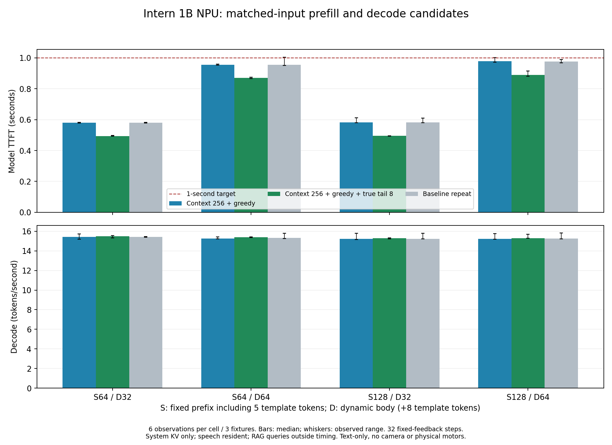

# Intern 1B NPU：同输入 prefill / decode 优化报告

2026-10-25，combined-matrix-r2。Windows权威源码；Mac仅保存报告副本、转发Git对象。

**短文本候选达到目标：动态正文32 token首token中位数约0.49秒，64 token约0.87–0.89秒；24次性能请求全部小于1秒，最大0.916秒，decode约15.3–15.5 token/s。整轮72次性能、36次自然请求、36次成本输入自然生成、15份完整logits诊断完成，3组正常关闭driver=0。**

这是缓存好system后的模型TTFT，不含VAD端点、摘要、排队、RAG或动作执行。旧组合r1曾在关闭时报堆损坏；新v2保守调整释放顺序后复测通过，但原根因未定位，未替换默认Agent运行时，也未重跑优化版1小时。

## 输入与对照口径

|固定前缀|system正文|system模板|动态正文|动态模板|总输入|reused|new prefill|性能输出|
|---:|---:|---:|---:|---:|---:|---:|---:|---:|
|64|59|5|32|8|104|64|40|32|
|64|59|5|64|8|136|64|72|32|
|128|123|5|32|8|168|128|40|32|
|128|123|5|64|8|200|128|72|32|

每请求重置后仅准备system KV，不使用前次动态KV。同格完整token IDs、权重及量化常量、亲和及背景负载一致。精确长度使用少量标点补齐，只是成本fixture。性能输出32步使用固定反馈token100662，decode计31个后续间隔，不是32-token自然回答。每格3场景重复2次，P95取观测最大值，小样本不能保证长期全部达标。

## 首token与decode

|固定/动态正文|旧C1280 mask基线 TTFT P50(s)|本轮C256+greedy基线(s)|加真8尾批 P50 / P95(s)|<1s|prefill P50(s)|decode P50(token/s)|
|---|---:|---:|---:|---:|---:|---:|
|s64-d32|0.9595|0.5794|0.4938 / 0.4974|6/6|0.4752|15.50|
|s64-d64|1.5953|0.9550|0.8698 / 0.8750|6/6|0.8508|15.38|
|s128-d32|0.9767|0.5832|0.4948 / 0.4965|6/6|0.4756|15.29|
|s128-d64|1.6104|0.9788|0.8905 / 0.9156|6/6|0.8705|15.30|

旧C1280基线来自前轮r3，同fixture/负载契约；本轮C256基线→真8→C256复测才是同轮对照。不能将跨轮差值全部归因某一修改。完整12格、分段decode和new/reuse见REPORT_NEXT.md，前后漂移见独立审计。

## prefill为什么变快

1. 原图容量1280，短prompt仍承担大容量注意力/缓存形状的成本。短文本图改为256，保留当前全部有效输入；r3中C256+greedy已把64正文TTFT从约1.60秒降至约0.96秒。
2. 实际新prefill40/72正好是2/4个完整16批次加8-token尾部。专用8行图替代尾部16行padding，再省约0.086–0.088秒；本轮每次实际调用1次真8图。
3. INT16输出头单遍argmax主要改善decode采样开销；r3中decode由约13.7–13.9提高到约15.2–15.4 token/s。本轮加尾图后仍约15.3–15.5，不把微小差异当作新decode算法收益。

组合版prefill仍约0.475秒（32正文）/0.851–0.871秒（64正文），head约18–19ms。进一步裁掉图内确定无效历史槽位的方案见intern-context256-20261025/OPT_NEXT_PREFILL.md，尚未编译/实测，收益未知。

## 数值、自然输出与动作质量

- 相对本轮C256基线：24/24固定反馈预测序列、12/12自然输出、12/12精确长度成本自然输出完全一致；5对4步全词表logits逐字节一致，包括此前C1280真8出现差异的s64-d64-2。独立审计重新读实际f32核对SHA、长度和finite。
- C1280→C256改变图形状，r3全词表relative L2约2.93–3.26%，不能称对旧图bitwise无损。同小集合token一致不是普遍精度保证。
- C1280+真8原来的“挥手→举起”首token差异仍保留，不能与本次C256组合混淆。
- 原自然场景目标完成9/12，3次静止是保守退让。RAG Top3仍有冲突，如静止→前移/后移、点头→摇头，禁止直接执行全部Top3。本轮仅记录检索，没有电机动作。

自然质量组固定64=正文59+模板5：动态正文min/P50/max=4/11/21，另模板8，总输入=76/83/93，实际new=12/19/29；输出含EOS=4/5/5，去末尾EOS=3/4/4。这组自然短输入不替代上方32/64精确长度性能结果。

自然质量组固定128=正文123+模板5：动态正文min/P50/max=4/11/21，另模板8，总输入=140/147/157，实际new=12/19/29；输出含EOS=3/4.5/5，去末尾EOS=2/3.5/4。这组自然短输入不替代上方32/64精确长度性能结果。

## 资源与范围

整轮全机CPU均值7.20%（8核归一化），最高温度50.282℃，load1峰4.11；harness+worker PSS峰591.9MiB，最低MemAvailable 3065.1MiB。

|配置|性能阶段CPU均值|全阶段最高温度℃|PSS峰MiB|NPU driver MiB|
|---|---:|---:|---:|---:|
|combined-base|6.94%|49.910|584.9|666.4|
|combined-tail8|7.11%|49.910|591.9|942.4|
|combined-repeat|6.98%|50.282|589.8|666.4|

真8额外图增加约276MiB driver常驻内存。PSS仅采样harness/worker，driver单列，不能直接相加当作唯一物理内存；三组共用Python宿主，allocator可能保留高水位。CPU动态调频，未锁频。

swap读入0页、写出1708页×4096B=6.672MiB，集中在tail图load阶段；三个性能阶段没有新增swap写出。收尾整机SwapUsed约59.5MiB是累积占用，不能报swap=0。独立收尾driver0、alloc/free=550/550，MemAvailable约4478.3MiB，温度43.772℃。

语音前处理、降噪、KWS、VAD、流式ASR及RAG常驻；实时回放合成录音，RAG只在自然质量阶段查询。记录31514帧、77端点、audio error为空、overruns计数1566；最大滞后0.649秒最早快照已出现，之后未增长，不能称无滞后。queue=1指一段WAV任务，不是原始采样数量。

本轮控制器约9.2分钟，计时与质量/诊断分开；仅Intern NPU文本decoder，无视觉编码器、真实麦克风或电机，不是新一小时全agent测试。

## 关闭问题与候选状态

旧combined-matrix-r1完成推理后报double free or corruption(out)，整轮失败。原ASan完整重放和原O2详细关闭日志重放均正常，不能据此证明旧错误消失；ASan leak detection关闭，SDK自有内存池也限制其覆盖。

v2只将关闭顺序改为全部group→全部network→自有buffer，所有推理模块不变。3次最小加载/请求/关闭成功，随后本轮三个完整配置均正常closed、driver0。原失败根因仍未知，属于候选有限验证，不宣称根治或默认部署。详见../CLOSE_INVESTIGATION.md和本目录INDEPENDENT_RESULT_AUDIT.md/json。

最大prompt200、输出32占用231个KV位置；C256不能在最大格输出64，更不能追加256图像token。长上下文/视觉保留原容量路线。

## 复现与后续

- 配置config.combined-v2.json；controller_next.py combined-matrix-r2；已存在run名不可复用。binary SHA ff758d8eb013b7ebd05eae1f95634ecef065b92f0bf1fca7b292256351a2900d，源清单见intern-nextopt-20261025/runtime-combined-v2/FINAL_DELIVERY.json。
- events/resources、graph-provenance、fixtures/provenance和大f32留Windows；Git保存源码、配置、哈希和报告，忽略ELF/模型/大诊断数组。
- 实验源码checkpoint c660150已同步GitHub；本报告与最终审计在同一个后续结果提交归档，最终SHA以Git历史为准。Windows推送超时后用Mac临时bare仓库转发Windows bundle，没有在Mac编辑源码。
- 未完成：旧close确定根因、更广自然输入质量、优化版长稳、真实语音/视觉、RAG兼容门控、图内有效历史裁剪实验。
