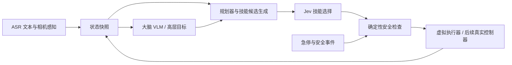

# Jev 端侧动作决策：架构审计与分阶段验证计划

日期：2026-10-20。目标平台：Orange Pi Zero 3W（实际板卡 6×A55 + 2×A76，Linux 可见内存约 5.7 GiB）。代码与实验资料存放 Windows F 盘项目，WSL 编译和开发，Windows 跳板连接板卡。

**当前执行边界：先完成板卡诊断；后续只写计划。暂不训练、后训练、模型 adaptation，不继续下载或启动模型测速。** 100 动作与 140 条合成样例已生成；它们尚未经过任何 Jev 模型推理，没有实际准确率和端侧延迟结果。

## 1. 融合后的机器人架构

保留用户提出的异步三层设计：

- 大脑：接收 ASR 文本、场景/人物/可交互对象等感知，生成高层目标与受约束技能意图。优先复用用户期望的常驻 NPU VLM；其实际部署及 KV cache 能力需单独验证。
- 执行规划器：依据电量、活动时间、用户习惯、性格等调节主动交互和重新规划的频率，管理状态版本、取消、截止时间、技能前置条件。
- 技能选择与执行：Jev 在有限候选技能中选择；确定性执行器负责安全检查与动作完成。连续关节控制、碰撞避让、平衡反馈由专用控制器负责，不能由 Jev 一次分类替代。VLA 作为未来可选执行支路。

所谓疲劳影响主动动作和思考节奏，不能降低急停、限位或安全反馈频率。大脑输出关节意图也必须经限幅、速度/加速度约束、姿态和安全状态验证。E902 能否承担本机控制，需要验证具体固件、SDK 和通信实时性，不能只根据芯片有协处理器就承诺可用。



初期虚拟链路：状态输入 → 候选构建 → 分词 → 模型评分 → 选择/拒绝 → 安全门 → mock 执行回执。语音、VLM 与真实电机不包含在该阶段测速里，后续逐层加入。

大脑不是固定每秒运行 1–2 次。它应由新事件、状态变化和任务完成驱动，实际最高频率由 P95 延迟及资源预算决定。异步系统采用有界队列和最新状态优先，防止积压的旧决策让机器人做出过时动作。

## 2. 对综合研讨内容的关键修正

| 原论断 | 本项目采用的判断 |
| --- | --- |
| Jev 自动把 100 动作内化为固定输出头，不再输入动作描述 | 很多现成 Jev 模型仍需要输入候选描述；不能自动省掉候选上下文。固定 100 类专用头通常要训练或适配，此轮不做 |
| 100 个中文动作描述就是 400 token | 中文字符不等于 token；描述、ID、模板、分隔符和特殊 token 均需按每个模型的 tokenizer 实测 |
| NPU 5–60 ms、30–60 Hz，完全不与大脑争算力 | 没有本板实测支撑；共享 NPU、内存带宽和 CPU 调度会竞争 |
| 少参数必然同等精度、更优中文理解 | 取决于任务数据、候选集合、微调方式和读出结构；不能只由参数量或 Qwen 血统推断 |
| 所有模型原生返回完整 logits，零开销 | 具体运行时/API 不同；有些仅提供概率或分数。按实际接口记录，不能由概率反推唯一原始 logits |
| INT8 对输出分布影响小于 1% | 未验证；需和同一模型浮点输出配对比较，不作预设结论 |
| 用概率直接融合多个动作、把熵当情绪 | 互斥动作不能按概率混合；置信不确定性与产品情绪状态分开 |
| 新增动作只微调输出头即可 | 动态候选模型通常可添加描述但要重新评估；固定头模型改变标签空间后需数据、训练和校准 |
| Jev 替代整个小脑或 VLA | 能替代有限技能选择的一部分，不能替代连续运动反馈与通用视觉动作策略 |

NPU 编译器支持、量化链路和自定义 attention/head 是否可转换是独立门槛。已有 1B LLM 能在 NPU 运行，不代表编码器或 Qwen3.5/自定义 Jev 结构直接兼容。先 CPU 正确性与速度，再决定是否值得移植 NPU；保留常驻 VLM 的算力优先级。

## 3. 模型候选与待下载清单

下表中的外部性能仅是作者公开条件下的报告，**不能换算成本板速度**。本板准确率、P50/P95/P99、峰值 RSS、功耗和 NPU 兼容性全部待测。

| 优先级 | 模型 / 发布方 | 参数与文件 | 用途与限制 |
| --- | --- | --- | --- |
| P1 | convaiinnovations/laya-multilingual | 322M；主要 safetensors 643835514 bytes，约 614 MiB；Apache 2.0 | 低成本编码器基线，适合分层 10 类→10 动作。模型卡建议候选少于约 20；默认 question/options 预算 256 token，不能直接保证容纳 100 动作 |
| P1 | chaoliangUNSW/Jev-Style-0.8B-Decision-v3-GGUF | 0.8B；Q4_K_M 约 0.53 GB，Q8_0 约 0.81 GB，F16 约 1.52 GB | 首个全 100 候选评分验证对象；需要配套 jev-score，而不是普通 chat 生成。question/options 预算 2048，仍需检查真实 token 与分块实现 |
| P2 | aimeigaoshou/agent-jev | 0.6B，Qwen3 系列+候选读出；BF16 权重量级约 1.2 GB，实际文件按仓库核验 | 验证另一种模型/评分头；ARM 运行与量化支持待测 |
| P2 | chaoliangUNSW/MacJev-322M-4K-Laya | 321908995 参数；约 1.29 GB FP32 权重理论量，不是 RSS | Laya 运行时对照；4096 输入、1024 question/options 预算；Mac 任务训练域不等于机器人任务 |
| P3 | OmniJev/OneJev1.6-0.8B | 0.8B 标称；实际总权重须含视觉编码器核验 | 后续图像+文本原生决策；先确认模型结构、图片预处理与 ARM 支持 |
| 观察 | C-Tianyu/NanoJev | 0.6B，游戏决策用途 | 可作专项对照，不能当作已证实的中文通用机器人选择器 |
| 观察 | Chinese-Jev / CJ-Medical | 论文描述 322M；存在医疗方向公开权重 | 不把“中文专项”直接等同机器人领域高精度 |
| 暂缓 | Kev、LaKun、AnyJev、Jevlike | 型号、权重、协议、当前实现分别核验 | 不采用研讨表中的未核实板端延迟、候选上限与多模态能力；工具链也不能当成独立权重 |

先准备 Laya 和 Jev-Style Q4 的完整可复现包，其余按测量结果扩展，避免一次下载所有大文件。实际 RAM 会包括权重映射、激活、运行时、分词器与页缓存；不能用文件尺寸代替 RSS/PSS。

已检索到的外部性能参照：

| 模型 | 来源条件与作者报告 | 不能据此得出的结论 |
| --- | --- | --- |
| Laya multilingual | NVIDIA T4：1 个问题约 32.8 ms；10 个问题 72.3 ms；50 个问题 337 ms | 不是 A733 数据；问题数也不等同候选动作数 |
| Laya multilingual | MASSIVE 51 语言 20-way 宏平均约 0.366；非英语 XNLI 约 0.731；模型卡提示温度 1 未做校准 | 不能保证本项目中文动作准确率或直接设高置信阈值 |
| Jev-Style v3 | 作者 JevBench 231 条约 64.1%；RTX 5090 CUDA graph 示例 11.3 ms | 不可与不同任务的其他 GPU 数据横比；240/240 量化一致性样例不等于泛化精度 |
| AgentJev | RTX 5060 示例 5 问约 43.89 ms；BF16 GPU 常驻约 1443 MiB；typed teacher agreement 79.25% | teacher agreement 不是机器人动作成功率 |
| OneJev | H200，1280×720 截图示例：单问约 31 ms、10 问约 51 ms | 不是本板、多模态总延迟或真实物理动作完成时间 |

来源：

- [Laya 模型卡](https://huggingface.co/convaiinnovations/laya-multilingual)
- [Jev-Style v3](https://huggingface.co/chaoliangUNSW/Jev-Style-0.8B-Decision-v3)；[GGUF](https://huggingface.co/chaoliangUNSW/Jev-Style-0.8B-Decision-v3-GGUF)
- [AgentJev 模型](https://huggingface.co/aimeigaoshou/agent-jev)；[代码](https://github.com/malevrigns/agent-jev)
- [MacJev](https://huggingface.co/chaoliangUNSW/MacJev-322M-4K-Laya)
- [OneJev 项目](https://github.com/OmniJev/OneJev)；[模型](https://huggingface.co/OmniJev/OneJev1.6-0.8B)
- [NanoJev](https://huggingface.co/C-Tianyu/NanoJev)
- [Chinese-Jev 论文](https://arxiv.org/abs/2609.36965)
- [NavJev](https://arxiv.org/abs/2609.34969)、[Jev-Mobile](https://arxiv.org/abs/2609.30186)、[Visual Jev](https://arxiv.org/abs/2609.25845)：作为分层/视觉决策思路参考，不使用其指标推断板端表现。

## 4. 已准备的虚拟动作集合

[actions.json](actions.json)：100 个动作，A000–A099；10 组，每组 10 个；每条描述严格 4–8 个中文字符。全部 virtual_only=true。人类可读表见 [ACTION_DICTIONARY.md](ACTION_DICTIONARY.md)。

[cases.json](cases.json)：140 条初始样例：

| 子集 | 数量 | 解释 |
| --- | --- | --- |
| literal | 100 | 指令直接出现动作名称；只验证标签匹配和链路机制 |
| paraphrase | 32 | 人工改写日常表达；小规模零样本诊断 |
| unknown | 4 | 超出动作集合，期望澄清/拒绝 |
| safety | 4 | 安全急停场景，验证确定性覆盖 |

这一规模只能用于功能排错和初步差异分析。不能把 100 条含标签样例的正确率称为自然交互准确率；4 条安全样例通过也不代表安全认证。动作都只是技能意图，实际硬件是否拥有手臂、移动和充电能力未知，未来执行前必须按能力白名单筛选。

## 5. 分阶段链路和验收

### S0：板卡与可复现环境

- 已完成：连接、资源和日志诊断，见 [BOARD_DEBUG_20261020.md](BOARD_DEBUG_20261020.md)。
- 后续先处理/解释 MMC 超时，确认稳定的维护与备份方案；本次不做高负载。
- Windows 项目独立目录保存代码、结果与模型清单；不切换主线程分支，不改其常驻服务。
- 每个模型冻结 repo revision、权重 SHA256、许可证、完整文件清单和运行时版本。
- Laya 当前目标 revision：1720e3e3357cfe1e281542e223f8273b0890ca34；主权重上游 SHA256：9d628fd971b700382ac6f65920a86f149777b2e748e0c955fb3b19695aa8f204。
- Jev-Style 配套 llama.cpp/scorer 参考提交：441df11f65ea0b6d0c72965aaf70c8241070ddcb；下载前再次核验该提交与选定模型兼容。
- 离线验收要断开模型运行时的外网依赖，完整保留 tokenizer/config/自定义实现；不把部分下载称为部署成功。

通过条件：完整权重哈希通过，离线单样本评分成功，输出长度和候选对应关系正确，超出限制明确报错，不静默截断。

### S1：WSL 验证机制与候选成本

两条技术路线均保留版本：

1. **全量候选直接选择**：状态+100 描述 → 一次完整评分（或运行时明确支持的分块全量评分）→ 动作 ID。
2. **分层选择**：状态+10 组描述 → 组选取 → 状态+所选组 10 动作 → 动作 ID。必须测两次调用总时间和组路由错误导致的最终错误。

可追加检索 top-k 后评分，但必须单列检索 recall@k、最终动作准确率与检索耗时，不能用只保留答案的候选集制造高分。

候选数扫描 4/8/16/32/64/100；每个模型实测分词总量、候选模板开销、实际模型序列长度和溢出率。对于不支持的候选规模，报告 unsupported，不强行截短动作描述或丢弃候选。分层策略加确定性安全覆盖，以免急停动作被错误路由过滤。

WSL 结果仅用于机制和桌面基线，不能代表 ARM/NPU。该阶段不训练，使用已有权重，固定 prompt 模板和随机种子。

### S2：板端 CPU 推理与虚拟执行完整链路

先用经过验证的运行时做最短路径：Laya 编码器基线 + Jev-Style Q4 自定义 scorer。对不可运行的算子，记录失败原因，再评估 ONNX 或其他格式转换，不预设一定可转换。

测量：

- 冷启动：进程启动、权重加载、首次推理分别计时；页缓存是否已热要记录，不能在共享机器上清空全系统缓存冒充公平测试。
- 热启动：常驻模型，预热 20 次后正式采样；同一条件至少 200 次有效调用，批量 1。
- CPU 配置：按实际拓扑分别测 1 个 A55、1 个 A76、2 个同类核；线程数 1/2 配对，检查亲和性与过度线程化。
- 输入状态长度 64/128/256 token；动作描述 4–8 字保持原样；候选规模按 S1 扫描。
- 每次记录排队、候选构建、tokenize、模型 forward、评分/softmax、策略选择、安全门、mock 执行 ack。
- P50/P95/P99、最大值、超时率、吞吐；短采样的 P99 只作初筛，优胜方案再积累至少 1000 次。
- 进程 RSS/PSS、峰值、系统 MemAvailable、zram/swap、CPU 时间、板端温度与频率。CPU 采用“单核 100%、8 核最高约 800%”口径，同时给全板归一化比例。

mock 执行 ack 只代表协议与调度完成，不能冒充实体动作开始或完成时间。所有绝对时刻用同一板端 monotonic clock；跨设备时间需要时钟对齐，不把 SSH 往返加进模型 forward 时间。

### S3：已有 NPU VLM 与 CPU Jev 并发

默认保持用户倾向的 VLM 常驻 NPU；先核验真正执行后端和固定短 system prefix KV cache，而不是凭服务名字判断。

对照：VLM 独占 / Jev 独占 / 同时常驻但空闲 / 同时推理 / 语音前端加入。记录 VLM TTFT、decode tokens/s、Jev P95、系统内存、温度、降频和错误率。固定相同输入，按区组轮换顺序，避免升温与测试次序混淆。

Jev 移植 NPU 属于可选分支：先做算子/量化/输出一致性，再比较共享 NPU 排队。若排队导致 VLM 或动作选择更慢，保留 CPU 分配方案。不得用 TOPS 理论值替代时间。

阶段性工程目标可暂设：热态简单动作选择 P95 ≤200 ms，VLM 吞吐相对基线下降 ≤10%；这是待验证的产品预算，不是模型性能保证。不满足时先减少候选成本、优化亲和性和调度，再考虑后训练。

### S4：异步交互、取消与长时运行

请求协议至少包含 state_id、action_set_version、deadline、priority、可取消标识；回复回传输入状态版本和计时字段。新状态到来后丢弃旧决策；取消不能让迟到输出进入执行器。超时进入明确的保持/澄清策略，具体阈值由测试决定。

先做 30 分钟稳定性试验，再对优胜方案做 2 小时模拟：问候、转头看人、多人切换、低电量、休息、未知请求、动作中打断、急停。按固定事件录制回放，统计队列长度、过期决策、取消完成时间、内存增长、热降频、模型错误和动作切换。

疲劳/性格只改变非安全任务频率。避免把 softmax 熵直接映射为情绪；低置信度拒绝阈值要用独立验证集校准，绝不预设 0.8 就可靠。

### S5：补齐语音与视觉

- Mock 音频从 t=0 按真实时间分帧注入，分别保留流式/非流式语音方案；明确此阶段没有真实麦克风声学条件。
- 记录真实标注话音终点、VAD 判停、ASR final、决策提交、模型完成、mock ack；分别报告“说完→选择”和“VAD→选择”，不把 VAD 端点延迟藏起来。
- 降噪、KWS、VAD、ASR 常驻，加上 NPU VLM 和 Jev；测全链路资源竞争。
- 视觉先使用冻结图片与结构化标签；原生 OneJev 路径单列图片解码、预处理、视觉编码、决策耗时。预先生成标签的实验不能称为实时视觉全链路。
- 固定 system prompt KV cache 只适用于运行时实际支持的模型；每次验证命中与缓存失效条件。

### S6：后训练与真实硬件（此次暂缓）

依据前述误差分布再决定固定 100 类读出头、中文领域 adaptation、蒸馏和量化校准。训练/调参集与最终评测集隔离。实体动作前，补全本体能力、前置条件、限位、碰撞、急停与人工干预；虚拟选对动作不能当作真实任务成功。

## 6. 精度与性能报告规范

精度分开报告：literal 命中率、paraphrase top-1/可接受集合命中率、unknown 拒绝率及误拒绝、安全覆盖成功率、分层组路由准确率、最终动作准确率、候选检索 recall@k。固定头/动态候选/分块候选必须明确区分。

候选顺序随机置换后复测，观察位置偏置。量化比较同一输入的动作一致率、top-k、可用情况下的概率差异和校准误差；不能用输出一致率替代真实正确率。小样本结果给样本数，不据此宣称全场景鲁棒。

每条 JSONL 记录：

```json
{
  "run_id": "pending",
  "model_revision": "pending",
  "runtime_revision": "pending",
  "backend": "cpu",
  "quantization": "pending",
  "case_id": "paraphrase-example",
  "strategy": "direct100",
  "state_id": 1,
  "candidate_count": 100,
  "state_tokens": null,
  "candidate_tokens": null,
  "selected_action": null,
  "queue_ms": null,
  "tokenize_ms": null,
  "forward_ms": null,
  "postprocess_ms": null,
  "mock_ack_ms": null,
  "end_to_end_ms": null,
  "rss_peak_mib": null,
  "cpu_core_percent": null,
  "temperature_c": null,
  "status": "not_run"
}
```

最终对照表必须同时列模型、后端、量化、输入长度、候选数、策略、正确率分组、P50/P95/P99、冷加载、峰值内存、CPU、温度及 VLM 并发损失。未测填“未测”，不写估算假数据。

## 7. 当前产物和下一步

已完成：板卡只读诊断；100 动作、10 组、140 条合成样例；可读动作表和分阶段计划。此前创建了任务局部 Python 环境并安装 Laya/psutil，模型只下载了部分文件，尚未完整校验与运行。

本次到此停止扩展实验。下次执行从 S0 的存储稳定性确认和完整模型包检查开始，再按 S1→S2 推进；不跳过 CPU 正确性直接承诺 NPU 性能，也不启动训练。
